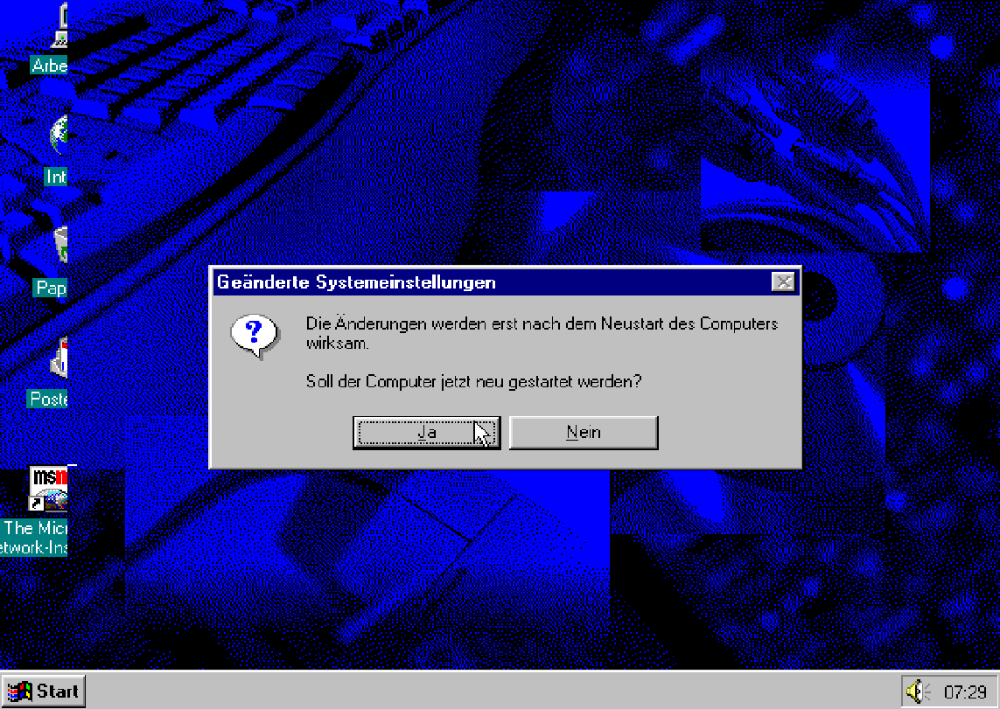
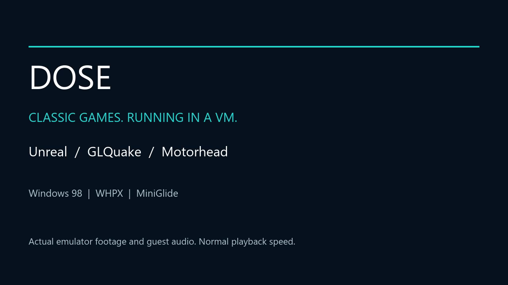
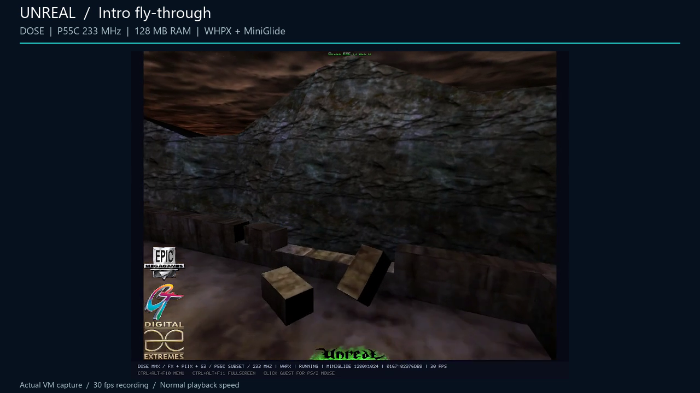
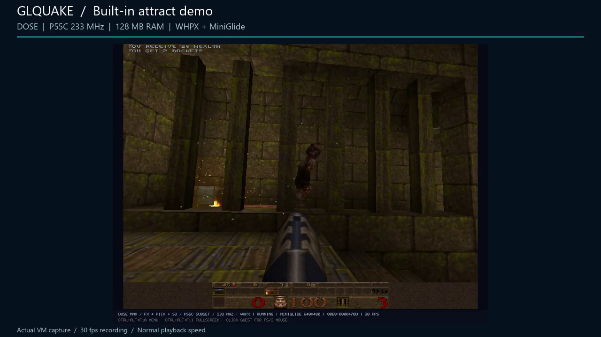
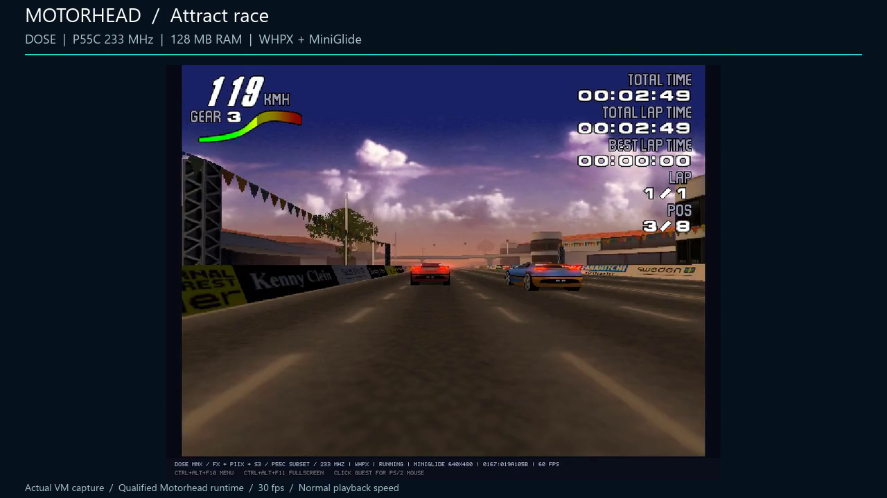
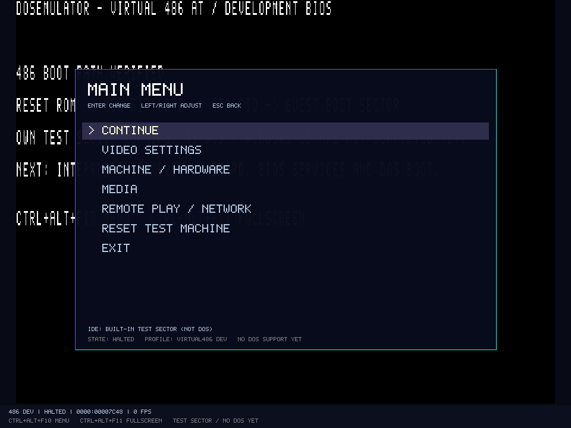
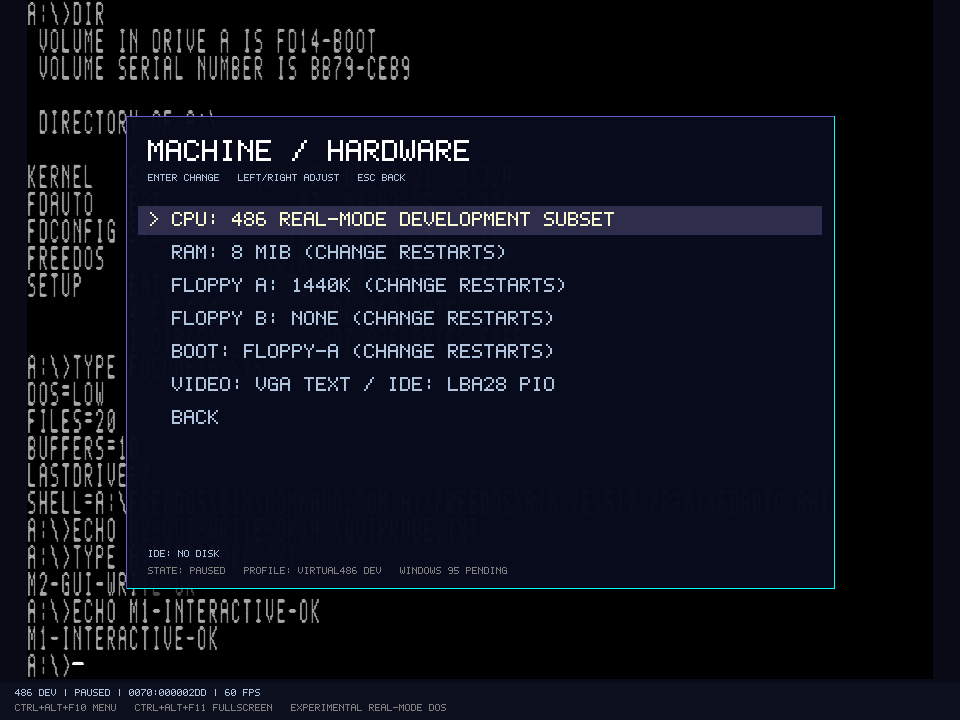

# DOSE Emulator


DOSE is a personal IBM PC emulator written in C# for exploring DOS-era hardware, Windows 95/98, and classic games. It combines a software x86 engine with optional Windows Hypervisor Platform (WHPX) acceleration, a configurable PC, sound and video devices, snapshots, and a single-window settings overlay. Like my [C64Emulator](https://github.com/n1k0m0/C64Emulator), it is a hands-on emulator project and an opportunity to learn from real software and hardware behavior.

**Latest Windows release:** [DOSE Emulator 0.1.1](https://github.com/n1k0m0/DOSEmulator-Releases/releases/tag/v0.1.1) provides a self-contained x64 setup. Installed copies check GitHub Releases at startup and ask before downloading an update. The [installer and update notes](docs/INSTALLER-AND-UPDATES.md) describe what is included.

**Highlights**

- Boot MS-DOS, FreeDOS, Windows 95, and Windows 98 from your own legal installation media and disk images.
- Choose a 486 or Pentium-family configuration, RAM, IDE disks, ATAPI CD-ROM, floppy drives, and supported video, audio, and network devices.
- Run the software CPU engine or the optional WHPX engine on a compatible Windows host. Engine selection is available in the overlay and through launch options.
- Display VGA/S3 output and MiniGlide presentation in the emulator window. A separate compatible Glide-2 host library enables the optional host Glide bridge; the original Voodoo hardware path is also under development.
- Save and load complete machine snapshots with the matching engine and format. Keep disk changes in copy-on-write journals.
- Use NAT, Host-only, or Bridged networking with the supported virtual network cards. Bridged mode requires a separately installed Npcap-compatible capture driver.
- Explore FAT12/16/32 IMG/COW disks offline with the [DOSE Disk Explorer](docs/DISK-EXPLORER.md), including file and folder import/export.

## Screenshots

These are captures of actual DOSE guests and games, not generated mockups. The Windows 95 image shows a guest display-change prompt; the Unreal, GLQuake, and Motorhead frames come from a recorded run on separate VM safety copies. Games and operating-system images are **not** distributed with DOSE.

| FreeDOS | Windows 95 | Windows 98 |
| --- | --- | --- |
|  |  |  |

| Unreal with MiniGlide | GLQuake | Motorhead |
| --- | --- | --- |
|  |  |  |

| Settings overlay | Hardware configuration |
| --- | --- |
|  |  |

## Getting started

1. Download and run the [Windows x64 setup](https://github.com/n1k0m0/DOSEmulator-Releases/releases/latest). The installer contains DOSE, its own firmware, and the pinned native libraries used for NAT and Host-only networking. It contains no commercial OS, game, or driver media.
2. Start DOSE and open the menu with **Ctrl+Alt+F10**. Configure a machine and attach your own bootable floppy, hard disk, or ISO image. Use **Ctrl+Alt+F11** for fullscreen.
3. Save the machine definition and keep its disk image and `.cow` journal together. After shutting down the guest, the optional Disk Explorer can import or export files offline.

The menu is in English. Windows 95/98 and DOS display the language of the guest media you install. See [machine configuration](docs/MACHINES.md), [settings and launchers](docs/SETTINGS-AND-LAUNCHERS.md), [networking](docs/NETWORKING.md), and the [Windows 95 user guide](docs/WINDOWS95-USER-GUIDE.md) for details.

## Emulated hardware

| Area | Current options |
| --- | --- |
| CPU | 486 and Pentium-family software execution; optional WHPX acceleration for supported Pentium profiles |
| Memory and storage | Configurable RAM, IDE hard disks, copy-on-write journals, floppy controller, ATAPI CD-ROM, snapshots |
| Video | VGA, S3 Trio64 subset, developing Voodoo SST-1 path, integrated MiniGlide display |
| Audio | PC speaker, AdLib/OPL, Sound Blaster families including SB16 subsets |
| Network | NE2000 ISA and RTL8029 PCI; NAT, Host-only, and Bridged backends |
| Input | Keyboard, PS/2 mouse, game port, and selected serial/parallel device behavior |

The [implementation status](docs/IMPLEMENTATION-STATUS.md) records exact tested devices, guest workloads, and remaining limitations. Smooth gameplay and real-time speed under every workload are still goals, not blanket guarantees. WHPX, snapshots, video modes, original drivers, and Glide games have specific validated combinations; use their linked documentation when choosing a profile.

## Build and release

Build the GUI with the .NET 10 SDK on Windows:

```powershell
dotnet build src/DOSEmulator/DOSEmulator.csproj -c Release
```

Build a self-contained setup with Inno Setup 6:

```powershell
./scripts/build-installer.ps1
```

The source repository and its release assets do not include personal VMs, Windows or DOS installation media, games, proprietary guest drivers, or a Glide-2 host library. Existing portable VM folders retain their pinned runtime until deliberately upgraded. The public setup releases live in [DOSEmulator-Releases](https://github.com/n1k0m0/DOSEmulator-Releases).

DOSE source is licensed under [Apache 2.0](LICENSES/Apache-2.0.txt). Bundled dependency provenance and license notices are in [THIRD-PARTY-NOTICES.md](THIRD-PARTY-NOTICES.md).
