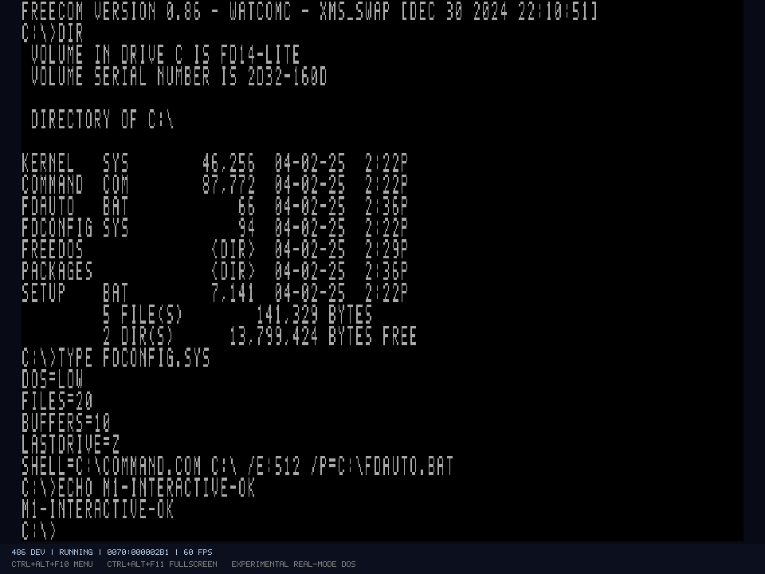

# DOSE – DosEmulator

**Aktueller Hauptzweig:** `main` enthält die WHPX-Beschleunigung, den
Software-Fallback, die integrierte MiniGlide-Anzeige und den
Glide-Hostpfad. Das [Windows-Setup](docs/INSTALLER-AND-UPDATES.md) wird aus
diesem Stand gebaut. Der Glide-Hostpfad benötigt weiterhin eine separat
bereitgestellte kompatible Glide-2-Bibliothek; Gastspiele und VM-Platten
gehören zu den jeweiligen lokalen Maschinen.

**Offline-Dateitransfer:** Der englische [DOSE Disk Explorer](docs/DISK-EXPLORER.md)
öffnet IMG/COW-Platten und gespeicherte VMs, zeigt FAT12/16/32-Verzeichnisse und
importiert/exportiert Dateien und Ordner samt langen Dateinamen. Start lokal über
`VMs/Open-Disks.cmd`; die VM vorher beenden. Änderungen werden geprüft in das
lokale COW-Journal übernommen, das Basisimage bleibt unverändert.

**Aktuelle Starter:** Die normalen DOS-/Windows-Starter wählen den gemeinsamen
geprüften C54-Stand mit WHPX. C58 und MiniGlide sind getrennte Entwicklungswege;
ein Quellbuild ersetzt die ausgewählte Laufzeit nicht automatisch.
Nach einem [Projektumzug](docs/WORKSPACE-RELOCATION.md) bleiben relative Starter
und die dokumentierte Kompatibilität für alte Maschinen-/Snapshotpfade erhalten.

**DOSE Tools und MiniGlide direkt im Windows-Gast installieren:** `local/launchers/Build-Guest-Installers.cmd` erzeugt die Installer und CD-ISOs für Windows 95 und 98. Die passende CD einlegen und im Gast `SETUP.EXE` starten. Der Installer bietet Komponentenauswahl, Autostart und Wiederherstellung beim Entfernen. [Anleitung und lokale Paketdateien](docs/GUEST-INSTALLERS.md).

Der MiniGlide-Starthelfer ist separat auswählbar und zeigt das eigene Logo auch mit dem ursprünglichen Grafiktreiber. **Launch Glide Program** im Gast öffnet die freie Programmauswahl. Die getrennte lokale Hardware-Demo-Kopie startet über `local/launchers/Start-Hardware-Demo-MiniGlide.cmd`; im Gast **Motorhead with MiniGlide** wählen. [Beide Startpfade](docs/GUEST-INSTALLERS.md#beide-startpfade-mit-miniglide-logo).

**Unreal mit MiniGlide unter Windows 95 und 98:** `local/launchers/Setup-Glide-Bridge.cmd` richtet eine eigene Gastkopie ein; danach mit `local/launchers/Start-Unreal-Win95-Glide-Host.cmd` oder `local/launchers/Start-Unreal-Win98-Glide-Host.cmd` starten. Im Gast öffnet `C:\MGLIDE.EXE` das Spiel. [Einrichtung, Messungen und Grenzen](docs/GLIDE-HOST-BRIDGE.md).

**Historischer Echtzeit-Teststand C44b:** Originale Windows-95/98-Energietreiber nutzen den neuen [APM-CPU-Leerlaufpfad](docs/hardware/APM-BIOS.md). Leerlauf und die geöffneten Testanwendungen erreichen in den benannten Messungen ungefähr 100%; Boot und kalter Programmstart bleiben langsamer. [Messungen und Grenzen](docs/PERFORMANCE.md). Die getrennten privaten Testkopien starten über `local/launchers/run-win95-apm.cmd` beziehungsweise `local/launchers/run-win98-apm.cmd`, ohne Neubau. Die bisherigen Arbeits-PCs und Standardstarter bleiben erhalten. C44:14912/14912 Regressionen; C44b:317/317 gezielte Hostfälle bei bytegleichen fünf VM-Modulen. Die Automation bleibt pausiert; allgemeine1:1- und M4–M8-Abnahmen sind offen.

**Historischer Win95-Starter C19: [NE2000 ISA und RTL8029 PCI mit NAT, Host-only und Bridged](docs/NETWORKING.md)** — 14775/14775 Regressionen,0 Warnungen/Fehler. Zwei optionale Kartenplätze im englischen NETWORK-Menü, echte DOS-Pakettreiber- und Windows95A-TCP-/UDP-Nachweise, vollständige lokale Fortsetzung. Host-only verbindet auch getrennte DOSE-Prozesse; Bridged benötigt separat installiertes Npcap und ist auf dem aktuellen Host noch nicht physisch geprüft. [Windows95 starten, RAM, Uhr, Grafik und Treiber](docs/WINDOWS95-USER-GUIDE.md); damals verwendete der Win95-Starter C19 und der Win98-Starter C23. Die heutigen Standardstarter wählen C54. [Vollständiger aktueller Stand](docs/IMPLEMENTATION-STATUS.md).

## Historische Baustein-Nachweise

**11819er-Stand: [eigene PCI-BIOS-/BIOS32-Firmware](docs/hardware/PCI-BIOS.md)** — 11819 Regressionen,0 Warnungen/Fehler. Zusätzliches festes 100-MHz-/32-MiB-Profil, echte DOS-/Original-EMM386-/Konfigurations-/FAR-Aufrufe, acht Starts und 16 volle Fortsetzungen. Profil: [dose-430fx-piix-s3-atapi-pcibios-dev-v1.json](profiles/dose-430fx-piix-s3-atapi-pcibios-dev-v1.json). Windows 95, Originaltreiber, höhere S3-Modi, 133 MHz und M4–M8 blieben auf diesem historischen Build offen.

**M4: [ursprüngliche PIIX-IDE-Funktion mit echtem PCI-Busmaster-DMA](docs/hardware/PIIX-IDE.md)** — **10755 Regressionen**, 0 Warnungen/Fehler. Eigenes 100-MHz-/32-MiB-Profil, tatsächliche Ressourcen-/MIRQ-/PRD-Wirkungen, acht neue DOS-/EMM386-Starts und 16 volle Fortsetzungen; acht gezielte alte 486-Fortsetzungen getrennt. CF9/INIT/Resetdomänen, vollständige 430FX-/Windows-95-Plattform und M4–M8 bleiben offen.

**Historischer 10141er-M4-Schritt: [PIIX-PIRQ/ELCR mit echter DOS-Fortsetzung](docs/hardware/PIIX-IRQ.md)** — **10141 Regressionen**, 0 Warnungen/Fehler. Eigenes zusätzliches P54C/100-MHz-/32-MiB-Profil, vier PCI-Pins, ISA-Auswahl und vollständige Snapshots: acht neue DOS-/EMM386-Fortsetzungen plus acht gezielte 486-Fortsetzungen. PIIX-IDE/Reset, vollständiges 430FX und Windows95 bleiben offen.

**Historischer 9819er-Frontendfix für kurze Tastendrücke:** [500 ms bis zum ersten Repeat](docs/KEYBOARD-REPEAT.md), danach 50 ms Folgeabstand. **9819 Regressionen**; kontrollierte MS-DOS-/FreeDOS-Eingaben geprüft, bestehende VM-/Snapshot-DLLs unverändert.

**Zweiter Audit korrigiert:** [STI-/ENTER-, Import-, IPC-/COW- und Eingabegrenzen](docs/AUDIT2-FIXES-2026-10-27.md), **9792 bestandene Regressionen**, 0 Warnungen/Fehler. Echte DOS-/Audio-/x87-/Doom- und volle Snapshotfortsetzung geprüft. Größere Performancevorschläge und native Bedienabnahmen bleiben getrennt offen.

**M4-Fortschritt: [82437FX-A2-Hostcontroller mit PAM und DRAM-Dekodierung](docs/hardware/430FX-HOST.md)**, 9125 bestandene Regressionen. Das eigene Host-Validierungsprofil besitzt P54C/100 MHz/32 MiB, echte DOS-/EMM386-/DOS4GW-Fortsetzungen und volle lokale Snapshots. PIIX, das vollständige historische 430FX-Board und Windows 95 bleiben offen. Das bisherige [DOSE-AT-/P54C-Profil](docs/hardware/P54C-PC.md) bleibt erhalten; Standard und alte PCs bleiben 486.

**Auditkorrekturen:** Scheduler-/Snapshotgrenzen, BIOS-Puffer, Eingabeannahme und Capability behoben; Wiederholungspfad intern ergänzt. Sichere CPU-/Host-/OPL-/Journaloptimierungen sind geprüft und gemessen. **8870 Regressionen, 0 Warnungen/Fehler**. [Nachweise und bewusst offene Grenzen](docs/AUDIT-FIXES-2026-10-27.md).

**M4 weiterentwickelt:** Der interne [P54C-Debugbaustein](docs/hardware/P54C-DEBUG.md) ergänzt CR4.DE/I/O-Breakpoints; die gemeinsame [POP-Speicherkorrektur](docs/hardware/X86-POP-MEMORY.md) behebt falsche ESP-Zieladressen und erhält Faultgrenzen. **8689 Regressionen, 0 Warnungen/Fehler**. Vier eigene tatsächliche P54C-Fortsetzungen und acht volle 486-DOS-Fortsetzungen bestehen. Die volle P54C-PC-/DOS-/430FX-/Windows-95-Integration bleibt offen.

**M3 im funktionalen Referenzumfang abgenommen:** 7030 Regressionen, 50 DOS-Kaltstarts und 26 tatsächliche Snapshot-Fortsetzungen. Neu sind BIOS-Joystickdienste und der abschließende CPU-/x87-Abgleich. M4 beginnt mit dem PCI-Konfigurationspfad; eine Pentium-/Windows-95-Abnahme steht aus. [Umfang und Nachweis](docs/M3-ACCEPTANCE.md).

**Vollständige lokale Snapshots:** Im Menü SAVED MACHINES lassen sich CPU, rohe x87-Werte, RAM, implementierte Geräte, Scheduler und passende Medien gemeinsam speichern und fortsetzen. Der ursprüngliche 6247er-Build und der neue 7030er-M3-Abschluss prüfen eigene DOS-/EMM386- und laufende Doom-II-Fortsetzungen. Format 1 benötigt denselben VM-Build und unveränderte lokale Basisimages; gespeicherte PC-Konfigurationen bleiben Kaltstarts. [Bedienung und Grenzen](docs/SNAPSHOTS.md).

**DOSE** steht für **DosEmulator**: ein modularer PC-Emulator in C#/.NET 10 für geplante 486-, Pentium- und Pentium-MMX-Systeme. Eigene Firmware und Standardgrafik heißen **DOSEBios** und **DOSE VGA**. Grafik und Overlay-Bedienung basieren auf einer eigenständigen SharpPixels-Kopie aus dem C64Emulator.

**Neu: eigene Festplattendateien mit MiB/GiB-Größe, vier IDE-Plätze und speicherbare PCs.** Im Menü `Strg+Alt+F10` unter `MEDIA → HARD DISKS` neue Images anlegen/anschließen; unter `SAVED MACHINES` vollständige Hardware-/Medienkonfigurationen speichern und kalt laden. [Bedienung, CLI-Beispiele und Grenzen](docs/MACHINES.md). Die projektweite [Bug-/Performanceprüfung](docs/CODE-REVIEW-2026-10-26.md) ergänzt messbare Hostoptimierungen und Lizenz-/Funktionskommentare mit automatischer Abdeckungsprüfung.

**Optionaler virtueller COM1:** National PC16550D an 3F8h/IRQ4 mit getakteten Frames, FIFOs und grundlegenden BIOS-Diensten. Die Hardwareauswahl gehört zum gespeicherten PC; Gegenstelle und Eingaben bleiben ausdrücklich virtuell. [Profil, DOS-Nachweise und Grenzen](docs/hardware/SERIAL-16550.md). Es wird kein Host-COM-Gerät geöffnet.

**Optionaler virtueller LPT1:** IBM Printer Adapter 6361507 an 378h/IRQ7 mit wirklichen Daten-/Status-/Steuerleitungen, INT17 und ausdrücklich angeschlossener getakteter Rohbyte-Senke. Originales DOS gibt über BIOS, PRN und COPY aus. [Profil, Handshake und begrenzter Nachweis](docs/hardware/PARALLEL-PRINTER.md); kein Hostdrucker, EPP/ECP oder fertiges Seitendruckwerk.

**Optionaler MIDI-Transport der CT1740:** MPU-UART an 300h/330h mit vollständigen getakteten Ein-/Ausgabebytes und geteiltem Karten-IRQ. [Auswahl, DOS-Nachweise und Grenzen](docs/hardware/MIDI-MPU401.md). Die Gegenstelle bleibt virtuell; Synthesizer, Host-MIDI und Intelligent Mode sind nicht implementiert.

**FreeDOS 1.4 bootet über IDE und Diskette bis zur interaktiven Kommandozeile.** Der Gast kann in privaten Overlays Dateien anlegen, kopieren, umbenennen und löschen; Änderungen bleiben nach einem Kaltstart erhalten. Kernel, FreeCOM und Bootcode stammen unverändert aus den offiziellen Medien. Nur die FreeDOS-Startkonfiguration privater Kopien ist vereinfacht.

**Die vorhandenen deutschen MS-DOS-6.22-Disketten installieren über das originale Setup auf eine neue private Festplatte.** Sieben Kaltstarts prüfen Partitionierung, Formatierung, beide Diskettenwechsel, HDD-Boot und persistente Dateioperationen; die vom Setup erzeugten Startdateien bleiben erhalten. Auch Microsofts `FORMAT.COM` formatiert eine private 1,44-MiB-Diskette über FDC/DMA2, die nach Kaltstarts lesbar und beschreibbar ist. Das ursprüngliche Setup-Profil bleibt erhalten. Eine gesonderte private Konfiguration bootet nun das originale HIMEM.SYS mit vollständigem Speichertest und geprüften XMS-Transfers. Descriptor-Caches, PE16/PE32 und Rückkehr nach DOS sind unter beiden DOS-Systemen geprüft. Neu sind [4-KiB-Paging/TLB, V86 und originales EMM386/NOEMS](docs/hardware/X86-PAGING-V86.md) mit grundlegenden VCPI-Speicherprüfungen über IDE und FDC. [Echte VCPI-Protected-Clients und EMS-Bankwechsel](docs/hardware/X86-VCPI-EMS.md) sind mit originalem EMM386/RAM bei 4/8/16 MiB zusätzlich geprüft. [Originales DOS/4GW Professional 1.95 und Doom II](docs/hardware/X86-DOS4GW.md) spielen nun eine eigene kurze 32-Tick-Demo mit geprüften VGA-Bildern ab und kehren unter vier Speichermanager-Konfigurationen zu DOS zurück. [16-/32-Bit-Call-Gates mit TSS-Stacks, Parametern und äußerem RETF](docs/hardware/X86-CALL-GATES.md) sind zusätzlich unter beiden DOS-Systemen mit/ohne eigenes Paging geprüft. [16-/32-Bit-Hardware-Tasks und Task-Gates](docs/hardware/X86-HARDWARE-TASKS.md) prüfen zusätzlich Save/Load, Busy/Backlink/NT/TS und reparierte Fehler nach dem Task-Commit. [LOCK/CMPXCHG/XADD und Alignment-Check](docs/hardware/X86-LOCK-ALIGNMENT.md) sind ebenfalls mit echten Fehler-/Wiederholungspfaden geprüft. [486-Debugregister, Breakpoints und Einzelschritt](docs/hardware/X86-DEBUG.md) besitzen nun eigene DOS-Gastnachweise; originales Microsoft DEBUG.EXE führt zwei echte T-Schritte mit/ohne EMM386 aus. [Acht tatsächliche 80-Bit-x87-Register, Stack/Tags und Save/Restore](docs/hardware/X86-X87-STATE.md) sind nun unter MS-DOS/FreeDOS und EMM386 mit unabhängigen Rohdatenprüfungen abgenommen. [Elementare 80-Bit-Arithmetik mit reellen/Integer-Konvertierungen und expliziter Rundung](docs/hardware/X86-X87-NUMERIC.md) besteht zusätzlich 5696 unabhängige Zahlenfälle und 16 DOS-Kaltstarts. [FERR/IGNNE, Port F0/IRQ13 und tatsächliche #MF-Rückkehrgäste](docs/hardware/X86-X87-ERRORS.md) bestehen inzwischen 16 weitere Kaltstarts. [Geordnete/ungeordnete x87-Vergleiche und FTST](docs/hardware/X86-X87-COMPARE.md) bestehen zusätzlich 8922 native Referenzfälle und 16 DOS-Kaltstarts. [FRNDINT mit integralen 80-Bit-Ergebnissen](docs/hardware/X86-X87-ROUND.md) besteht zusätzlich 8160 native Zahlenfälle und 16 DOS-Kaltstarts mit 24 tatsächlichen MF-Rückkehrvorgängen. [FSQRT mit ganzzahliger Wurzel, PC24/53/64 und vier Rundungsarten](docs/hardware/X86-X87-SQRT.md) besteht zusätzlich 14176 native Zahlenfälle, 16 DOS-Kaltstarts und 24 tatsächliche MF-Rückkehrvorgänge. [Alle sieben x87-Konstanten mit RC und vollständiger 80-Bit-Präzision](docs/hardware/X86-X87-CONSTANTS.md) bestehen zusätzlich 15120 native Fälle und 16 DOS-Kaltstarts mit 24 tatsächlichen MF-Rückkehrvorgängen. Sound, längere Spielpfade, umfassende CPU-Präzision, vollständiges x87 und Windows 95 bleiben offen.

Eine optionale **PS/2-Zweitastenmaus** arbeitet über KBC-Aux/IRQ12 und eigene BIOS-Dienste. Der echte CuteMouse-Treiber ist unter FreeDOS und installiertem MS-DOS 6.22 mit Bewegung, Tasten, Entladen/Neuinstallieren sowie Text/VGA-13h/VGA-12h geprüft. Im Hardwaremenü oder mit `mouse=ps2-two-button` einschalten; dies startet die Maschine neu. Klick im Gast fängt die Hostmaus, **Strg+Alt**, Menü und Fokusverlust geben sie samt Gasttasten frei. Relative Eingabe/Freigabe sind getestet; die automatische native Abnahme prüft Gastpfad und Darstellung, keinen physischen Betriebssystem-Mausfang. Details und Grenzen: [PS/2-Maus](docs/hardware/PS2-Mouse.md).

VGA-Grafik ist jetzt für Modus 13h (320×200/256 Farben) und Modus 12h (640×480/16 Farben) mit echten DOS-COM-Programmen geprüft. Auflösung und Palette wechseln durch den Gast; das SharpPixels-Fenster übernimmt sie live. Register-/BIOS-Sonderfunktionen bleiben begrenzt.

**CP850 mit äöü/ÄÖÜ/ß und Linienzeichen wird vom echten DISPLAY.SYS/MODE aus der Gastdatei EGA.CPI geladen.** Alle 256 Glyphen sind für 8, 14 und 16 Pixel Zeichenhöhe vollständig gegen diese privaten Fontdaten geprüft. Acht VGA-Fontblöcke, A/B-Auswahl sowie 25/28/43/50 Textzeilen sind umgesetzt. Microsofts `MODE CON LINES=25/43/50` benötigt ANSI.SYS; dessen Gastpfad und Livewechsel sind in einer gesonderten privaten Konfiguration geprüft. 28 Zeilen verwendet der eigene BIOS-Test. Weitere BIOS-Funktionen sind offen. [Umfang und Reproduktion](docs/hardware/VGA.md).

**Die eigenen ROM-Ausgangsfonts decken nun alle 256 CP437-Videozeichen ab**, einschließlich echter Kleinbuchstaben, Akzenten, Symbolen, einfachen/doppelten Rahmen und Blöcken. Die selbst entworfenen 8×8/14/16-Schriften sind unter FreeDOS und MS-DOS mit acht und neun Pixel breiten VGA-Zellen geprüft. 20 Gaststarts und drei native Fenster belegen Laden, alle Bildpixel und die bytegenaue Wiederherstellung des vorherigen DOS-Fonts. Es sind eigene Referenzschriften; das Aussehen eines IBM-ROMs wird nicht nachgebildet. Die Menüschrift bleibt getrennt.

**Textseiten und Cursor sind unter MS-DOS/FreeDOS geprüft:** acht Seiten bei 80×25, vier bei den getesteten 80×50-Zeilen-Profilen, getrennte Cursorpositionen, Seitenwechsel, rechteckiges Scrollen und BIOS-Stringausgabe. Der Cursor verwendet die Zeichenfarbe und einen eigenen virtuellen Blinktakt. Die nativen 25-/50-Zeilenbilder sowie das Menü wurden visuell geprüft.

**Grafikfonts und BIOS-Zeichenausgabe in 12h/13h sind ergänzt:** tatsächliche Gastfontzeiger, planarer XOR, Vorder-/Hintergrundfarben, Scrollen, Teletype, Strings und Rücklesen aus den wirklichen Grafikpixeln. Alle 256 CP850-Glyphen sind unter MS-DOS für 8/14/16 Pixel Höhe in beiden Auflösungen pixelgenau geprüft. MS-DOS und FreeDOS wechseln mehrfach zwischen Grafik und regulärem DOS-Prompt. Drei native Fenster mit Menü/Filtern wurden geprüft. Vollständige VGA-/Windows-Kompatibilität bleibt offen.

**BIOS-Cursor-Skalierung AH12/BL34h ist ergänzt.** Die angeforderte Form bleibt über AH03 lesbar, während AH01 die entsprechenden nativen CRTC-Zeilen programmiert. Ein-/Ausschalten, unterschiedliche Zeichenhöhen, Kontrollbits und DOS-Rückkehr sind unter beiden DOS-Systemen geprüft. Die eigene Referenzregel und ihre Grenzen stehen in der [VGA-Dokumentation](docs/hardware/VGA.md).

Der PC Speaker erzeugt Ton über PIT-Kanal 2/Port 61h bis zur Windows-Audioausgabe. Optional spielt ein begrenzter SB2-DSP-Pfad 8-Bit-Mono-PCM über DMA1/IRQ5 ab, jetzt auch High-Speed-Ausgabe mit Einzel-/Auto-Init und besonderem Reset-Abbruch. Direct-ADC und normale/High-Speed-Aufnahme sind zusätzlich unter MS-DOS 6.22 und FreeDOS geprüft: echte DMA-Schreibvorgänge mit definiertem virtuellem Eingang und anschließender Wiedergabe; ein Host-Mikrofon wird nicht geöffnet. Ein OPL2-Entwicklungspfad ergänzt neun FM-Kanäle, Timer, Hüllkurven und Wellenformen; alle drei Quellen sind gleichzeitig im DOS-Gast geprüft. FM-Portzugriffe verbrauchen virtuelle ISA-Buszeit, sodass klassische Verzögerungen mit sechs/35 Statuslesezugriffen funktionieren. Ein eigener Gast prüft außerdem timergetriebenes CSM-Keying aller 18 Operatoren. **AUDIO SETTINGS** bietet Mute sowie getrennte Master-/Speaker-/Digital-/FM-Pegel. Portbasis 220h/240h und IRQ3/5/7/9 lassen sich im Hardwaremenü umstellen; DMA bleibt bei dieser SB2-Karte 1. Der Wechsel startet die Maschine mit erhaltenen Medien neu, Pegel bleiben live. Creative ADPCM (2/3/4 Bit, Einzel-/Auto-Init), alle fünf OPL2-Schlaginstrumente und ein CSM-TL-Latch sind jetzt im dokumentierten Samplezeitmodell unter MS-DOS/FreeDOS geprüft. Exakte Originalchip-Pipelines, Host-Eingänge, MIDI/Gameport und weitere Kartentypen bleiben offen.



**Gastneustarts über KBC und Port 92h sind mit FreeDOS und MS-DOS 6.22 geprüft.** Im Menü **RESET / POWER** stehen Tastenkombination an den Gast, CPU-Reset mit erhaltenem RAM und Power-Cycle mit leerem RAM getrennt zur Verfügung. Gerätezeit und Medien bleiben beim CPU-Reset erhalten, Batterie-CMOS auch beim Power-Cycle. Das originale MS-DOS-Setup setzt seine Installation inzwischen mit eigenem Software-Neustart in einem Prozess fort. [Verhalten und Grenzen](docs/hardware/RESET.md).

[Gemessene Performance-Optimierungen](docs/PERFORMANCE.md): RAM/Shift, gezielte CPU-Sicherungen, REP, IRQ/Scheduler und Bild-/Tonpfade. Im aktuellen zusätzlichen Vorher-/Nachher-Vergleich benötigt die kurze Doom-Referenzdemo lokal rund 20–25 % weniger Hostzeit; Gast-RAM, Bilder und virtuelle Zeit bleiben identisch.

## Starten

Die privaten CMD-Starter liegen in **`local/launchers/`** und werden nicht
versioniert. [Lokale Starter und VM-Dateien](docs/LOCAL-LAUNCHERS.md) erklärt
die Ablage; die tatsächlichen Maschinenpfade stehen lokal in
`local/VM-LOCATIONS.md`. Ein neuer Git-Checkout verwendet die folgenden
PowerShell-Einstiegspunkte direkt.

Voraussetzungen: Windows x64, **PowerShell 7.4 oder neuer** (`pwsh.exe`) und .NET SDK 10.0.401 oder kompatibler 10.0-Patchstand. Der Quellbuild über `scripts/build.ps1` benötigt zusätzlich Python 3 und NASM 3.02 am konfigurierten Pfad `artifacts/tools/nasm-3.02/nasm-3.02/nasm.exe`, um den eigenen DOS-CD-ROM-Treiber zu erzeugen. Bereits gebaute Programme benötigen diese beiden Buildwerkzeuge nicht. Die CMD-Starter finden PowerShell über PATH, die normale Installation oder den Microsoft-Store-Alias. Ein direkter PS1-Aufruf benötigt ebenfalls PowerShell 7; bei einem älteren Host erscheint vor der Ausführung die erforderliche Mindestversion.

- `scripts/run.ps1` startet nach dem Build den Emulator mit dem eigenen Testmedium.
- **`scripts/run-doom2.ps1` öffnet den experimentellen manuellen Doom-II-Test** mit einer eigenen persistenten Kopie der bereits vorhandenen privaten DOS-/Doom-Abnahmemedien. Danach im DOS `doom2 -config doomtest.cfg -nosound` eingeben. [Anleitung und Grenzen](docs/DOOM2-TESTEN.md).
- **`scripts/run-freedos.ps1` startet FreeDOS über IDE.** `scripts/run-freedos.ps1 -Writable` verwendet ein persistentes privates Overlay.
- **`scripts/run-freedos-floppy.ps1` startet FreeDOS über den FDC.** `scripts/run-freedos-floppy.ps1 -Writable -TwoDrives` öffnet zwei Diskettenlaufwerke mit getrennten persistenten Overlays.
- Beim ersten Start wird das jeweilige offizielle FreeDOS-Paket geladen und anhand seiner veröffentlichten SHA-256-Prüfsumme geprüft. Basisimages bleiben immer schreibgeschützt.
- Menü: **Strg+Alt+F10**, Vollbild: **Strg+Alt+F11**.
- Im Menü mit Pfeiltasten, Enter und Esc navigieren. PS/2-Maus im Hardwaremenü einschalten; Gasttreiber muss im DOS geladen werden.
- Filter, Upscaling, Seitenverhältnis und VSync wirken auf die Hostdarstellung.
- Im Hardwaremenü: RAM, Diskettenlaufwerkstypen, Bootgerät und optionale Soundkarte ändern; diese Änderungen starten die Maschine neu. Verfügbar sind Speaker, AdLib-OPL2-Entwicklungspfad, SB2-DSP und SB2-DSP mit OPL2. **SOUND CARD RESOURCES** wählt 220h/240h und IRQ3/5/7/9 bei festem DMA1; Standard ist A220/I5/D1. FM verwendet 388h/389h und im Kombiprofil zusätzlich Basis+8/+9. Ein Laufwerkstypwechsel setzt dazu passende oder ausgeworfene Medien voraus.
- Im Medienmenü: IDE-Image mit oder ohne Overlay öffnen; Disketten A:/B: an Controller-Ruhepunkten einlegen oder auswerfen. FreeDOS erkennt den Medienwechsel. IDE-Wechsel startet die Maschine neu.
- Raw-IDE-Images lassen sich auch mit `--disk` oder Drag-and-drop öffnen. Schreibzugriffe benötigen `--overlay`; Disketten verwenden `--floppy-a`/`--floppy-b` mit optionalem `--floppy-a-overlay`/`--floppy-b-overlay`. Das eigene ATAPI-Profil unterstützt schreibgeschützte ISO-Dateien und den [festen DOS-CD-ROM-Treiber mit originalem MSCDEX](docs/hardware/DOS-CDROM-DRIVER.md); vollständiges ATAPI und Windows 95 bleiben offen.

```powershell
.\scripts\run.ps1
.\scripts\run-freedos.ps1
.\scripts\run-freedos.ps1 -Writable
.\scripts\run-freedos-floppy.ps1 -Writable -TwoDrives
.\scripts\run.ps1 -Disk 'C:\Pfad\disk.img'
.\scripts\run.ps1 -Profile '.\profiles\virtual486-dev-v1.json'
.\scripts\run.ps1 -Profile '.\profiles\virtual486-sb2-dsp-dev-v1.json' -Disk 'C:\Pfad\private-dos.img'
.\scripts\run.ps1 -Profile '.\profiles\virtual486-sb2-opl2-dev-v1.json' -Disk 'C:\Pfad\private-dos.img'
```

## Prüfen

```powershell
.\scripts\build.ps1
.\scripts\test-scripts.ps1 -Gui
.\scripts\test.ps1 -SkipBuild
.\scripts\smoke-gui.ps1 -SkipBuild
.\scripts\prepare-freedos.ps1 -Download
.\scripts\prepare-freedos-floppy.ps1 -Download
.\scripts\test-freedos.ps1 -SkipBuild
.\scripts\test-freedos-writes.ps1 -SkipBuild
.\scripts\test-freedos-floppy.ps1 -SkipBuild
.\scripts\test-floppy-format.ps1 -SkipBuild -Gui
.\scripts\test-msdos622.ps1 -SkipBuild -Gui
.\scripts\test-guest-reset.ps1 -SkipBuild -Gui -Install
# Mit einer lokal installierten DOS-Basis und dem zugehörigen privaten Overlay:
.\scripts\test-mouse.ps1 -SkipBuild -Gui
# Optional zusätzlich die installierte lokale DOS-HDD prüfen:
.\scripts\test-mouse.ps1 -SkipBuild -Gui -MsdosDisk 'C:\Pfad\private-blank-32m.img' -MsdosOverlay 'C:\Pfad\installed-pristine.cow'
.\scripts\test-msdos-format.ps1 -SkipBuild -Disk 'C:\Pfad\private-blank-32m.img' -Overlay 'C:\Pfad\installed-pristine.cow'
.\scripts\test-vga-fonts.ps1 -SkipBuild -Gui -Disk 'C:\Pfad\private-blank-32m.img' -Overlay 'C:\Pfad\installed-pristine.cow'
.\scripts\test-vga-text.ps1 -SkipBuild -Gui -Disk 'C:\Pfad\private-blank-32m.img' -Overlay 'C:\Pfad\installed-pristine.cow'
.\scripts\test-vga-graphics-fonts.ps1 -SkipBuild -Gui -Disk 'C:\Pfad\private-blank-32m.img' -Overlay 'C:\Pfad\installed-pristine.cow'
.\scripts\test-cp437-fonts.ps1 -SkipBuild -Gui -Disk 'C:\Pfad\private-blank-32m.img' -Overlay 'C:\Pfad\installed-pristine.cow'
.\scripts\test-cursor-emulation.ps1 -SkipBuild -Gui -Disk 'C:\Pfad\private-blank-32m.img' -Overlay 'C:\Pfad\installed-pristine.cow'
.\scripts\test-freedos-gui.ps1 -SkipBuild -WriteOverlay -Floppy
.\scripts\test-vga.ps1 -SkipBuild -Gui
.\scripts\test-speaker.ps1 -SkipBuild -Gui
.\scripts\test-sb2.ps1 -SkipBuild -Gui
.\scripts\test-sb2-highspeed.ps1 -SkipBuild -Gui
.\scripts\test-sb2-input.ps1 -SkipBuild -Disk "C:\Pfad\private-dos.img" -Overlay "C:\Pfad\pristine.cow"
.\scripts\test-sb2-resources.ps1 -SkipBuild -Gui -Disk "C:\Pfad\private-dos.img" -Overlay "C:\Pfad\pristine.cow"
.\scripts\test-opl2.ps1 -SkipBuild -Gui
.\scripts\test-opl2-csm.ps1 -SkipBuild -Gui
```

Die Regressionstests benötigen normale lokale Named-Pipe-Rechte. Der GUI-Test startet einen eigenen kurzlebigen Emulatorprozess und speichert sechs OpenGL-Screenshots unter `artifacts`. Er öffnet keinen Browser. Screenshots müssen zusätzlich visuell geprüft werden.

**876 Regressionstests bestehen.** Die FreeDOS-Abnahmen prüfen unabhängige Kaltstarts über IDE und FDC, echte KBC-/IRQ1-Eingaben, `VER`, `DIR`, `TYPE`, identische Bildhashes und unveränderte Medien. Weitere Gastläufe prüfen Schreibpersistenz, COPY/REN/DEL/RD auf IDE und zwei Disketten sowie tatsächlichen Medienwechsel im laufenden FreeDOS. Neue Tests prüfen BIOS-Diskettenformatierung, bufferlose HDD-Verifikation, VGA-Fontblöcke/-Geometrie/-Zustandsabfragen, vollständige eigene CP437-Fonts und Rahmenkanten, Textseiten/Strings/Cursor, Grafikfont-/Zeichen-/Scroll-/Lesedienste, Reset-/Power-Cycle-Verhalten und bildschirmgesteuerte Tastatur-/Medienfolgen. Die MS-DOS-Abnahme verwendet ausschließlich die vorhandenen privaten Originalmedien und einen neuen 32-MiB-Datenträger; separate Python-Prüfer kontrollieren Journale, FAT-Ketten, Systemdateien und sämtliche Text-/Grafikfont-Testbildpixel. Das originale Setup setzt seine Installation inzwischen mit seinem eigenen Software-Neustart in einem Prozess fort; KBC-/Port-92h-Hardware-Resets sind zusätzlich unter beiden DOS-Systemen geprüft.

VGA-Abnahmen vergleichen jeden Pixel beider Grafikmodi; Audioabnahmen prüfen PCM-Werte, Tonhöhe, normales und High-Speed-DMA, IRQ-/Resetverhalten, FM-Hüllkurven/Wellenformen, CSM-Impulsraten, klassische Port-Wartezugriffe, Mischung, Stille und getrennte Livepegel bis zum Windows-Provider. Die GUI begrenzt zeitliches Aufholen und verwendet einen kleinen Audiovorlauf; laufende Tonintervalle werden zusätzlich auf Pufferunter-/überlauf geprüft. Eigene COM-Gasttests benötigen NASM 3.02 und Python 3; die MS-DOS-Installation benötigt zusätzlich die lokalen Disketten. Keine Freigabe aller DOS-Anwendungen oder vollständiger Yamaha-/Creative-Chipvergleich.

Alle Start-/Testskripte verwenden standardmäßig den gemeinsamen Build unter `artifacts/m1-build`. `-OutputRoot` akzeptiert bei den entsprechenden Build-/Testskripten sowohl zum Repository relative als auch absolute Verzeichnisse; Benutzerdateipfade beziehen sich auf das aufrufende PowerShell-Verzeichnis. Hashprüfungen verwenden eine gemeinsame SHA-256-Funktion ohne Abhängigkeit von `Get-FileHash`. Fehlgeschlagene native Werkzeuge beenden das jeweilige Skript; die CMD-Starter geben Fehlercodes zurück. Damit bleibt ein bereits geöffnetes älteres Fenster aus `src/DOSEmulator/bin` unberührt. Der Name des Ausgabeverzeichnisses stammt aus der ersten M1-Abnahme.

`scripts/test-scripts.ps1 -Gui` prüft PowerShell-Dateien, Hash-/Pfadbehandlung, Hostauswahl einschließlich Store-Fallback und Fehlerweitergabe mit selbst erzeugten temporären CMD-Startern. Der optionale native Starttest verwendet private Einstellungen. Direkt: `scripts/run.ps1 -NoBuild -SmokeTestDirectory "artifacts\mein-starttest"`; ein neues Verzeichnis verwenden. Ohne Smoke-Option bleibt das Emulatorfenster geöffnet.

Headless-Boot ohne OpenGL:

```powershell
dotnet .\artifacts\m1-build\Release\net10.0\DOSEmulator.Headless.dll --help
dotnet .\artifacts\m1-build\Release\net10.0\DOSEmulator.Headless.dll --steps 100000
```

## Stand und weitere Umsetzung

- [Implementierungsstand mit Nachweisen und nächsten Schritten](docs/IMPLEMENTATION-STATUS.md)
- [Architektur- und Umsetzungskonzept M0–M8](docs/DOSEmulator-Konzept.md)
- [Private Disk-Overlays](docs/DISK-OVERLAYS.md)
- [FDC-Umfang und Grenzen](docs/hardware/FDC-82077.md)
- [VGA-Modi, Registerumfang und Grenzen](docs/hardware/VGA.md)
- [PS/2-Zweitastenmaus, CuteMouse-Gasttests und Grenzen](docs/hardware/PS2-Mouse.md)
- [PC Speaker, Hostaudio und Grenzen](docs/hardware/PC-SPEAKER.md)
- [SB2-DSP-/PCM-Pfad, gemeinsamer Mixer und Grenzen](docs/hardware/SB2-DSP.md)
- [OPL2-Timer, FM/CSM-Keying, Portzeiten und Genauigkeitsgrenzen](docs/hardware/OPL2.md)
- [Lizenzhinweise und SharpPixels-Herkunft](THIRD-PARTY-NOTICES.md)

M1 ist abgenommen. M2 besitzt die geprüfte MS-DOS-6.22-HDD-Installation, originale Diskettenformatierung, PS/2-Maus mit echtem DOS-Treiber, Gastresets, eigene vollständige CP437-Fonts sowie CP850 in mehreren Textseiten und VGA-Grafikmodi. BIOS-Cursor-Skalierung und virtuelle SB2-Aufnahme sind zusätzlich abgenommen. SB2-Port-/IRQ-Ressourcen sind jetzt einschließlich Hardwaremenü und 64 DOS-Kaltstarts geprüft. ADPCM, OPL2-Rhythmus und CSM-Pegel sind umgesetzt. Der native Windows-Eingabetest hat zudem einen GUI-Serialisierungsfehler behoben und den gesamten Mausfang-/Fokus-/DOS-Pfad erfolgreich geprüft. Die letzte kombinierte Mauswiederholung bleibt auf ausdrücklichen Benutzerwunsch bis zu einem neuen Auftrag offen. Umfang, Nachweise und Grenzen stehen in [der M2-Abnahme](docs/M2-ABNAHME.md). M3 besitzt inzwischen [Descriptor-Caches, echte PE16-/PE32-Wechsel und geschützte Fehlerpfade](docs/hardware/X86-PROTECTED.md), geprüft unter beiden DOS-Systemen. Originales HIMEM.SYS mit /TESTMEM:ON sowie XMS-Reservieren, Sperren, Kopieren und Freigeben sind in einer privaten MS-DOS-Konfiguration nachgewiesen. [LLDT/LTR und tatsächliche TSS-Interrupt-Stackwechsel mit äußerer Rückkehr](docs/hardware/X86-TSS.md) sind ebenfalls unter MS-DOS und FreeDOS nachgewiesen. [Paging/TLB, V86/I/O-Bitmap und originales EMM386 mit grundlegenden VCPI-Speicherfunktionen](docs/hardware/X86-PAGING-V86.md) sind nun geprüft. [VCPI-DE0Ch und echte EMS-Bankwechsel mit RAM](docs/hardware/X86-VCPI-EMS.md) bestehen weitere 20 Kaltstarts mit 4/8/16 MiB; der damalige gemeinsame Build bestand 4873 Regressionen. [Originales DOS4GW und die kurze Doom-II-Referenzdemo](docs/hardware/X86-DOS4GW.md) bestehen acht weitere Starts mit/ohne HIMEM/EMM386; CPU-Erkennung und x87-Kontrollbefehle sind ergänzt. [FDC-Schreiben/Format und tatsächliche VDS-DMA-Puffer unter EMM386](docs/hardware/X86-FDC-VDS.md) bestehen zusätzlich 13 Kaltstarts, auch mit nicht zusammenhängenden EMS-Aufrufern und originalem Microsoft FORMAT. Ungeeignete interne EBDA-Puffer werden mit AH09 abgewiesen. [16-/32-Bit-Call-Gates](docs/hardware/X86-CALL-GATES.md) bestehen acht weitere MS-DOS-/FreeDOS-Kaltstarts und 33 negative Oracles. [Hardware-Tasks/Task-Gates](docs/hardware/X86-HARDWARE-TASKS.md) bestehen acht eigene DOS-Kaltstarts mit/ohne Paging, zwölf tatsächlichen Taskwechseln pro Start und 59 negativen Oracles. [LOCK und Alignment-Check](docs/hardware/X86-LOCK-ALIGNMENT.md) bestehen acht weitere DOS-Kaltstarts mit tatsächlichen UD-/AC-/PF-Rahmen und 70 negativen Oracles. [Debugregister/Breakpoints/TF](docs/hardware/X86-DEBUG.md) bestehen acht eigene Kaltstarts und 278 negative Oracles; originales Microsoft DEBUG.EXE zusätzlich sechs Starts ohne Manager und mit EMM386 NOEMS/RAM, mit korrekten Einzelschritt-Registern und 24 Gegenprüfungen. [x87-Zustand mit acht echten 80-Bit-Registern und vollständigen Save-/Restore-Abbildern](docs/hardware/X86-X87-STATE.md) besteht 16 weitere Kaltstarts unter beiden DOS-Systemen, originalem EMM386 und eigenen PE-/Paging-Varianten sowie 376 negative Oracles; der ursprüngliche FPU-Zustand wird bytegenau restauriert. [Elementare x87-Arithmetik und Zahlenkonvertierungen](docs/hardware/X86-X87-NUMERIC.md) sind mit 5696 getrennten nativen Referenzfällen und 220 Zahlenfällen je DOS-Start zusätzlich geprüft. Die echte Host-x87 dient ausschließlich der Prüfung; der Emulator rechnet mit Ganzzahlen. [FERR/IGNNE und tatsächliche IRQ13-/#MF-Fehler-/Rückkehrpfade](docs/hardware/X86-X87-ERRORS.md) besitzen nun 63 neue CPU-/Gerätefälle und 16 DOS-Kaltstarts. [FCOM/FUCOM/FTST und reelle/Integer-Speichervergleiche](docs/hardware/X86-X87-COMPARE.md) sind inzwischen mit NaNs, Leerstack, Status/Pop und 8922 unabhängigen nativen Fällen sowie 16 eigenen DOS-Kaltstarts geprüft. [FRNDINT mit allen vier Rundungsarten](docs/hardware/X86-X87-ROUND.md) ist mit 8160 nativen Zahlenfällen, 16 DOS-Kaltstarts und 24 tatsächlichen MF-/IRETD-Rückkehrvorgängen zusätzlich geprüft. [FSQRT mit ganzzahliger Wurzel, PC24/53/64 und vier Rundungsarten](docs/hardware/X86-X87-SQRT.md) besteht zusätzlich 14176 native Zahlenfälle, 16 DOS-Kaltstarts und 24 tatsächliche MF-Rückkehrvorgänge. [Alle sieben x87-Konstanten mit RC und vollständiger 80-Bit-Präzision](docs/hardware/X86-X87-CONSTANTS.md) bestehen zusätzlich 15120 native Fälle und 16 DOS-Kaltstarts mit 24 tatsächlichen MF-Rückkehrvorgängen. [FSCALE mit voller Präzision und getrennten Exponentenantworten](docs/hardware/X86-X87-SCALE.md) besteht 35152 unabhängig zertifizierte native Fälle, 16 DOS-Kaltstarts und 40 tatsächliche MF-Rückkehrvorgänge. [FXTRACT mit beiden exakten 80-Bit-Ergebnissen und tatsächlichen Stackfehlern](docs/hardware/X86-X87-EXTRACT.md) besteht 13815 unabhängig zertifizierte native Fälle, 16 DOS-Kaltstarts und 40 tatsächliche MF-Rückkehrvorgänge. [FPREM/FPREM1 mit exakten Resten, echten Teilreduktionsschleifen und Quotientenbits](docs/hardware/X86-X87-REMAINDER.md) besteht 7972 unabhängig zertifizierte native Fälle mit 138982 Remainderbefehlen, 16 DOS-Kaltstarts und 40 tatsächliche MF-Rückkehrvorgänge. [F2XM1 mit ganzzahligem Intervallkern und unabhängigen mathematischen Fehlergrenzen](docs/hardware/X86-X87-EXP2M1.md) besteht 3932 Zahlenfälle, 16 DOS-Kaltstarts und 40 tatsächliche MF-Rückkehrvorgänge. Der dokumentierte mathematische Rundungsvertrag kann um einen darstellbaren Schritt von der modernen nativen Näherung abweichen. [FYL2X/FYL2XP1 mit ganzzahligen Produktintervallen und geprüften Pop-/Fehlerantworten](docs/hardware/X86-X87-LOGARITHM.md) bestehen 6169 unabhängig geprüfte Zahlenfälle, 16 DOS-Kaltstarts und 72 tatsächliche MF-Rückkehrvorgänge. [FPATAN mit allen Quadranten, unabhängigen Winkelgrenzen und tatsächlichen Fehlerrückkehrgästen](docs/hardware/X86-X87-ATAN.md) besteht 3752 Zahlenfälle, 16 DOS-Kaltstarts und 48 tatsächliche MF-Rückkehrvorgänge. [FPTAN mit strenger Argumentreduktion, beiden Stackzielen und C2](docs/hardware/X86-X87-TANGENT.md) besteht 4704 unabhängig eingeschlossene Zahlen-/Zustandsfälle, 16 DOS-Kaltstarts und 48 tatsächliche MF-Rückkehrvorgänge. [FSIN/FCOS mit unabhängigen Zahlenintervallen](docs/hardware/X86-X87-SIN-COS.md) besteht 9410 Zahlen-/Zustandsfälle, 16 DOS-Kaltstarts und 64 tatsächliche MF-Rückkehrvorgänge. [FSINCOS mit atomaren Ergebnis-/Stackantworten](docs/hardware/X86-X87-FSINCOS.md) besteht 4721 Zahlen-/Zustandsfälle, 16 DOS-Kaltstarts und 64 tatsächliche MF-Rückkehrvorgänge. Allgemeine Spiel-/DOS-Extender-/VDS-Kompatibilität, umfassende CPU-/Task-/Fault-Präzision, vollständige historische x87-/Chippräzision und M4–M8 mit Pentium, Windows 95, Netzwerk und Voodoo bleiben offen. Der funktionale M3-Referenzumfang besitzt inzwischen die oben verlinkte gemeinsame Abnahme. Die autorisierte stündliche Fortsetzung bleibt aktiv.

[Gerätegetaktetes 16-Bit-DMA5–7](docs/hardware/AT-DMA16.md) besitzt jetzt 133 neue Gerätefälle und acht eigene DOS-/EMM386-Kaltstarts mit unabhängigen Wort-/Zeit-/VDS-Oracles. 35 weitere FDC-/SB2-/ADPCM-/Aufnahmestarts erhalten den Bytepfad. Die Testquelle bleibt testexklusiv. Der darauf aufbauende [CT1740-/DSP-4.05-PCM-Kern mit CT1745](docs/hardware/SB16-CT1740-PCM.md) besitzt inzwischen 24 eigene MS-DOS-/FreeDOS-/EMM386-Kaltstarts: DMA8/DMA16, Stereo, virtuelle Aufnahme und getrennte IRQ-Latches. 226 neue Geräte-/Audio-/PIC-Fälle und insgesamt 87 aktuelle DOS-Gaststarts prüfen das Paket und bestehende Ton-/Laufwerkspfade. OPL3, vollständiger Mixer/Legacy-Satz und allgemeine Karten-/Spielkompatibilität bleiben offen; YMF262/OPL3 besitzt inzwischen die unten verlinkte eigene Folgeabnahme.

Der private Ordner `Disks and CDs (DO NOT PUT INTO GITHUB)` sowie Betriebssystem-, Spiel- und ROM-Images sind in `.gitignore` ausgeschlossen. Originalmedien werden nicht verändert. Eigene BIOS-Firmware steht unter `firmware/dose-bios.asm` und den dort eingebundenen INC-Dateien; das reproduzierbar erzeugte C#-Image liegt bei. NASM 3.02 wird beim regulären Quellbuild außerdem für den eigenen `DOSECD.SYS` benötigt, daneben zum Neuübersetzen geänderter BIOS- und Gast-Testquellen. Für Builds und Tests zuerst `scripts/build.ps1` ausführen; es erzeugt auch die vom Testprojekt eingebettete SYS-Ressource. Originales MSCDEX wird nicht mitgeliefert.

[YMF262/OPL3 im CT1740-Profil](docs/hardware/OPL3.md) besitzt jetzt 18 Kanäle, sechs Vieroperator-Paare, acht Wellenformen, vier interne Ausgänge und CT1745-FM-Pegel. 16 eigene DOS-/FreeDOS-/EMM386-Kaltstarts und 24 erneute PCM-Starts prüfen 409 neue Gerätefälle auf dem gemeinsamen Build mit 4873 bestandenen Regressionen. Ein eigener GUI-DOS-Lauf bestätigt Bild und aktive Windows-Ausgabe; allgemeine Soundkarten-/Spielkompatibilität und unterlauffreie Echtzeit bleiben getrennt offen. Startprofil: [virtual486-sb16-dev-v1.json](profiles/virtual486-sb16-dev-v1.json). Die nachfolgende [ET4000AX-Vertikale](docs/hardware/ET4000AX.md) ist inzwischen gesondert geprüft.

[ET4000AX ISA mit 1 MiB](docs/hardware/ET4000AX.md) besitzt jetzt getrennte Lese-/Schreibbanken und eigene Legacy-BIOS-Modi 640×480, 800×600 und 1024×768 mit 256 Farben. 32 DOS-/FreeDOS-/EMM386-Kaltstarts prüfen vollständige VRAM-Zugriffe, alle sichtbaren Pixel und DOS-Rückkehr; 92 bisherige Grafik-/Font-/Cursorstarts und 16 kurze Doom-Starts auf beiden Karten bestehen erneut. Aktueller Build: **4934 Regressionen, 0 Warnungen/Fehler**. Profil: [virtual486-et4000-dev-v1.json](profiles/virtual486-et4000-dev-v1.json). VBE und vollständige ET4000-/M3-Kompatibilität bleiben offen. Ein nativer WinMM-Freigabefehler beim Schließen wird jetzt separat erfasst; saubere Host-Audiofreigabe ist damit nicht abgenommen.
# Installer and automatic updates

The Windows installer and startup update flow are described in [docs/INSTALLER-AND-UPDATES.md](docs/INSTALLER-AND-UPDATES.md).
