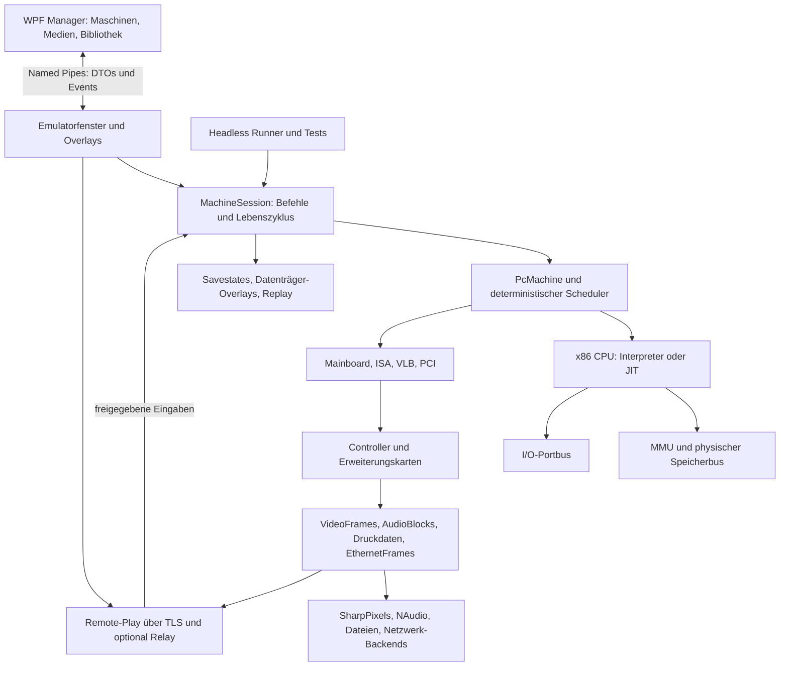

# Konzept: DOSEmulator

**Stand:** 24. Oktober 2026 · **Status:** Architekturentwurf 1 · **Zielplattform:** Windows x64, C#/.NET 10  
**Programme:** `DOSEmulator.exe`, `DOSEmulatorManager.exe`, `DOSEmulator.Headless.exe`

## 1. Zielbild und verbindliche Leitlinien

DOSEmulator bildet einen vollständigen historischen PC nach, auf dem ein echtes Gastbetriebssystem von Disketten-, Festplatten- oder CD-Images startet. MS-DOS und Windows 95 sind Gäste des emulierten Rechners. BIOS, CPU, Speicherverwaltung, Interrupts, DMA, Laufwerkscontroller, Grafik-, Sound- und Netzwerkkarten gehören zum Rechner und werden entsprechend modelliert.

Der Aufbau und die Bedienung orientieren sich am C64Emulator: eigenes Emulationsfenster mit SharpPixels, Overlay-Menüs, Medienbrowser, Statusanzeigen, Savestates, Remote-Play sowie ein separat nutzbarer WPF-Manager. Das PC-System erhält dafür einen eigenen modularen Hardwarekern.

Die wesentlichen Entscheidungen:

1. **Eigener C#-Emulationskern als Hauptpfad**, passend zum Charakter des C64-Projekts. Vorhandene PC-Emulatoren dienen als Referenz und zum Vergleich. Ein eingebetteter Fremdkern ist eine mögliche spätere Produktentscheidung, keine Voraussetzung dieses Entwurfs.
2. **Mehrere x86-Prozessormodelle:** zunächst 486DX, danach DX2/DX4, Pentium und Pentium MMX. Sie teilen sich Architekturbausteine, unterscheiden sich aber bei Befehlssatz, Identifikation, FPU, Timing und Plattform. 8086/286/386 können später hinzukommen.
3. **Kompatible Maschinenprofile** statt beliebiger Kombinationen von CPU, Mainboard und Steckkarten. Jedes freigegebene Profil hat eine überprüfte Hardware-, Firmware- und Treiberkombination.
4. **Konfiguration während des Betriebs:** Einstellungen sind jederzeit erreichbar. Sofortige Änderungen, Medienwechsel, pausierte Änderungen und Änderungen nach Ausschalten werden ausdrücklich unterschieden. Eine im Menü gewählte Pentium-CPU wird dadurch nicht mitten in einem laufenden 486-Windows ausgetauscht.
5. **Reproduzierbarer Referenzbetrieb zuerst.** Interpreter, Software-Rasterizer und deterministische Gerätezeit bilden die Referenz. JIT und GPU-Beschleunigung folgen nach Messung und Vergleich.
6. **Ein vollständiger vertikaler Pfad pro Ausbaustufe:** Booten, Installieren, Spielen, Speichern und Wiederherstellen werden früh zusammen überprüft.

„Komplette Hardware“ bedeutet zunächst einen vollständigen, konkret definierten PC einschließlich seiner sichtbaren Geräte und ihrer relevanten Register, Befehle und Zeitabläufe. Transistor-, elektrische Signal- oder vollständige Pipeline-Simulation sind keine Voraussetzung. Eine pauschale Zusage von Zyklusgenauigkeit für sämtliche 486-/Pentium-Systeme wäre unhaltbar; Genauigkeit wird pro Gerät und Profil ausgewiesen.

## 2. Befund im C64Emulator und Übertragung

Die folgenden Aussagen beruhen auf dem lokal vorliegenden Quellcode und den vorhandenen Screenshots, nicht nur auf der README. Die Links beziehen sich auf das benachbarte Repository.

| Im C64Emulator vorhanden | Befund | Übertragung auf DOSEmulator |
| --- | --- | --- |
| [Projektdatei](../../C64Emulator/C64Emulator/C64Emulator.csproj), [SharpPixels](../../C64Emulator/SharpPixels/SharpPixels.csproj) | C#/.NET 10, Windows x64, OpenTK 4.9.4, NAudio 2.3.0 | Gleiche technische Familie; genaue Paketstände bei Implementierung festlegen |
| [C64System](../../C64Emulator/C64Emulator/Machine/C64System.cs), `SystemBus`, CPU/VIC/CIA/SID | Zentrale Maschine mit Bausteinen, Bus und zeitlicher Koordination | `PcMachine`, getrennte Speicher-/I/O-Busse, austauschbare CPU und Geräteregistrierung |
| [C64Window](../../C64Emulator/C64Emulator/C64Window.cs) | Eigenständige Emulationsschleife, Overlays, Netzwerk, Eingabe, Status | Bedienkonzept übernehmen; Dienste aufteilen, damit das Fenster nicht sämtliche Aufgaben sammelt |
| [SharpPixelsWindow](../../C64Emulator/SharpPixels/SharpPixelsWindow.cs), [FrameBuffer](../../C64Emulator/C64Emulator/Vic/FrameBuffer.cs) | OpenGL-Präsentation, Filter/Upscaling, stabil veröffentlichte vollständige Frames | Variable Gastauflösung und Bildrate; Präsentationsschnittstelle mit Frame-Metadaten |
| [SidAudioOutput](../../C64Emulator/C64Emulator/Sid/SidAudioOutput.cs) | Gepufferte Monoausgabe über NAudio | Host-Ausgabeprinzip übernehmen; Mehrquellenmixer und Stereo neu entwickeln |
| [Network](../../C64Emulator/C64Emulator/Network/C64NetProtocol.cs), `relay_server` | TLS/TCP, Relay, Rollen/Rechte, Video-Deltas, IMA ADPCM | Transport- und Sitzungsprinzip übernehmen; PC-Video-/Audioformat und Protokoll neu versionieren |
| [SaveStateFile](../../C64Emulator/C64Emulator/SaveStates/SaveStateFile.cs) | Versioniertes Format, vollständiger Zustand, Vorschau | Neues PC-Format mit Geräteversionen, Profilkennung und konsistentem Datenträgerzustand |
| [Contracts](../../C64Emulator/C64Emulator.Contracts/IpcContracts.cs), [IPC-Server](../../C64Emulator/C64Emulator/Ipc/EmulatorIpcServer.cs) | Gemeinsame DTOs, Named Pipes, Prozesskommunikation | Gleiches Muster mit maschinenbezogenen Kommandos und Fähigkeitsabfrage |
| [Manager](../../C64Emulator/C64EmulatorManager/C64EmulatorManager.csproj), `LibraryRepository` | Eigenes WPF-Programm, SQLite-Bibliothek | Maschinenbibliothek, Installationsmedien, Startprofile, Treiber und Snapshot-Verzweigungen ergänzen |
| [Golden-Harness](../../C64Emulator/C64Emulator/Golden/GoldenTestHarness.cs), [Referenzworkflow](../../C64Emulator/docs/golden-reference-workflow.md) | Headless-Läufe, Manifeste, Hashes, JSON/JUnit und Vergleich | CPU-, Geräte-, Boot-, Installations- und Screenshot-Regressionen |
| Updateprüfung und Inno-Setup-Skripte | Self-contained-Paket, Updates und Installer | Gleicher Auslieferungsablauf mit Firmware-/Profilprüfung vor Updates |

**Gezielt neu zu entwerfen:** x86-Kern, PC-Busse, Gerätekatalog, Ressourcenverwaltung, Mehrkanalton, dynamische Bildschirmmodi und persistente Blockgeräte. Das feste C64-Farbmodell, die PAL-Taktannahmen und die vorhandenen Savestate-Dateien sind keine PC-Schnittstellen.

Besonders relevant: Das C64-Netzwerk reduziert Bilder auf eine feste 16-Farben-Palette mit vier Bit pro Pixel. Ein PC benötigt wechselnde Paletten, höhere Farbtiefen und Auflösungen. Das aktuelle Netzwerkformat lässt sich deshalb nicht unverändert übertragen.

SharpPixels zunächst als eindeutig versionierte lokale Kopie übernehmen, einschließlich Lizenzhinweisen. Später ist ein gemeinsames Paket möglich. Keine Build-Abhängigkeit auf einen beliebig veränderlichen Nachbarordner und keine Änderungen am C64-Projekt für den ersten DOS-Stand.

## 3. Umfang und Zielmaschinen

### 3.1 Betriebssysteme

| Gast | Ziel |
| --- | --- |
| FreeDOS | Frei verfügbarer erster Boot-, Installations- und Automatisierungspfad; ersetzt keine MS-DOS-Abnahme |
| MS-DOS 5.x/6.x | Booten, Installation, Dateizugriff, Treiber, Spiele und Anwendungen |
| Windows 3.1/3.11 | Optionales Zwischenziel für Protected Mode, Treiber und Grafik |
| Windows 95 RTM | Erster verbindlicher Windows-95-Abnahmestand; FAT16, Standardgeräte und stabile Installation |
| Windows 95 OSR2/2.5 | Separater späterer Abnahmestand, unter anderem für FAT32 und passende Treiberversionen |

MS-DOS und Windows 95 werden aus vom Benutzer bereitgestellten Medien installiert. Ein DOS-EXE wird innerhalb eines installierten Gasts gestartet. Komfortfunktionen dürfen später Dateien über ein Austauschmedium bereitstellen oder Tastatureingaben automatisieren; sie ersetzen keinen DOS-Kernel im Emulator.

### 3.2 Vorgesehene Standardprofile

Diese Profile sind Entwicklungsziele. Erst nach bestandener Abnahme erscheinen sie als „freigegeben“.

| Profil | CPU / Plattform | RAM | Grafik | Ton | Laufwerke / Netz |
| --- | --- | --- | --- | --- | --- |
| **486 Basis** | 486DX-33; eigene `Virtual486AT-v1`, ISA | 8 MiB | Referenz-VGA, 512 KiB | PC Speaker; danach SB 2.0 | 1,44-MB-Diskette, 256-MiB-IDE-HDD; danach NE2000 ISA |
| **486 DOS Spiele** | 486DX2-66, danach DX4-100; AT, ISA, später VLB | 16 MiB | Tseng ET4000AX ISA, 1 MiB | SB Pro 2 oder SB16; MPU-401 optional | Zwei Diskettenlaufwerke, 504-MiB-HDD, ATAPI-CD, NE2000 |
| **Pentium Windows 95** | Pentium P54C-100/133; 430FX-/PIIX-Modell | 32 MiB | S3 Trio64 PCI, 2 MiB | SB16, OPL3, MPU-401 UART | 1-GiB-IDE-HDD, ATAPI-CD, PS/2-Maus, RTL8029 PCI |
| **Pentium MMX / Voodoo** | P55C-166/200/233; 430TX-/PIIX4-Modell | 64 MiB | S3 Trio64 plus Voodoo Graphics PCI | SB16 oder AWE32; MIDI | 2-GiB-IDE-HDD, CD, RTL8029 PCI, Gameport |

`Virtual486AT-v1` ist ausdrücklich eine eigene dokumentierte Referenzplattform mit eigener Firmware. Sie wird nicht als Nachbildung eines konkreten kommerziellen Mainboards ausgegeben. Die Intel-Chipsatzprofile werden erst aktiviert, wenn deren benötigte Register, PCI-Funktionen und Firmwarepfade umgesetzt sind. Vorher gibt es keinen bloß umbenannten „430TX“.

Voodoo Graphics bezeichnet hier die erste 3dfx-Generation. Voodoo2 ist die nächste Ausbaustufe; Banshee und Voodoo3 folgen als eigene 2D-/3D-Kombikarten. „Voodoo 3D“ wird somit sowohl als gewünschte 3D-Beschleunigung als auch als spätere Möglichkeit einer Voodoo3 abgedeckt.

### 3.3 Kompatibilitätsregeln

- CPU-Sockel/Familie, Kern-/Bustakt, Chipsatz, RAM-Größen und Erweiterungsbusse müssen zusammenpassen.
- Karten benötigen einen geeigneten ISA-, VLB- oder PCI-Steckplatz. AGP gehört nicht zum ersten Zielumfang.
- VGA/SVGA-Karte und Voodoo Graphics/Voodoo2 dürfen zusammenarbeiten. Banshee/Voodoo3 besitzen dagegen eigene VGA-/2D-Funktionen und werden entsprechend als primärer Adapter behandelt. Grundlage: [Bochs-Dokumentation zu Voodoo](https://bochs.sourceforge.io/doc/docbook/user/voodoo-notes.html).
- Mehrere Soundkarten sind möglich, etwa SB16 plus Gravis Ultrasound. Überlappende Decoderbereiche, IRQs und DMA-Kanäle müssen geprüft werden.
- Windows-Treiber und Gerätetyp werden als zusammengehöriger geprüfter Stand verwaltet. Ein Wechsel der Karte kann eine Treiberinstallation im Gast verlangen.
- Ein Experimentiermodus darf nicht freigegebene Kombinationen zulassen; er zeigt deren Status und hebt echte Adress-/Ressourcenkonflikte nicht auf.

## 4. Gesamtarchitektur und Projekte



Remote-Eingaben gelangen über die Befehls-/Eingabewarteschlange in die Maschine. Der Netzwerkdienst greift nicht direkt auf CPU- oder Gerätezustände zu.

Vorgesehene Solution:

```text
DOSEmulator.sln
  src/
    DOSEmulator/                   Fenster, Overlays, Composition Root
    DOSEmulator.Core/              Maschine, Scheduler, Busse, Profile, Lebenszyklus
    DOSEmulator.Cpu.X86/           Decoder, Register, MMU, Interpreter, x87, später JIT
    DOSEmulator.Hardware/          Mainboards, Systemcontroller, Karten, Ports
    DOSEmulator.Media/             Blockgeräte, Images, COW, Wechselmedien
    DOSEmulator.Audio/             Gerätemischung und Resampling
    DOSEmulator.Video/             Frame-Verträge, Software-Rasterizer, Scanout
    DOSEmulator.Host.Windows/      NAudio, Host-Eingabe, MIDI, Druck-/Netzadapter
    DOSEmulator.Network/           Remote-Play, TLS, Relay, Codecs
    DOSEmulator.State/             Zustandsformat, Snapshot-Koordination, Replay
    DOSEmulator.Contracts/         UI-unabhängige IPC-DTOs und Konfigurationsmodelle
    DOSEmulatorManager/            WPF/MVVM, SQLite, Maschinen- und Spielebibliothek
    DOSEmulator.Headless/          CLI, Boot- und Regressionstests
    SharpPixels/                  versionierter Präsentationsstand aus C64Emulator
  firmware/                       eigener BIOS-/Option-ROM-Quellcode und Builds
  profiles/                       versionierte Referenzprofile, keine Gastinstallationen
  tests/                          CPU-, Geräte-, Integrations- und Golden-Tests
  docs/                           Architektur, Registermodelle, Kompatibilitätsmatrix
  scripts/                        Build, Test, Veröffentlichung, Installer
  relay_server/                   optionaler Relay-Dienst
  installer/
```

Diese Trennung beschreibt Verantwortlichkeiten. Kleine Bausteine können anfangs Ordner in weniger Assemblies sein; CPU und Core müssen trotzdem ohne GUI, OpenTK und NAudio ausführbar bleiben. `Contracts` enthält Datenverträge, keine Hardwareinstanzen. `Core` definiert Schnittstellen; konkrete Geräte werden im Composition Root registriert, damit keine zyklischen Projektabhängigkeiten entstehen.

## 5. Maschinenkern, Busse und Zeit

### 5.1 Zentrale Bausteine

| Baustein | Verantwortung |
| --- | --- |
| `MachineSession` | Start/Pause/Fortsetzen/Stop, Befehlswarteschlange, Profilwechsel, Snapshot-Koordination |
| `PcMachine` | Gerätegraph, aktives Profil, Resetleitungen, Stromzustand |
| `X86Cpu` / `ICpuExecutor` | Architekturzustand; Interpreter und später JIT führen denselben Zustand aus |
| `Mmu` | Segmentierung, Paging, Schutzprüfungen und Übersetzungs-Cache |
| `PhysicalMemoryBus` | RAM, ROM, MMIO, Mappingprioritäten, Zugriffsbreiten, Schreibbenachrichtigungen |
| `IoPortBus` | 16-Bit-Portadressraum mit 8-/16-/32-Bit-Zugriffen und gerätespezifischen Regeln |
| `InterruptRouter` | IRQ-Leitungen, PIC-Kaskade, NMI, PCI-INTx-Routing |
| `DmaController` | DMA-Anforderungen, Adressen, Zähler, Page-Register und Transferzeit |
| `DeviceScheduler` | Virtuelle Zeit, nächste Ereignisse, stabile Reihenfolge gleichzeitiger Ereignisse |
| `DeviceRegistry` / `ResourceAllocator` | Gerätetypen, Slots, Ressourcen, Konflikte und Fähigkeiten |
| `SnapshotCoordinator` | Gemeinsamer Haltepunkt und konsistenter Zustand aller Geräte und Medien |

### 5.2 Zeitmodell

Ein PC besitzt mehrere Taktbereiche. CPU, ISA/PCI, PIT, RTC, VGA-Pixeltakt, FM-Chip und Audio-Sampleraten sind nicht an einen einzigen PAL-Takt gekoppelt.

- Zentrale virtuelle Zeit als Ganzzahl/Festkomma mit rationalen Frequenzumrechnungen und gespeicherten Resten; keine langfristig driftenden Gleitkomma-Akkumulatoren.
- CPU läuft in begrenzten Ausführungsblöcken bis zur nächsten relevanten Gerätefrist. IRQs, DMA-Arbitration und MMIO müssen präzise Ausstiegspunkte besitzen.
- `HLT` wartet auf das nächste relevante virtuelle Ereignis. Er beschleunigt dadurch den Host, ohne Interrupts oder Zeit zu überspringen.
- Hostzeit steuert die gewünschte Geschwindigkeit. Sie verändert nicht unmittelbar den Geräte- oder CPU-Zustand.
- Bildwiederholung, Gast-CPU-Takt, Audiozeit und Host-Renderlimit bleiben getrennt. 70-Hz-DOS-Modi laufen auch auf einem 60-/144-Hz-Host korrekt weiter.
- Im Referenzmodus sind Timer- und Busereignisse reproduzierbar. Ein späterer schneller Modus darf begründete Timing-Vereinfachungen haben und wird als eigener Genauigkeitsstand ausgewiesen.
- CPU-Modell und nomineller Takt sind kein Versprechen derselben Benchmarkleistung wie beim Original. Cache-, Speicher- und Instruktionstiming werden durch Tests kalibriert.

**Threads:** Ein Emulationsthread besitzt den veränderlichen Maschinenzustand. UI/IPC/Netzwerk stellen Befehle und Eingabeereignisse ein. Rendering verarbeitet veröffentlichte Frames, Audio zieht fertige Blöcke aus einem begrenzten Ringpuffer. Dateien und Netzwerk dürfen asynchron arbeiten; Abschlussereignisse werden kontrolliert an die virtuelle Maschine übergeben. Keine unkoordinierte Parallelisierung einzelner Chips.

Frame-Puffer erhalten explizite Besitz-/Freigaberegeln. Pooling und zwei bis drei Puffer vermeiden dauernde große Allokationen. Ein belegter Render-/Encoder-Puffer wird vom Produzenten nicht überschrieben.

### 5.3 Geräteschnittstellen

Vorgesehene Verträge sind `IEmulatedDevice`, `IStatefulDevice`, `IIoPortDevice`, `IMmioDevice`, `IPciFunction`, `IBlockDevice`, `IVideoSource`, `IAudioSource` und `IEthernetBackend`.

Ein Gerät meldet Typkennung, Zustandsversion, Bus-/Ressourcenbedarf, Resetverhalten und unterstützte Änderungen. Ein Gerät muss nicht alle Verträge implementieren. Registrierung liefert explizite Mapping-Handles, damit Entfernen und Neuaufbau keine verwaisten Handler hinterlassen.

DMA greift über den physischen Bus zu, ohne die Segmentierung oder Seitentabellen der CPU zu verwenden. Schreibbenachrichtigungen für Code-/Video-/Speichercaches gelten deshalb auch für DMA und andere Busmaster. Zugriffseffekte und Adressgrenzen ergeben sich aus dem jeweiligen Controller und Mainboard.

## 6. x86-CPU, FPU und Speicher

### 6.1 Gemeinsamer Architekturzustand

- Allgemeine 8-/16-/32-Bit-Register, EIP/EFLAGS, Segmentselektoren und ihre verborgenen Descriptor-Caches.
- CR0/CR2/CR3 und weitere Register nur soweit das gewählte Modell sie tatsächlich besitzt; Debugregister, GDTR/IDTR, LDTR und Taskregister.
- Real Mode, 16-/32-Bit-Protected-Mode und Virtual-8086-Mode; Operand-/Adressgrößenpräfixe, ModR/M, SIB und Segment-Overrides.
- Privilegstufen, Segmentgrenzen, Gates, TSS, I/O-Permission-Bitmap, Interrupt-/Exception-Rahmen, korrekte Fehlercodes, Double Fault und Triple-Fault-Reset.
- 32-Bit-Paging, Zugriffsrechte, Accessed-/Dirty-Bits, TLB-Invalidierung, Seitenübertritte und korrekte Reihenfolge von Fehlern und Seiteneffekten.
- Präzise Unterbrechbarkeit langer `REP`-Operationen; Interrupt-Schatten nach einschlägigen Befehlen, `LOCK`-Semantik und selbstmodifizierender Code.

Für Windows 95 genügt es nicht, nur DOS-Befehle im Real Mode auszuführen. Protected Mode, Paging, V86, Interrupts, Rückkehrpfade und Geräte müssen gemeinsam funktionieren. Die [Intel-Handbücher](https://www.intel.com/content/www/us/en/developer/articles/technical/intel-sdm.html) sind die Architekturgrundlage. Für historische Unterschiede kommen die ursprünglichen 486-/Pentium-Handbücher und Stepping-Dokumente hinzu; moderne IA-32-Funktionen dürfen nicht automatisch auf alte Modelle übertragen werden.

### 6.2 Prozessormodelle

| Modell | Geplanter Unterschied |
| --- | --- |
| 486DX / DX2 / DX4 | 486-Befehlssatz, integrierte x87-FPU, modellgerechte Identifikation; Kern-/Bustakt und Multiplikator getrennt |
| 486SX, später | FPU fehlt; entsprechende Erkennung und Exceptions statt still aktivierter FPU |
| Pentium P54C | Pentium-Befehle, CPUID-Merkmale, TSC und modellbezogene Register/Timing |
| Pentium MMX P55C | MMX und dessen Registerüberlagerung mit x87 einschließlich `EMMS` |
| 386/286/8086, später | Eigene Einschränkungen und Plattformprofile; gemeinsamer Decoder allein erzeugt noch keine historische Kompatibilität |

CPUID, EFLAGS-Identifikationsbits und verfügbare Instruktionen werden pro genauem Modell/Stepping geführt. Keine CMOV-/SSE-/PAE-/APIC-Fähigkeiten durch Vererbung aus einem modernen Host. Dass historische Familien als eigene Modelle geführt werden sollten, zeigt auch die [CPU-Modellierung in Bochs](https://bochs.sourceforge.io/doc/docbook/user/cpu-models.html).

### 6.3 x87

x87 benötigt acht 80-Bit-Register als Stack, Tags, Control-/Statuswort, Rundungsmodi, Exceptions und die zum Modell passende Fehlerleitung beziehungsweise `#MF`-Behandlung. Host-`double` ist dafür keine ausreichende Referenz.

Für die elementare 80-Bit-Arithmetik ist eine geprüfte SoftFloat-Anbindung ein sinnvoller Kandidat. [Berkeley SoftFloat](https://www.jhauser.us/arithmetic/SoftFloat.html) bietet Extended Precision und Rundungs-/Exception-Grundlagen. x87-Befehlssemantik, Stackverhalten, historische Sonderfälle und transzendente Funktionen müssen darüber hinaus gesondert implementiert und getestet werden. SoftFloat ist kein vollständiger x87-Kern.

### 6.4 RAM und Adressraum

- Getrennte Angaben für Gast-RAM, Grafikspeicher, ROM und optionale Kartenspeicher.
- Konventioneller Speicher unter 640 KiB, VGA-Fenster, Upper Memory Area, Option-ROMs/System-BIOS sowie Extended Memory ab 1 MiB.
- A20-Steuerung über die vorgesehenen Plattformpfade, BIOS-Mappings einschließlich Reset-Alias, später Shadow-RAM/ROM-Schreibschutz im Chipsatz.
- Zielgrößen zunächst 4/8/16/32/64/128 MiB, jeweils nur soweit das Profil sie unterstützt; größere Speicherbestückungen später.
- XMS und EMS entstehen durch Gastsoftware wie HIMEM/EMM386 auf der nachgebildeten CPU/Speicherhardware. Keine parallele Host-XMS-Abkürzung im normalen Hardwaremodus.
- Offene Busbereiche, Aliasing, Zugriff auf nicht vorhandenen Speicher und unzulässige Zugriffe erhalten definierte geräte-/plattformabhängige Regeln.

### 6.5 Leistungspfad

Zuerst ein gut prüfbarer Interpreter mit Decoder- und Ausführungstests. Danach Decoder-Cache und optimierte RAM-Zugriffe; erst anschließend Blockübersetzung/JIT, falls die Messungen sie rechtfertigen.

Ein JIT muss Exceptions, Codeänderungen, DMA-Schreibzugriffe, Paging-/Segmentwechsel, MMIO und Debugger zuverlässig behandeln. Er führt bis zu einer virtuellen Frist aus und kehrt an sicheren Grenzen zurück. Interpreter und JIT werden auf identischen Tests verglichen. JIT-Code ist ein Cache und wird nach Laden eines Savestates verworfen.

## 7. Mainboard und Systemcontroller

| Hardware | Erforderliches Verhalten | Einführung |
| --- | --- | --- |
| 8259A, Master/Slave | IRQ0–15, Kaskade, Masken, Prioritäten, EOI und relevante Sonderfälle | Boot-Grundlage |
| 8237A, zwei Controller | 8-/16-Bit-DMA, Masken, Modi, Page-Register, Auto-Init, Zähler und Grenzfälle | Diskette und Sound |
| 8254 PIT | Drei Kanäle, Latches, Gates, Modi, IRQ0 und Speaker-Ansteuerung | Boot-Grundlage |
| RTC/CMOS, MC146818-kompatibel | Datum/Uhrzeit, Alarm/periodische IRQs, Statusregister, NVRAM, Prüfsummen | Boot-Grundlage |
| 8042-kompatibler KBC | Tastaturkommandos, Scancodes, Status, IRQ1, A20/Reset; später PS/2-Maus und IRQ12 | Boot, danach Maus |
| AT-Systemlogik | Port 61h, NMI-Steuerung, Port 92h falls vorhanden, Resetursachen, FPU-Fehlerpfad | Boot-Grundlage |
| ISA / später VLB | Port-/MMIO-Decoding, Buszugriffe, IRQ-/DMA-Zuordnung, Wartezeiten | ISA zuerst |
| PCI | Konfigurationsmechanismus, Bus/Device/Function, IDs, BAR-Probing/-Mapping, Command-Bits und INTx | Pentium/SVGA/Voodoo |
| PCI-IDE / Bus Master | IDE-Funktionen und später PRDT/DMA einschließlich Speicher-/Interruptverhalten | Nach stabilem PIO |
| ISA Plug and Play | Isolation, logische Geräte und Ressourcenzuweisung für konkrete PnP-Karten | Nach Non-PnP-Karten |
| APM / SMM | Profilabhängige Funktionen, Firmwarepfade und Rückkehrzustand | Nur für Profile, die sie benötigen |

ACPI, USB, AGP, SMP und moderne APIC-Plattformen gehören zu späteren Erweiterungen. Ein Profil darf solche Funktionen erst melden, wenn sie vorhanden sind. Ebenso darf eine verwendete Firmware nicht unbemerkt SMM oder andere noch fehlende Geräte voraussetzen.

Ressourcenverwaltung berücksichtigt teilweise decodierte ISA-Adressen, Aliase, ROM-Fenster und gemeinsam genutzte PCI-INTx-Leitungen. Zwei Geräte mit derselben gewollt gemeinsam nutzbaren PCI-Leitung sind anders zu behandeln als zwei exklusive ISA-DMA-Nutzer.

## 8. BIOS und Firmware

Der Rechner startet an seinem modellgerechten Resetvektor und führt Firmwarecode aus. POST, RAM-Erkennung, Interruptvektoren, CMOS, Bootreihenfolge und Option-ROM-Initialisierung sind Bestandteil des Bootpfads.

**Erster Pfad:** eigene kleine, dokumentierte Referenzfirmware für `Virtual486AT-v1`, mit Textausgabe, Tastatur, Zeitdiensten und Boot von Diskette/IDE. BIOS-Dienste werden als Firmwarecode ausgeführt. Begrenzte Debug-/Testports sind möglich, aber kein stiller Ersatz regulärer Hardwarezugriffe.

**Danach:** Ausbau der eigenen Firmware oder Integration eines geeigneten offenen BIOS-Stands nach überprüften Plattformvoraussetzungen und Lizenzbedingungen. Original-BIOS-Dateien sind ein gesonderter benutzerseitiger Import für tatsächlich nachgebildete Boards, keine beliebig austauschbaren ROMs.

Für jedes Profil existiert ein Firmwaremanifest: System-BIOS, VGA-/weitere Option-ROMs, Größe, Prüfsumme, Herkunft, Lizenz-/Importstatus und kompatible Geräteversionen. Die komfortable ROM-Prüfung des C64-Projekts wird übernommen; automatische Downloads benötigen ausdrücklich dafür vorgesehene Quellen. Fehlende Firmware wird vor dem Start verständlich gemeldet.

## 9. Grafik, Auflösungen und Voodoo

### 9.1 Geräte und Ausbaureihenfolge

| Stufe | Gerät | Inhalt |
| --- | --- | --- |
| 1 | VGA-Referenz | Textmodus, Fonts/Cursor, 16-Farben-Planarmodi, 256-Farben-Modus, Latches, DAC, CRTC, Attribute-/Sequencer-/Graphics-Controller, Chain-4 und unverkettete Modi |
| 2 | Tseng ET4000AX | Konkrete SVGA-Register, Banking, passende Firmware und Treiber |
| 3 | S3 Trio64 PCI | PCI, höhere Auflösungen/Farbtiefen, Linear Framebuffer und 2D-Beschleunigung soweit vom Treiber benötigt |
| 4 | 3dfx Voodoo Graphics PCI | 3D-Zusatzkarte neben VGA/SVGA, Register, Speicher und Rasterizer |
| 5 | Voodoo2 | Eigenes Modell; zusätzliche Funktionen, SLI erst nach stabiler Einzelkarte |
| 6 | Banshee / Voodoo3 | Eigener VGA-/2D-/3D-Pfad und eigene Firmware-/Treibertests |
| Optional | MDA/Hercules/CGA/EGA und weitere SVGA-Karten | Für ältere Software; jeweils eigene Gerätemodelle |

VBE/VESA ist eine vom Gast über Firmware/Treiber genutzte Schnittstelle. Der angebotene Modussatz muss zur implementierten Karte, Firmware und VRAM-Größe passen. Ein Menüeintrag für „1920×1080“ erzeugt nicht automatisch einen solchen Modus auf einer emulierten ET4000.

### 9.2 Auflösungsmodell

Zu prüfen sind insbesondere Textausgaben wie 80×25 Zeichen, 320×200, Mode-X-Varianten wie 320×240, 640×350, 640×400, 640×480, 800×600, 1024×768 und später 1280×1024. Nicht jede Karte unterstützt jede Kombination mit jeder Farbtiefe. Die Matrix entsteht aus Gerät, VRAM, Timing, Firmware und Treiber.

Vier getrennte Größen:

1. **Gastmodus:** vom Programm oder Windows-Treiber gesetzte Auflösung, Farbtiefe und Rasterparameter.
2. **Emulierter Monitor:** erlaubte Frequenzbereiche, gegebenenfalls Overscan und Bildseitenverhältnis.
3. **Hostdarstellung:** Fenstergröße, Vollbild, Integer Scaling, Filter, Zoom und Seitenverhältniskorrektur.
4. **Remote-Stream:** Transportauflösung, Bildrate und Kompressionsqualität.

Host-Vollbild mit 2560×1440 kann deshalb ein korrekt skaliertes 320×200-Gastbild zeigen. 320×200 wird wahlweise mit quadratischen Pixeln oder historisch passendem 4:3-Seitenverhältnis dargestellt. Filter und Upscaling bleiben wie beim C64 lokal wählbar.

`VideoFrame` enthält mindestens Modusgeneration, Frame-ID, virtuellen Zeitstempel, Breite/Höhe, Stride, Pixelformat und Pixel-Seitenverhältnis. Der Host erhält zunächst normalisierte BGRA32-Frames; der Netzwerkencoder darf geeignete Index-/Palettenformate nutzen. Ein Moduswechsel veröffentlicht atomar neue Metadaten und einen vollständigen Frame. Speichergrößen werden vor Allokation begrenzt und geprüft.

CRTC und Rasterzeit laufen im Gerät. Auch Programme, die Retrace abfragen, Register mitten im Bild ändern, Startadressen umschalten oder VGA-Latches benutzen, müssen einen definierten Ablauf erhalten. Ein bloßes Kopieren des Videospeichers einmal pro Hostframe reicht dafür nicht.

### 9.3 3dfx-Pfad

Voodoo wird auf Hardwareebene nachgebildet: PCI-Konfiguration, BARs, MMIO, Registerzustand, FIFO/Befehle soweit im Modell vorhanden, Framebuffer-/Texturspeicher, Texturformate, Rasterisierung, Tiefentest, Blending, Dithering, Status-/Busy-Verhalten und Buffer-Swaps. Für Voodoo Graphics/Voodoo2 kommt die Umschaltung zwischen durchgereichtem VGA-Bild und 3D-Ausgabe hinzu.

Ein Gast verwendet seine 3dfx-Treiber und Bibliotheken. Glide ist damit ein API innerhalb des Gasts; Direct3D/OpenGL können ebenfalls über passende Gasttreiber auf dieselbe Karte zugreifen. Eine alleinige Übersetzung von Glide-Aufrufen im Host erfüllt das Ziel vollständiger Hardwareemulation nicht.

Zwei spätere Ausführungswege teilen den emulierten Gerätezustand:

- **Software-Rasterizer:** Referenz für reproduzierbare Ergebnisse, Textur-/Framebuffer-Lesezugriffe und Golden-Tests.
- **Beschleunigter Rasterizer:** OpenGL über die vorhandene technische Basis oder ein späteres anderes Backend. Er erhält bereits decodierte Geräteoperationen und muss Rundung, Dithering, Speicherzugriffe und Reihenfolge ausreichend genau nachbilden.

Host-GPU-Ressourcen sind abgeleitete Caches. Savestates enthalten den emulierten Kartenzustand und alle relevanten Speicher, keine OpenGL-Handles. Ein Backendwechsel ist nur an einem implementierten Synchronisationspunkt mit vollständig rekonstruierbarem Zustand erlaubt; bis dahin erfolgt er nach Maschinenneustart.

## 10. Audio und mehrere Soundkarten

| Gerät | Emulierter Umfang | Reihenfolge |
| --- | --- | --- |
| PC Speaker | PIT-Kanal, Gate, Pegelwechsel und passende Rekonstruktion | Zuerst |
| AdLib / OPL2 | Ports, Register, Timer, Status und FM-Synthese | Früher DOS-Ausbau |
| Sound Blaster 2.0 | DSP, 8-Bit-PCM, DMA/IRQ, Mixer und OPL2 | Erster PCM-Pfad |
| Sound Blaster Pro 2 | Modellgerechtes Stereo, DSP-/Mixerunterschiede, OPL3 | Danach |
| Sound Blaster 16 | 8-/16-Bit-DMA, Auto-Init, DSP-Kommandos, IRQ-Quellen, Mixer, OPL3, MPU-UART je Modell | DOS/Win95-Standard |
| MPU-401 | UART zuerst; Intelligent Mode als eigene Erweiterung | Parallel zu SB16 |
| Gravis Ultrasound | Eigene Sample-RAM-/Voice-/DMA-/IRQ-Logik | Erweiterung |
| AWE32 / AWE64 | EMU8000, Samplespeicher, Register und passende Treiber | Erweiterung |
| Covox / Disney Sound Source | LPT-DAC beziehungsweise FIFO/Handshake | Erweiterung der Ports |
| PCI-Audio, z. B. ES1370 | Konkretes PCI-Gerät mit eigenem Treiberpfad | Später |

Karten werden mit exakten Modellkennungen angelegt, nicht nur als unspezifischer „Sound-Blaster-Modus“. Beispielsweise benötigt ein Non-PnP-SB16 ein anderes Ressourcenmodell als eine spätere PnP-Karte.

Das Ziel ist die gleichzeitige Nutzung kompatibler Geräte, etwa SB16 für PCM/OPL und GUS für Musik. Das UI zeigt I/O, IRQ, DMA8, DMA16, MPU-Port und Gameport-Ressourcen. Ein belegter OPL-Port wird nicht unbemerkt von zwei Karten decodiert.

Zeitgestempelte Quellen laufen in einen gemeinsamen Mixer: Speaker, OPL, PCM, MIDI-Synthese, CD-Audio und optionale Laufwerksgeräusche. Intern zunächst Float32-Stereo bei 48 kHz als Host-Mischformat, mit Resampling der tatsächlichen Gerätefrequenzen. Gast-DMA-/IRQ-Timing wird dadurch nicht auf 48 kHz umdefiniert. Masterlautstärke und Quellenpegel wirken auf die Hostwiedergabe; Gast-Mixerregister bleiben Bestandteil der Karte.

MIDI trennt MPU-Hardware und Synthesizer-Backend. Möglich sind später ein SoundFont-Synthesizer, ein externes MIDI-Gerät oder ein MT-32-Modul mit separat bereitgestellten ROMs. Host-MIDI hat begrenzte Snapshot-/Replay-Eigenschaften. Beispiel für eine ähnliche Trennung: [86Box-Audio- und MIDI-Konfiguration](https://86box.readthedocs.io/en/latest/settings/sound.html).

## 11. Laufwerke, Controller und Datenhaltung

### 11.1 Disketten

- FDC nach einem konkret festgelegten 765-/82077-kompatiblen Modell: Command-/Result-Phase, FIFO soweit vorhanden, IRQ6, DMA2, Seek, Sense, Motor, Disk Change, Schreibschutz, Daten-/CRC-Fehler.
- Zunächst A: und B: mit 360 KiB, 720 KiB, 1,2 MiB und 1,44 MiB; 2,88 MiB später und nur mit passendem Controller/Profil.
- Standard-Sektorimages `.img`/`.ima` zuerst. Track-/Fluxformate und Kopierschutz sind ein eigener späterer Umfang, keine implizite Fähigkeit des Raw-Readers.
- Diskettenwechsel erfolgt am sicheren Gerätepunkt. Schreiboperationen werden beendet oder der Wechsel mit nachvollziehbarer Ursache zurückgestellt.

### 11.2 Festplatten

- IDE/ATA zunächst PIO, zwei Kanäle mit je Master/Slave, Status/Errors, IDENTIFY, IRQ14/15, CHS und LBA28 nach Gerätemodell.
- PCI-IDE-/Bus-Master-DMA erst nach stabilem PIO-Pfad. Weitere Controller wie SCSI sind später registrierbare Geräte.
- Raw-Images `.img`/`.raw` mit Geometrie-/Sektor-Metadaten; weitere Container später über `IBlockDevice`.
- Kapazitäten und BIOS-Übersetzung werden gemeinsam getestet. Für den ersten MS-DOS-/Win95-RTM-Pfad bleiben die Standardimages bewusst innerhalb einfacher FAT16-/BIOS-Konfigurationen. OSR2/FAT32 wird getrennt freigegeben.
- FAT-Dateisystem und Laufwerksbuchstaben verwaltet der Gast. Der Emulator stellt Sektoren bereit.

### 11.3 CD-ROM

- ATAPI-Packet-Kommandos, TOC, Medienwechsel und Status; Gasttreiber/MSCDEX im DOS-Pfad.
- ISO für Daten-CDs; CUE/BIN später für Audio-/Mixed-Mode-CDs, Trackgrenzen und CD-Audio.
- El-Torito-Boot optional nach Disketten-/HDD-Boot. Windows-95-Installation muss zunächst über Bootdiskette plus CD funktionieren; ein bootfähiges CD-Abbild wird nicht vorausgesetzt.

### 11.4 Schreib- und Snapshotmodell

Standardmäßig arbeitet jedes installierte System auf einem eigenen beschreibbaren Overlay über einem Basisimage. Ein Basisimage wird während seiner Nutzung nicht verändert. Der Manager kann eine neue Maschine aus einer vorhandenen Installation klonen, ohne dieselbe beschreibbare Platte gleichzeitig zu öffnen.

Ein Snapshot speichert nicht nur eine Referenz auf ein weiterhin veränderliches Overlay. Er versiegelt eine Datenträgergeneration und erzeugt für weitere Schreibzugriffe einen neuen Zweig. CPU-/Controllerzustand und Datenträgergeneration werden gemeinsam festgehalten. Nur so passt nach dem Laden auch das Dateisystem zum gespeicherten RAM.

Direktes Schreiben in ein Originalimage ist ein gesonderter Modus mit exklusivem Dateizugriff und eingeschränktem Rücksprung. Zusammenführen eines Overlays ist eine ausdrückliche Medienaktion; es erfolgt niemals beiläufig beim Laden oder Löschen eines Savestates. Eine Maschine wird mit Dateisperren und Transaktionsjournal gegen versehentliches paralleles Öffnen geschützt.

Datenaustausch zunächst über ein vom Manager erzeugtes FAT-Austauschimage oder ISO. Ein live gemeinsam beschreibbarer Hostordner besitzt andere Semantik und ist keine erste Pflichtfunktion. Mechanische Laufwerkssimulation, Aktivitäts-LEDs und Geräusche werden getrennt konfiguriert.

## 12. Tastatur, Maus, Joysticks, Drucker und Anschlüsse

| Bereich | Gast-Hardware | Host-Anbindung / Verhalten |
| --- | --- | --- |
| Tastatur | AT-/PS/2-Tastatur, KBC, Scancode-Sets und Kommandos | Physische Tasten, DE/EN-Zuordnung, Typematic, Layout bleibt auch Gastaufgabe |
| Maus | Microsoft-kompatible serielle Maus; PS/2-Maus in passenden Profilen | Relative Bewegung, Capture/Freigabe, Tasten; Rad erst als eigenes Modell |
| Joystick | Analoger Gameport, zunächst zwei Achsen/Buttonsätze nach Modell | Gamepad-Mapping, Deadzones, Kalibrierung, invertierte Achsen und Tasten |
| COM1–COM4 | 8250/16450/16550A je Profil, FIFO, Baudrate, Leitungszustände, IRQ | Datei, Nullmodem-Tunnel, später echter Host-COM-Port und Hayes-Modem |
| LPT1–LPT3 | Zunächst SPP/Centronics, Status/Handshake; EPP/ECP später | Virtueller Drucker, Dateiausgabe, Covox oder anderes exklusives Portgerät |
| MIDI/Gameport | Entsprechend konkreter Soundkarte oder Einzelkarte | Getrennte Auswahl von Joystick- und MIDI-Ziel |

Gameport-Achsen benötigen zeitabhängiges Lade-/Entladeverhalten, da DOS-Spiele dieses ausmessen. Ein digitaler Joystickzustand allein genügt nicht. Serielle Mauspakete kommen tatsächlich über den UART; PS/2-Mausdaten über KBC/IRQ12.

**Drucker:** Zuerst Byte-Spooldateien und ein virtueller Textdrucker, danach ein konkreter ESC/P-Drucker mit Raster-/Seitenmodell. Ausgabe als Seitenvorschau und Datei; PNG/PDF sind spätere Host-Exporter. Reales Drucken wird als bewusst ausgelöste Ausgabe unterstützt. Druckersprachen wie PCL/PostScript sind eigene Ausbaustufen. Ein emulierter Anschluss allein interpretiert noch keine Druckersprache.

**Bedienung:** Mausfang über Klick, Freigabe standardmäßig mit `Strg+Alt`. Alle DOS-Funktionstasten bleiben erreichbar. Das C64-Menüprinzip wird übernommen, die Standard-Host-Hotkeys verwenden jedoch beispielsweise `Strg+Alt+F10` für Menü, `Strg+Alt+F11` für Vollbild und `Strg+Alt+F12` für Savestates. Klassische F10/F11/F12-Belegung ist optional konfigurierbar; ein „Taste an Gast senden“-Befehl löst Konflikte.

Bei Fokusverlust, Trennung eines Remote-Clients und Snapshot-Laden werden Host-Tastenzustände abgeglichen, damit keine Tasten hängen bleiben. Ein aufgezeichneter Gastzustand und neu eintreffende Hosteingaben werden dabei nicht vermischt.

## 13. Zwei unabhängige Netzwerkebenen

### 13.1 Gastnetz: emulierte Ethernetkarte

DOS und Windows sehen eine tatsächlich nachgebildete Netzwerkkarte mit Registern, Paketpuffern, IRQs und passenden Treibern.

- Zunächst NE2000 ISA für DOS-Pakettreiber und frühe Windows-Pfade.
- Danach RTL8029 PCI als eigenes Modell; weitere Karten wie 3Com können folgen.
- `IEthernetBackend` bietet zunächst „Kabel getrennt“, einen lokalen virtuellen Ethernet-Switch und danach ein User-Mode-NAT-Backend, beispielsweise auf Basis eines geprüften SLiRP-Bausteins.
- Mehrere emulierte PCs können an einem virtuellen Layer-2-Switch teilnehmen. DOS/IPX-Spiele und Windows-LAN-Software verwenden ihre normalen Gastprotokolle.
- Ein Tunnel für diesen Switch transportiert Ethernetframes einschließlich Broadcast/Multicast. Gewöhnliches IPv4-NAT transportiert nicht automatisch IPX; dafür wird der Layer-2-Pfad verwendet.
- Bridge-Anbindung an das Host-LAN ist eine spätere Option mit passendem Windows-Backend, beispielsweise Npcap nach gesonderter Integrationsprüfung.

MAC-Adresse, Kabelzustand und Backend sind getrennte Einstellungen. Eine laufende TCP-Verbindung überlebt einen Backendwechsel oder Snapshot-Rücksprung nicht zwangsläufig. Das UI weist deshalb auf die konkret betroffenen Verbindungen hin.

Diese Trennung von Karte und Host-Netz ist ein etabliertes Modell, beschrieben unter anderem in [QEMU Network Emulation](https://www.qemu.org/docs/master/system/devices/net.html) und der [86Box-Netzkonfiguration](https://86box.readthedocs.io/en/latest/settings/network.html).

### 13.2 Remote-Play: ein PC, mehrere Betrachter/Spieler

Wie beim C64 führt genau ein Host den PC aus. Clients empfangen Bild/Ton und senden freigegebene Eingaben. Sie benötigen dafür keine eigene laufende Gastinstallation.

Übernommen werden TLS, optionale Relay-Sitzungen, Erstkontakt-Pinning, Sitzungskennwort, Rollen, Beobachter, getrennte Rechte sowie begrenzte Warteschlangen. Die tatsächliche Implementierung und Wiederverwendbarkeit des Relay-/TLS-Codes werden vor Übernahme überprüft. PC-Protokoll und Sitzungstyp bekommen eigene Kennungen; eine bestehende C64-Gegenstelle gilt nicht automatisch als kompatibel.

Zusätzliche PC-Anforderungen:

- Dynamische Moduswechsel mit Modusgeneration, Zeitstempel, vollständigem Schlüsselbild und neuem Delta-Bezug.
- Indexed8 plus Palette, RGB565 und BGRA32 als mögliche Quellformate; verlustfreie Kompression für Text/2D zuerst. Videocodecs für höhere Auflösungen/3D später nach Bedarf.
- Getrennte Konfiguration von Stream-Bildrate, Stream-Auflösung und lokalem Gastmodus; langsame Clients bremsen den Gast nicht.
- Werden Zwischenframes verworfen, muss der nächste Delta-Frame zum tatsächlich verfügbaren Referenzframe des Clients passen oder durch ein Schlüsselbild ersetzt werden. „Nur das neueste Paket behalten“ reicht bei abhängigen Deltas nicht.
- Zeitgestempelte Stereoblöcke; PCM-Referenz und unabhängige ADPCM-Blöcke zuerst, optional später Opus. Audio-Unter-/Überlauf erhält begrenzte Korrektur statt unbegrenztem Puffern.
- Rechte getrennt für Tastatur, Maus, Gameport 1/2 und administrative Maschinenbefehle. Maus-/Tastatursteuerung ist normalerweise exklusiv einem Teilnehmer zugeordnet.
- Gastprogramme und Fenster sehen nur die ihnen erlaubten virtuellen Eingabegeräte. Ein Remote-Client steuert keine Hostoberfläche.

**Größenordnung:** 1024×768 mit vier Byte pro Pixel bei 60 Bildern/s erzeugt unkomprimiert 188.743.680 Byte/s, also 180 MiB/s beziehungsweise rund 1,51 Gbit/s, ohne Protokolloverhead. Das erklärt, warum die C64-Kompression und deren 50-Hz-Annahmen neu bewertet werden müssen. Bandbreiten- und Latenzziele werden in jeder Grafikstufe gemessen.

Gastnetz und Remote-Play erhalten getrennte Menüs, Protokolle und Rechte. Der optionale Relay-Dienst kann später beide Sitzungstypen anbieten, darf sie aber nicht versehentlich zusammenführen.

## 14. Konfiguration und Live-Wechsel

### 14.1 Vier getrennte Konfigurationsarten

1. **Host-Einstellungen:** Darstellung, Audioausgabe, Hotkeys, Hostgeräte, Streamqualität, UI und globale Pfade.
2. **Maschinenprofil:** CPU, Chipsatz, Speicher, Firmware, Slots und Geräteparameter.
3. **Medienzuordnung:** HDD-Basis/Overlay, eingelegte Disketten/CDs, Schreibschutz und Bootreihenfolge.
4. **Startprofil pro Anwendung:** Zielmaschine oder Klon, Medium, Arbeitsverzeichnis/Befehl im Gast und bevorzugte Hostdarstellung.

Im laufenden Betrieb werden `ActiveConfiguration` und `PendingConfiguration` getrennt geführt. Das UI zeigt den tatsächlich aktiven Stand, vorgemerkte Änderungen und den nötigen Anwendungsschritt. Fähigkeiten und zulässige Werte liefert der Emulator aus seinem Gerätekatalog; der Manager erfindet keine zweite Hardwarematrix.

### 14.2 Änderungsmatrix

| Änderung | Behandlung | Bemerkung |
| --- | --- | --- |
| Hostfenster, Vollbild, Filter, Upscaling, Seitenverhältnis, Renderlimit | Sofort | Verändert keine Gast-Hardware |
| Masterlautstärke, Host-Quellenpegel, Stummschaltung | Sofort | Keine Änderung der Gast-Mixerregister |
| Host-Audiogerät, Ausgaberate | Kurzer kontrollierter Wiedergabe-Neustart | Geräteausführung im Gast bleibt konsistent |
| Gamepad-Mapping, Deadzone, Maus-Capture | Sofort mit Eingabeabgleich | Virtuelle Ports werden dabei nicht ausgetauscht |
| Auflösung, die DOS/Windows selbst setzt | Live durch Grafikgerät | Mode-Change-Frame und neuer Streambezug |
| Diskette/CD einlegen oder auswerfen | Sichere Gerätegrenze | Busy-/Schreibzustand und Gastauswurfsperren beachten |
| Virtuelles Netzwerkkabel | Live, soweit das Kartenmodell dies abbildet | Für alte Karten gegebenenfalls durch Empfangs-/Backendverhalten statt erfundenem Linkregister |
| Netzwerk-Backend oder externer MIDI-Endpunkt | Kontrolliertes Trennen/Neuverbinden | Verbindungen/Noten können enden; keine neue Gastkarte |
| Snapshot erstellen/laden | Globale Pause am gemeinsamen Haltepunkt | Geräte, Medien und externe Verbindungen koordinieren |
| CPU-Leistungsbegrenzung, Pause/Turbo | Sicherer Ausführungspunkt | Modell bleibt gleich; Timingänderung wird aufgezeichnet |
| Emulierter CPU-Takt | Nur in unterstützten Profilen am sicheren Punkt, sonst Power-Cycle | Abweichende Plattformtakte und TSC-Regeln beachten |
| CPU-Modell, RAM-Größe, Mainboard, ROM | Neuer Maschinenaufbau nach Power-Cycle | Kein Hot-Swap der laufenden CPU/MMU |
| Sound-/Grafik-/Netzwerkkartentyp, VRAM, ISA-Ressourcen | Power-Cycle | Gast benötigt gegebenenfalls andere Treiber |
| Gast schreibt Mixer-/PnP-/PCI-Register | Nach Geräte-/Busregeln live | Reguläre Gastoperation, keine Host-Umbestückung |
| Festplattentopologie oder HDD-Image | Ausgeschaltete Maschine | Normales IDE-Hotplug wird nicht vorgetäuscht |
| LPT-Drucker gegen Covox oder COM-Maus gegen anderes Gerät | In der ersten Version Power-Cycle | Später nur gerätespezifisch freigeben |
| Software-/GPU-Rasterizer | Pause und vollständige Synchronisation, sobald implementiert | Bis dahin Power-Cycle |

**Sofort konfigurierbar** bedeutet somit: Jede Auswahl lässt sich während der Sitzung vorbereiten. Die UI zeigt vor dem Anwenden, ob der laufende Gast weiterläuft, kurz pausiert oder beendet werden muss. Nicht unterstützte Live-Wechsel bleiben vorgemerkt.

### 14.3 Anwendung als Transaktion

`PrepareConfigurationChange` validiert eine Änderung vollständig und liefert einen Plan mit Konflikten, Neustartbedarf und Auswirkungen. `CommitConfigurationChange` wendet genau diesen Plan nur bei unveränderter Konfigurationsrevision an. Manager und Overlay benutzen denselben Pfad.

Für Hardwarewechsel:

1. Neues Profil, Firmware und Medien prüfen; Ressourcenplan erstellen.
2. Änderungen vormerken und konkreten Plan anzeigen, zum Beispiel „SB16 wird durch GUS ersetzt; Windows-Treiber erforderlich; Maschine muss ausgeschaltet werden“.
3. Gast regulär herunterfahren beziehungsweise den erforderlichen Neustart bewusst auslösen. Ein Emulator-Reset garantiert keinen geleerten Windows-Schreibcache.
4. Nach Bedarf Snapshot des alten, unterstützten Zustands erstellen; Mediengenerationen konsistent versiegeln.
5. Alten Gerätegraph beenden, neuen Gerätegraph erzeugen, Firmware starten und tatsächlich aktive Konfiguration melden.

Ein Fehler vor dem Commit lässt die laufende Konfiguration unangetastet. Ein späterer Startfehler darf einen vorbereiteten alten Zustand wieder laden, soweit dessen Medienzweig noch konsistent verfügbar ist. Bereits nach außen gesendete Netzwerkpakete oder Druckaufträge sind dadurch nicht rückgängig gemacht.

## 15. Bedienoberfläche und Manager

### 15.1 Emulatorfenster

Das Overlay bleibt optisch beim C64-Prinzip: dunkles Feld über dem Gastbild, klare Auswahlmarkierung, gut lesbare Pixel-/Bitmap-Schrift, kurze Werte und Statuszeile. Die UI wird in einer eigenen logischen Auflösung gerendert, damit sie in 320×200 und 1280×1024 bedienbar bleibt.

```text
MAIN MENU
  CONTINUE
  MACHINE          486 DOS Spiele / 16 MiB
  VIDEO            ET4000 / 640x480x8
  AUDIO            SB16 + MPU-401
  INPUT & PORTS    Keyboard / Mouse / Gameport / COM / LPT
  MEDIA            A: DOSBOOT   C: DOS-GAMES   D: CD-ROM
  GUEST NETWORK    NE2000 / Virtual LAN
  REMOTE PLAY      Host / Clients / Observer
  SAVESTATES
  RESET & POWER
  OPEN MANAGER
```

Jede Einstellungszeile zeigt „Sofort“, „Kurze Pause“, „Mediumwechsel“ oder „Ausschalten erforderlich“. Vorgemerkte Hardwareänderungen stehen gesammelt bei `MACHINE`. Der Footer zeigt A:/B:/HDD/CD-Aktivität, CPU-Zieltempo und erreichte Geschwindigkeit, Gastmodus, Audio-Puffer und Netzstatus. Debugdaten sind ausblendbar.

**Pauseverhalten:** Standardmäßig pausiert ein lokales Host-Menü wie beim C64; Remote-Betrachter erhalten einen Statushinweis. Bei aktivem Gastnetz kann eine längere Pause Verbindungs-Timeouts auslösen. Deshalb gibt es eine ausdrückliche Option „Menüs ohne Gastpause“ für reine Hosteinstellungen; Hardware-/Snapshotaktionen fordern weiterhin ihren sicheren Haltepunkt an. Eingaben im Menü gelangen nicht gleichzeitig an den Gast.

Resetarten werden getrennt beschriftet: Tastenkombination an den Gast senden, Hardware-Reset und Ausschalten/Einschalten. Sie besitzen unterschiedliche Geräte-/RAM-/NVRAM-Effekte. „Windows herunterfahren“ ist eine Gastaktion; ein ausgeschaltetes Display wird nicht automatisch als erfolgreicher Shutdown interpretiert.

### 15.2 DOSEmulatorManager

Eigenständig startbare WPF/MVVM-Anwendung mit SQLite, analog zum vorhandenen Manager:

- **Maschinen:** Profile anlegen, klonen, Hardwarebaum bearbeiten, Änderungen vergleichen, starten und verbinden.
- **Installationsassistent:** Hardwareprofil wählen, Firmware prüfen, HDD/Overlay anlegen, Bootdiskette/CD zuordnen, Gastinstallation starten.
- **Medien:** Images mit Kapazität, Geometrie, Hash, Schreibschutz und Zuordnung; Overlayzweige und exklusive Nutzung sichtbar machen.
- **Bibliothek:** Anwendungen mit zugehöriger Maschine, Medien, Startbefehl und Snapshots. Unterschiedliche Hardwareanforderungen erhalten unterschiedliche Maschinen oder Klone.
- **Treiber:** Benutzerseitige Treibermedien einem getesteten Gerät/Gast zuordnen und als Austauschmedium bereitstellen.
- **Savestates:** Vorschau, Maschinenprofil, Version, Datenträgerzweig, Erstellungszeit und Kompatibilität; portable Exporte gesondert kennzeichnen.
- **Verbindungen:** Emulatorinstanzen, Remote-Play und virtuelle LANs getrennt verwalten.
- **Diagnose:** POST-/Bootlog, Ressourcenkarte, Gerätetraces und Testberichte.

Named Pipes verwenden versionierte, längenbegrenzte JSON-Nachrichten für denselben Windows-Benutzer. Beispiele: `GetCapabilities`, `GetStatus`, `GetHardwareCatalog`, `PrepareConfigurationChange`, `CommitConfigurationChange`, `MountMedia`, `CreateSnapshot`, `LoadSnapshot`, `Reset` und `PowerOff`.

Anfragen tragen Request-ID, Maschinen-/Instanz-ID und erwartete Konfigurationsrevision. Antworten nennen aktive und vorgemerkte Werte sowie stabile Fehlercodes. Ereignisse sind unter anderem `MachineStateChanged`, `ConfigurationChanged`, `VideoModeChanged`, `MediaChanged` und `SnapshotCreated`. Ein fremdes UI verändert nie direkt die Hardwareobjekte.

## 16. Savestates, Replay und Persistenz

Neues Format, vorgeschlagene Endung `.dossav`, mit klarer Trennung zwischen Metadaten, maschinellem Zustand und referenzierten Medien:

- Format-/Emulatorversion, Profil-ID und -Version, kanonischer Hardwarefingerprint.
- CPU/MMU/x87, RAM/VRAM/Kartenspeicher, sämtliche Register und internen FIFO-/DMA-/IRQ-Zustände.
- Virtuelle Zeit, Taktumrechnungsreste, Schedulerwarteschlange, laufende Geräteoperationen.
- Firmware-/Option-ROM-Hashes, Geräte-Typkennungen und Zustandsversionen.
- Eingelegte Medien einschließlich unveränderlicher Basis-/Overlaygenerationen und Controllerpositionen.
- Screenshot mit eigenem Format, aktuellem Gastmodus und Metadaten.

Speichern erfolgt an einem globalen Haltepunkt. Ein Host-Schreibauftrag ist entweder abgeschlossen und zugeordnet oder vollständig als noch ausstehende Operation rekonstruierbar. Unterbrochene Writes dürfen nicht im Snapshot verschwinden. Dateien werden zunächst temporär geschrieben, geprüft und anschließend atomar veröffentlicht; ein Datenträgerjournal deckt mehrteilige Medien-/Zustandsaktionen ab.

Beim Laden wird erst die gesamte Struktur einschließlich Größen, Hashes und Abhängigkeiten geprüft. Dann wird eine passende Maschine aufgebaut und der Zustand übernommen. Ein unbekanntes zustandsrelevantes Gerät oder inkompatibler Firmwarestand führt zu einer verständlichen Ablehnung. Updates versprechen keine unbegrenzte binäre Rückwärtskompatibilität; Migration wird pro Version implementiert und getestet.

Zwei Exportarten:

- **Lokaler Snapshot:** kompakt, referenziert lokal vorhandene versiegelte Mediengenerationen.
- **Portables Paket:** enthält alle erforderlichen freigebbaren Medien-/Overlaydaten oder benennt exakt, was der Benutzer ergänzen muss. Ein Pfad allein macht einen Zustand nicht portabel.

Externe TCP/IP-, Nullmodem-, Host-MIDI- und Druckverbindungen können nicht allgemein zurückgespult werden. Nach Laden werden sie getrennt oder ausdrücklich neu angebunden. Bereits ausgegebene Druckseiten werden nicht erneut automatisch an einen physischen Drucker geschickt.

Deterministisches Replay erfasst Hosteingaben, Start-RTC, Zufallsquellen, Netzwerkempfang und relevante asynchrone Ergebnisse mit virtuellen Zeitstempeln. Es setzt eingefrorene Medienstände voraus. Host-Audio-/Renderqueues und JIT-/GPU-Caches sind keine autoritativen Gastzustände.

Pfade analog zum C64, aber nach Datenart getrennt:

```text
%APPDATA%\DOSEmulator\settings.json          Hosteinstellungen
%APPDATA%\DOSEmulator\machines\             Maschinen- und Hardwarekonfiguration
%LOCALAPPDATA%\DOSEmulator\firmware\        Firmware und Manifeste
%LOCALAPPDATA%\DOSEmulator\ipc\instances\  Instanzbeschreibungen
%LOCALAPPDATA%\DOSEmulator\logs\            Logs, Traces, Caches
%USERPROFILE%\Documents\DOSEmulator\        Bibliothek, Images, Overlays, Snapshots, Druckausgabe
```

Große Datenverzeichnisse sind umstellbar. Maschinen- und Medien-IDs sind stabil; absolute Dateipfade dienen als auflösbare Speicherorte. Zugangsdaten gehören nicht in exportierte Maschinenprofile oder Diagnosetraces.

## 17. Beispiel einer Maschinenkonfiguration

Illustration des vorgesehenen Datenmodells, noch kein implementiertes Dateiformat. Platzhalter-Firmwarekennungen werden im ausführbaren Produkt durch Manifest-IDs und geprüfte Hashes ersetzt. `.cow` bezeichnet hier den geplanten Overlaytyp, kein bereits bestehendes Containerformat.

```json
{
  "schemaVersion": 1,
  "machineId": "dos-games-486-01",
  "displayName": "486 DOS Spiele",
  "profile": { "id": "virtual-486-at", "version": 1 },
  "firmware": { "system": "virtual486-bios-v1", "video": "reference-vga-rom-v1" },
  "cpu": { "model": "i486dx2", "coreHz": 66000000, "busHz": 33000000, "executor": "interpreter" },
  "memory": { "ramMiB": 16 },
  "devices": [
    { "id": "vga0", "type": "reference-vga", "bus": "isa", "vramKiB": 512 },
    {
      "id": "sound0", "type": "sb16-nonpnp", "bus": "isa",
      "resources": { "basePort": "0x220", "irq": 5, "dma8": 1, "dma16": 5, "oplPort": "0x388" }
    },
    {
      "id": "nic0", "type": "ne2000-isa", "bus": "isa",
      "resources": { "basePort": "0x300", "irq": 10 },
      "mac": "02:44:4F:53:00:01"
    },
    { "id": "fdc0", "type": "fdc-at-reference" },
    { "id": "ide0", "type": "ide-at-reference", "channels": 2 },
    { "id": "com1", "type": "uart-16550a", "resources": { "basePort": "0x3F8", "irq": 4 } },
    { "id": "lpt1", "type": "lpt-spp", "resources": { "basePort": "0x378", "irq": 7 } },
    { "id": "gameport0", "type": "gameport-analog", "resources": { "basePort": "0x201" } }
  ],
  "media": {
    "floppyA": { "controller": "fdc0", "driveType": "3.5-1440k", "image": null },
    "disk0": {
      "controller": "ide0", "channel": 0, "unit": 0,
      "base": "media/dos-base.img", "overlay": "overlays/dos-games-486-01.cow"
    }
  },
  "attachments": {
    "nic0": { "backend": "virtual-switch", "networkId": "dos-lan-1", "connected": true },
    "com1": { "device": "serial-microsoft-mouse" },
    "lpt1": { "device": "text-printer", "destination": "prints" },
    "gameport0": { "hostMapping": "gamepad-default" }
  },
  "bootOrder": [ "floppyA", "disk0" ]
}
```

Das Beispiel verwendet bewusst den Referenz-VGA-Pfad und noch keine ET4000. Mainboardinterne Controller wie PIC/PIT/KBC/CMOS kommen aus der Profildefinition; auswählbare Geräte und deren Ressourcen sind hier sichtbar. Der Validator ergänzt feste Bereiche und prüft die gesamte resultierende Karte. Host-Filter, Fenstergröße, Masterlautstärke und Remote-Kennwörter stehen nicht in diesem Hardwareprofil.

## 18. Tests, Diagnose und Abnahmekriterien

### 18.1 Prüfebenen

| Ebene | Nachweis |
| --- | --- |
| CPU | Instruktionen/Flags, Präfixe, Grenzfälle, Segment-/Pagingfehler, Übergänge, Interruptpriorität und Modellmerkmale |
| x87/MMX | 80-Bit-Werte, Rundung/Exceptions, Stack/Tags, MMX-Aliasing und Wiederherstellung |
| Geräte | Registerprotokolle, I/O-Breiten, DMA/IRQ, Timer, FIFO, Reset und Zustand mitten in Operationen |
| Plattform | RAM-/ROM-/A20-Mapping, PCI-BARs, Ressourcen, POST und Bootpfad |
| Medien | Lese-/Schreibpfade, Geometriegrenzen, Disk Change, Crash-/Snapshotkonsistenz und gleichzeitiger Zugriff |
| Grafik/Ton | VGA-Sonderfälle, Moduswechsel, Audioquellen, DMA-Kontinuität und Referenzbilder/-samples |
| Gastbetriebssystem | Installation, Neustart, Treibererkennung, wiederholter Betrieb und regulärer Shutdown |
| Netzwerk | DOS-/Windows-Treiber, Ethernet-Broadcasts, IPX im virtuellen LAN, NAT getrennt, Remote-Rechte/-Moduswechsel |
| Zustände | Wiederherstellung aus aktivem DMA/Audio/Video/FDC/IDE, Medienverzweigung, Versionsabweichungen |

### 18.2 Referenzen und Headless-Modus

Der C64-Golden-Ansatz wird auf Manifestläufe mit virtueller Zeit, festen Firmware-/Medienhashes, Eingabelogs und erwarteten Ergebnissen übertragen. Ausgabe als JSON/JUnit, Screenshots, Audio-/Speicherhashes und kompakte Traces.

Vorgesehene CLI-Befehle sind `--headless --machine`, `--boot-test`, `--trace-cpu`, `--trace-io`, `--trace-dma`, `--dump-memory`, `--golden-run`, `--golden-compare` und `--benchmark`. Die Argumente werden bei Implementierung festgelegt; sie sind hier Funktionsziele.

CPU- und Geräteergebnisse werden, soweit sinnvoll, gegen unabhängige Implementierungen wie Bochs und 86Box sowie dokumentierte Originalhardware verglichen. Eine Übereinstimmung zwischen zwei Emulatoren ist ein hilfreicher Befund, aber kein endgültiger Hardwarebeweis. Kommerzielle Betriebssystem-/Spielimages bleiben lokale Testeingaben.

Debuggerfunktionen: Register/Disassembly, Breakpoints auf Ausführung/Ports/MMIO/IRQ, Speicher-/Ressourcenkarte, PCI-Gerätebaum, DMA-Kanäle, VGA-Register, Audiopegel und deterministischer Einzelschritt.

### 18.3 Leistungsziele und Grenzen

- Zunächst korrekte virtuelle Zeit und vollständiger Bootpfad; Echtzeitfähigkeit wird getrennt ausgewiesen.
- Pro Profil messen: Hosthardware, Gasttakt, erreichte Emulationsgeschwindigkeit, Framezeiten, Audio-Unterläufe, Speicherverbrauch und Netzwerkbandbreite.
- Erste sinnvolle Zielmarke: 486-DOS-Referenzprofil in Echtzeit auf einer dokumentierten Entwicklungsmaschine, während Bildausgabe und Ton aktiv sind.
- Pentium-MMX mit 3D wird erst nach Messung als Echtzeitprofil beworben. Ein „233 MHz“-Dropdown ist kein Leistungsnachweis.
- Tests für schnelle Backends müssen auch MMIO, selbstmodifizierenden Code, Gerätezustandswechsel und Wiederherstellung abdecken, nicht nur arithmetische Schleifen.

## 19. Entwicklungsphasen mit klaren Ausgängen

Die Phasen sind nach Abhängigkeiten geordnet. Sie sind keine Zusage eines festen Kalendertermins.

| Phase | Umfang | Abnahmekriterium |
| --- | --- | --- |
| **M0 – Fundament** | Solution, headlessfähiger Core, SharpPixels-Host, Profile, Konfigurationsrevisionen, Scheduler, Testschnittstellen | Referenzgerät und Testprogramm laufen reproduzierbar; Frame-/Audio-Puffer und IPC funktionieren ohne echten Gast |
| **M1 – 486-Bootpfad** | 486-Interpreter im für Firmware nötigen Umfang, RAM/ROM/A20, PIC/PIT/RTC/KBC, VGA-Text, Firmware, FDC oder IDE zuerst | Eigene Bootsektortests und anschließend FreeDOS-Boot von einem dokumentierten Referenzmedium; kein eingebauter DOS-Ersatz |
| **M2 – MS-DOS vollständig nutzbar** | Beide Standardcontroller, VGA-Grundmodi, Speaker/SB2, Maus, Medienbrowser, HDD-Installation | MS-DOS 6.x installieren, Dateien schreiben/lesen, neu booten und ausgewählte Real-Mode-Programme mit Bild/Ton ausführen |
| **M3 – 32-Bit-DOS und Zustand** | Protected Mode/V86/Paging vervollständigen, x87, SB16/OPL3, ET4000, COW-Snapshots, Gameport/COM/LPT | HIMEM/EMM386 und DOS-Extender-Tests; Doom/DOS4GW-Referenzfälle; Snapshot während Geräteaktivität korrekt wieder laden |
| **M4 – Pentium und Windows 95** | Pentium, PCI, definierter Chipsatz, S3 Trio64, ATAPI, passende Firmware/Treiber, Manager-Installationspfad | Windows 95 RTM installieren, mehrfach starten, VGA/SVGA/Sound/Maus/IDE stabil betreiben und regulär herunterfahren |
| **M5 – Netz und PC-Remote-Play** | NE2000/RTL8029, virtueller Switch, NAT-Backend, TLS/Relay, dynamische Video-/Stereoformate | Zwei getrennte Gäste kommunizieren im LAN; zusätzlich steuern Remote-Clients einen Host-PC mit geprüften Rechten und Moduswechseln |
| **M6 – Mehr Hardware und MMX** | P55C/MMX, weiteres Board, GUS/AWE32/MIDI, weitere Drucker-/Portgeräte, OSR2-Tests | Freigegebene Profilmatrix mit Ressourcen-/Treiberprüfung; DOS-/Win95-Fälle und Snapshots für jedes neue Gerät |
| **M7 – Voodoo Graphics** | PCI-/MMIO-Karte, Software-Rasterizer, Speicher-/Statuslogik, VGA-Passthrough, Gasttreiber | Kleiner Registertest, danach dokumentierte Glide- und Windows-3D-Referenzfälle; Save/Load im 3D-Betrieb |
| **M8 – Optimierung und Ausbau** | JIT nach Bedarf, beschleunigter Rasterizer, Voodoo2, danach Banshee/Voodoo3; weitere Karten/Boards | Beschleunigte Pfade bestehen Referenzvergleiche; Leistungs-/Kompatibilitätsgrenzen veröffentlicht |

Remote-Play-Schnittstellen, Snapshots und Manager-Verträge werden bereits in M0 vorgesehen und in den vorherigen Stufen mitentwickelt. M5 bezeichnet deren vollständige PC-/Netzabnahme. Entsprechend wird Protected Mode nicht erst in M3 begonnen; dort muss der für 32-Bit-DOS nötige Gesamtumfang nachweisbar fertig sein.

Die ersten drei konkreten Umsetzungspakete sind damit:

1. Core/Contracts/Headless/SharpPixels-Host und die unveränderliche Beschreibung von `Virtual486AT-v1` anlegen.
2. Speicher-/Portbus, virtuelle Zeit, CPU-Reset und kleine BIOS-/Bootsektortests implementieren.
3. Einen einzigen durchgehenden Firmware → Controller → Bootsektor → DOS-Pfad fertigstellen, bevor weitere Karten die Fehleranalyse vervielfachen.

## 20. Eigenentwicklung, Wiederverwendung und Projektrisiken

### 20.1 Kernstrategie

| Variante | Nutzen | Konsequenz für dieses Projekt |
| --- | --- | --- |
| Eigener C#-Kern | Beste Übereinstimmung mit dem C64-Aufbau, eigene Geräte-/Debugger-/Snapshotgestaltung | Empfohlener Hauptpfad; sehr großer Umfang, besonders CPU/MMU/x87 und Win95-Treiberverhalten |
| Vorhandener PC-Kern | Viele Geräte und Gastpfade bereits vorhanden | Alternative, wenn frühe Nutzbarkeit später Vorrang erhält; Einbettung, Threading, Snapshots und Lizenzmodell vorher konkret prüfen |
| Nur Frontend für externen Emulator | Rascher Zugang zu vorhandener Emulation | Eigenes Betriebsmodell; erfüllt nicht automatisch das Ziel eines eigenen, eng integrierten Hardwarekerns |

86Box bietet nach eigener Dokumentation eine breite Auswahl historischer Rechner und Geräte und steht unter GPLv2 oder später; es ist deshalb ein wertvoller Referenzkandidat, aber kein ungeprüft in das Apache-lizenzierte C64-Projekt kopierbarer Baukasten. Siehe [86Box-Projekt und Lizenzangaben](https://github.com/86Box/86Box). Vor einer Codeübernahme wird die konkrete Komponente samt Lizenz und Integrationsform bewertet. Eine Portierung in C# ändert ihre Herkunft nicht.

Ein Interface wie `ICpuExecutor` hält spätere Interpreter-/JIT-Alternativen offen. Es bedeutet keine Zusage, dass ein fremder CPU-Kern oder ein kompletter Emulator ohne Anpassung an Scheduler, Bus und Zustand austauschbar wäre.

### 20.2 Größte Unsicherheiten und Gegenmaßnahmen

| Risiko | Konsequenz | Vorgehen |
| --- | --- | --- |
| x86-Sonderfälle und präzise Exceptions | DOS wirkt funktionsfähig, Windows scheitert später | Modus-/Pagingtests früh; unverfälschter Interpreter als Referenz |
| BIOS-/Chipsatz-Mismatch | POST hängt oder Treiber erwarten fehlende Funktionen | Eigene einfache Referenzplattform zuerst; Firmwaremanifest pro Board |
| FPU/MMX-Fehler | Falsche Ergebnisse oder Abstürze | 80-Bit-Referenzarithmetik und getrennte x87-/MMX-Abnahme |
| VGA-/Soundtiming | Demos/Spiele scheitern trotz sichtbarem Desktop | Register-/DMA-/Retrace-Tests und reproduzierbare Traces |
| Datenplatten passen nicht zum Snapshot | Dateisystemschäden nach Rücksprung | Versiegelte Mediengenerationen und gemeinsame Snapshottransaktion |
| Performance von Pentium plus 3D | Hoher Gasttakt bleibt unter Echtzeit | Profilbasierte Messung, erst danach gezielte JIT-/GPU-Arbeit |
| Unbegrenzte Kombinationsvielfalt | Unüberschaubare Tests und schwer auffindbare Fehler | Wenige freigegebene Profile und schrittweise wachsende Matrix |
| Überfrachtetes Frontend | Hardwarelogik hängt an GUI und Threadzustand | Core ohne Hostbibliotheken; Dienste und Befehlswarteschlange |

FreeDOS ist ein geeigneter erster Gast, weil es ein offen entwickeltes DOS-kompatibles System ist; siehe [FreeDOS-Projekt](https://www.freedos.org/). Eine spätere Bündelung erfolgt paketbezogen unter den jeweiligen Bedingungen. Für MS-DOS, Windows, Original-ROMs, Soundfonts und Treibermedien werden keine pauschalen Verteilungsrechte vorausgesetzt. Dieser Entwurf installiert oder lädt solche Medien nicht.

### 20.3 Geltungsbereich dieses Dokuments

Das Dokument legt Zielbild, Hauptentscheidungen, Schnittstellen und Abnahmen fest. Noch zu erstellen sind die exakten Register-/Timing-Spezifikationen jedes konkreten Gerätemodells, Firmwarecode, ein ausführbares Konfigurationsschema und die Emulatorimplementierung. Geräte werden erst als unterstützt bezeichnet, wenn ihre zugehörigen Prüfungen bestanden sind.

Der vorhandene Windows-Codex-Browser-Workaround bleibt bei späterer Entwicklung bestehen: automatisierte Browserprüfungen nur über unterstütztes externes Chrome/Edge; keine Wegwerf-IAB-Tabs und kein automatisches Schließen vorhandener IAB-Tabs. Für dieses Konzept waren Quellcode-, Dokumentations- und Screenshotprüfung ausreichend.
