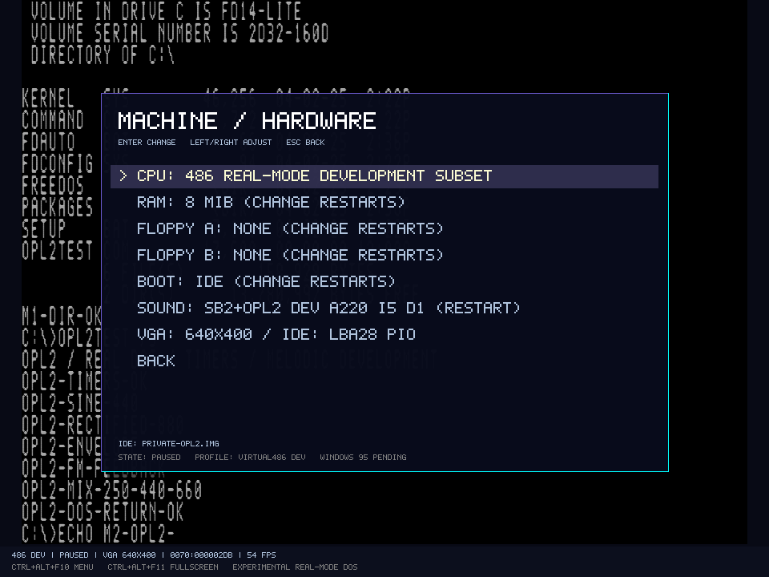
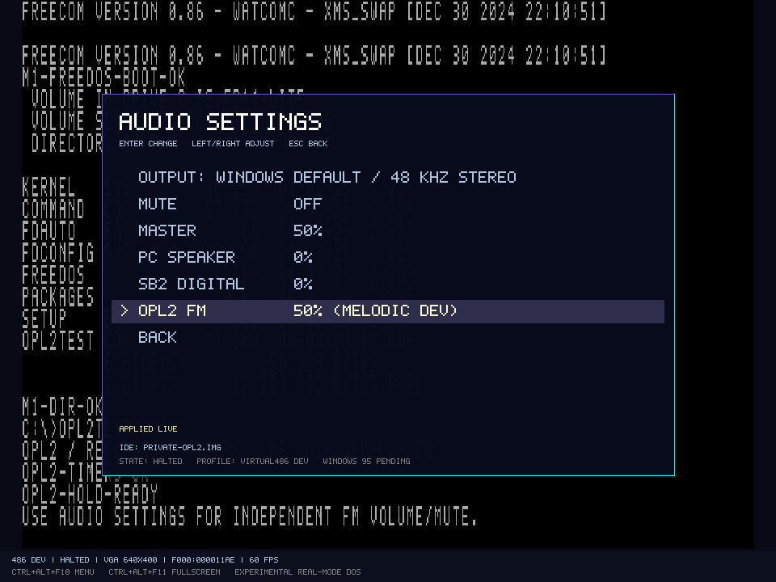
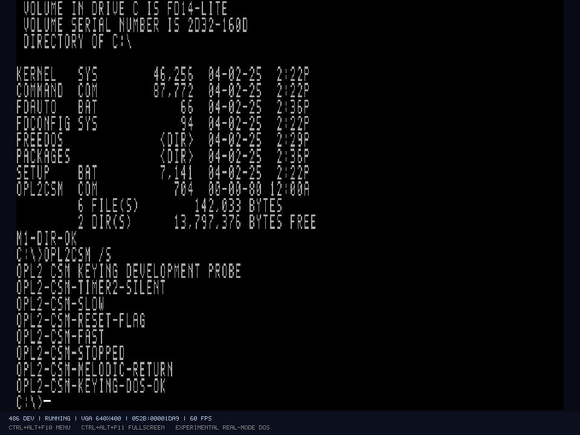

# OPL2: Timer, FM, CSM-Keying und Portzeiten

Der eigene YM3812-Pfad besitzt neun melodische Kanäle oder sechs melodische Kanäle plus fünf Schlaginstrumente. Timer, Register-/Buszeiten, Hüllkurven, Wellenformen, FM/Additiv-Verbindung, Feedback, Rhythmus und samplebasiertes CSM-Keying mit Total-Level-Latch sind mit Geräte- und echten DOS-Gasttests geprüft. Ausgewählte melodische und rhythmische Klänge sind gegen separat gebautes YMFM verglichen. **Keine allgemeine oder siliziumgenaue AdLib-/OPL2-Kompatibilitätsfreigabe:** insbesondere genaue Slot-/TL/KSL-Pipeline, Hüllkurvenmikrosteps, LFO und Analogausgabe bleiben begrenzt. Aktuelle Nachweise: [M2-ABNAHME.md](../M2-ABNAHME.md).

## Profile und Ports

| `soundCard` im Maschinenprofil | Installierter Umfang |
| --- | --- |
| `none` | PC Speaker; keine zusätzliche Soundkarte |
| `sb2-dsp-development` | Bisheriger begrenzter DSP-/PCM-Pfad auf 220h/IRQ5/DMA1, ohne FM |
| `adlib-opl2-development` | OPL2 mit Melodie, Rhythmus und samplebasiertem CSM, Adresse/Status 388h und Daten 389h |
| `sb2-opl2-development` | DSP-/PCM-Pfad plus derselbe OPL2, zusätzlich an Basis+8/+9 gespiegelt: 228h/229h oder 248h/249h |

Beide FM-Portpaare einer SB2-Konfiguration greifen auf einen gemeinsamen Adress-Latch, Registersatz und Klangzustand zu. Die konfigurierbare SB2-Basis und IRQ-Leitung sind im [DSP-Ressourcenpfad](SB2-DSP.md) beschrieben; altes Portpaar und alte DSP-Ports bleiben nach einem Wechsel unbeschaltet. DSP-Reset auf Basis+6 setzt den FM-Chip nicht zurück. Die OPL-Timerausgänge werden als Status/Chip-IRQ-Pin modelliert; sie sind in diesen Kartenprofilen nicht mit dem PIC verbunden. Die konfigurierte Soundkarten-IRQ-Leitung gehört zum DSP. Ein reines AdLib-Profil installiert keinen SB-FM-Alias.

Das Hardwaremenü wechselt die Profile über den vorhandenen Prepare-/Commit-Pfad mit Neustart. Lautstärken wirken live. Beispiele:

```powershell
.\scripts\run.ps1 -Profile '.\profiles\virtual486-adlib-dev-v1.json' -Disk 'C:\Pfad\private-dos.img'
.\scripts\run.ps1 -Profile '.\profiles\virtual486-sb2-opl2-dev-v1.json' -Disk 'C:\Pfad\private-dos.img'
.\scripts\test-opl2.ps1 -SkipBuild -Gui
.\scripts\test-opl2-csm.ps1 -SkipBuild -Gui
```



## Zeit, Register und Timer

Zeitbasis ist der feste Boardquarz mit 3.579.545 Hz. Der Chip erzeugt ein Sample pro 72 Masterclocks, also ungefähr 49.716 Samples/s. Ganzzahlige Clock-/Nanosekundenumrechnung verhindert langfristigen Drift. Der gemeinsame Hostmixer bleibt bei 48 kHz und integriert die gehaltenen Chip-Samplewerte über die Zeit; Windows-Callbacks treiben keine FM-Register oder Timer an.

Adress- und Datenzugriffe müssen die unterschiedlichen Wartezeiten einhalten: zwölf beziehungsweise 84 Masterclocks, im Modell nach oben auf 3.353 beziehungsweise 23.467 ns gerundet. Zu frühe Schreibzugriffe werden im Entwicklungsmodell verworfen und gezählt. Das ist ein definierter Fehlerpfad; tatsächliches Verhalten außerhalb der Yamaha-Timingvorgaben ist nicht vollständig nachgebildet.

`IoPortBus` kann nun pro Mapping einen synchronen Zeitpfad ausführen. Die FM-Portpaare teilen sich `Isa8BitIoTiming`: ein normales Byte benötigt im Referenzboard sechs Busclocks bei 8 MHz, also 750 ns. Anstehende Geräteereignisse werden vor dem Lesen/Schreiben ausgeführt; der Chip und `Accessed` beobachten den Zugriff am Zyklusende. Die zusätzlichen Buszeiten verändern nicht den CPU-Frequenzrest und werden nicht durch Host-Warteaufrufe erzeugt. Die weiterhin pauschalen vier Interpreter-Clocks kommen als angenäherter CPU-Anteil hinzu.

Der Gastprobe verwendet jetzt die klassischen sechs Statusreads nach einer Adresse und 35 nach einem Datenbyte. Der Trace enthält FM-Lese- und Schreibzugriffe samt `write`-Kennzeichnung und Abschlusszeit. Der unabhängige Prüfer bestätigt Anzahl und Mindestzeit dieser tatsächlichen IN-Befehle. Derselbe Gast scheitert im vorherigen Build an sieben zu frühen Schreibzugriffen und besteht mit dem Zeitpfad ohne Zurückweisungen.

Dieser Pfad gilt bisher **nur für FM-Ports**. Er ist eine feste normale 8-Bit-Zugriffszeit des Entwicklungsboards, keine vollständig kalibrierte ISA-/486-Pinsimulation. IOCHRDY/NOWS, Busarbitration, DMA-Busbelegung und timinggerechtes Aufteilen breiter Transaktionen fehlen. Wort-/Dwordzugriffe verbrauchen entsprechend mehrere Bytezeiten, behalten aber die bisherige Gerätebreitenregel: OPL akzeptiert ausschließlich Bytezugriffe; es entstehen keine erfundenen aufgeteilten Registerschreibvorgänge. Andere Portmappings behalten ihre bisherige Zeitbehandlung. Diese Einschränkungen bleiben Teil der Fremdprogramm-/Spielekompatibilitätsgrenze.

| Register | Implementierter Umfang |
| --- | --- |
| 01h | Wave-Select-Enable; andere Testbits werden als ununterstützt diagnostiziert |
| 02h/03h | Zwei Timer-Presets, je 8 Bit |
| 04h | Timerstart/-stop, separate Flagmasken, IRQ-Flagreset; Bit 7 ignoriert dabei die unteren Kontrollbits |
| 08h | Note-Select für KSR und samplebasiertes CSM mit TL-Latch; keine exakte Slotpipeline |
| 20h–35h | Gültige Operator-Slots: Multiple, Envelope-Typ, KSR, AM und Vibrato |
| 40h–55h | Total Level und Key-Scale-Level |
| 60h–75h / 80h–95h | Attack/Decay und Sustain-Level/Release |
| A0h–A8h / B0h–B8h | F-Number, Block und Key-On für neun getrennte Kanäle |
| C0h–C8h | FM/Additiv-Verbindung und Feedback |
| BDh | AM-/Vibrato-Tiefe, Rhythmusfreigabe und fünf unabhängige Schlagzeug-Keybits |
| E0h–F5h | Vier Wellenformen an den gültigen Operatoradressen, durch 01h freigeschaltet |

Timer 1 zählt in Einheiten von 288 Masterclocks, Timer 2 mit 1.152. Sie laden beim Überlauf den aktuellen Preset neu; Presetänderungen überschreiben keine bereits laufende Countdownperiode. Ein erneutes Startbit eines laufenden Timers startet ihn nicht neu. Masken unterdrücken/löschen das jeweilige Flag und stoppen den Zähler nicht. Lesen des Status quittiert keine Flags. Flagreset stoppt die Timer ebenfalls nicht. Der Status enthält die OPL2-Kennung in den unteren Bits und getrennte Timer-/IRQ-Flags.

## Melodische Synthese und Mixer

F-Number, Oktavblock und Multiple bestimmen die Phase jedes Operators. Key-On-Flanken starten Hüllkurve und Phase; wiederholte Schreibzugriffe mit gehaltenem Key-On starten den Ton nicht neu. Frequenzänderungen bleiben möglich. Ein Key-Off wechselt in Release. Attack-Rate null friert einen neu angeschlagenen stummen Operator ein, statt einen erfundenen sofortigen Ton zu erzeugen.

Die Hüllkurve behandelt Attack, Decay, Sustain und Release getrennt. Der Envelope-Typ wählt gehaltenen Sustain oder weiteres Abklingen. Total Level, Key-Scale-Level, Key-Scale-Rate und Note-Select wirken unabhängig. Die vier Wellenformen umfassen Sinus, Halbwelle, gleichgerichteten Sinus und die Folge positiver Viertelwellen mit Lücken. FM lässt den ersten Operator den zweiten modulieren; die additive Verbindung summiert beide. Feedback verwendet die letzten zwei Ausgabewerte des ersten Operators. AM und Vibrato sind eigene freie Chip-Zeitverläufe.

Dies ist eigene mathematische Synthese anhand der Yamaha-Unterlagen. Die Hüllkurve interpoliert die dokumentierten Ratentabellen kontinuierlich pro Chip-Sample; sie emuliert noch nicht die exakte globale Mikrostepfolge des Siliziums. Sinus-/Pegelberechnung, FM-Modulationstiefe, LFO-Folge, Phasen-/Pipelinefeinheiten und DAC-/Analogausgabe sind ebenfalls noch nicht gegen Originalaufzeichnungen abgenommen. Die Wellenform darf deshalb trotz korrekter Grundfunktionen von einem echten Chip abweichen.

Die Chipausgabe wird intern auf einen signierten 16-Bit-Wert quantisiert und zeitlich integriert. Der gemeinsame ganzzahlige Flächenmaßstab wurde dafür um acht Binärstellen erweitert; vorhandene Speaker-/SB2-Aufzeichnungen bleiben nachweislich bitgleich. Ein einfaches Sample-Hold-/Flächenresampling ist noch kein hochwertiger bandbegrenzter Resampler für jede Oberwelle. Neun Stimmen mit gleicher Phase können die begrenzte Ausgangssumme übersteuern; virtuelle Pegel sind keine kalibrierte Spannungs-/Analogsimulation.

## CSM-Keying und Total-Level-Latch im Samplezeitmodell

Yamaha beschreibt für CSM bei jedem Timer-1-Überlauf einen Key-On-/Key-Off-Vorgang aller Slots und fordert normale Kanal-Keys auf null beim Einschalten dieses Modus. Der Entwicklungspfad übernimmt dieses dokumentierte Grundverhalten. Timer 2 löst keine Keys aus. Die Timerflag-Maske beeinflusst die Pulse nicht; ein IRQ-Flagreset stoppt sie ebenfalls nicht. Der bestehende Timer-Preset-/Reloadpfad bestimmt die Impulsrate.

Vor einem Impuls wird das alte Audiosignal bis zur Timerfrist integriert. Die CSM-Keyquelle hält im eigenen Modell bis zur nächsten nativen Sampleberechnung, danach wechseln die Operatoren in Release. Normale B-Register-Keys und CSM besitzen getrennte Keyquellen, damit das Ende der einen Quelle die andere nicht versehentlich löscht. Reset und CSM-Abschalten entfernen die CSM-Quelle; Stoppen des Timers verhindert weitere Impulse und lässt einen bereits laufenden Impuls normal ausklingen. Rendern in großen oder kleinen Hostblöcken ergibt identische Samples.

**Die Ein-Sample-Pulsbreite bleibt der offengelegte Zeitvertrag.** Während CSM aktiv ist, ändern 40h-Schreibzugriffe zunächst nur das programmierte TL-Register; alle 18 effektiven Total Levels werden bei Timer 1 gelatcht. CSM-Abschalten übernimmt ausstehende Pegel. KSL-/Frequenz-/Slot-Latenzen sind nicht als exakte Siliziumpipeline modelliert. `csm=true`, `csmKeying=true` und `csmTotalLevelLatch=true` benennen diese implementierten Funktionen; `siliconExact=false` bleibt bestehen. Unterstützte CSM-/Rhythmusprogrammierung wird nicht mehr als unimplementiert diagnostiziert.

Zwei neue Gerätefälle prüfen alle 18 Latches und das Abschalten. Die eigene `CSMLEVEL.COM` startet unter MS-DOS und FreeDOS und hält den Timer während Pegeländerungen an. Ein unabhängig aus den tatsächlichen OUTs abgegrenzter Audiovergleich prüft unveränderte 100-Prozent-Pegel, die folgende 24-dB-Dämpfung und das sofortige Übernehmen beim CSM-Abschalten. Vier identische Kaltstarts, reguläre Programmenden/VER/ECHO/Prompt, keine Medienwrites. Ein-Sample-Pulse und dieser TL-Vertrag ersetzen keine Messung ursprünglicher Yamaha-Chips.

**AUDIO SETTINGS** bietet einen eigenen FM-Pegel neben Speaker, Digital, Master und Mute. Quellpegel werden im Emulationsthread angewandt, Master/Mute im Windows-Provider. Der Audiothread verarbeitet nur veröffentlichte PCM-Blöcke. Einstellungen einschließlich `FmVolume` werden gespeichert; ältere Einstellungen erhalten den Standardwert 100. Menüpause hält die gemeinsame virtuelle Zeit an.



## Nachweise

26 zusätzliche Geräte-/Integrationstests prüfen Timerfristen, Start/Stop/Reload/Masken/Flagreset, Wartezeiten, Alias-Latch, Sampleclock, alle neun Kanalzuordnungen, F-Number/Block/Multiple, Hüllkurven, einen dokumentierten Attack-Zeitanker, KSR/KSL/TL, die vier Wellenformen, FM/Feedback/LFO, Reset und die expliziten Grenzen. Renderblöcke bleiben unabhängig von der Host-Schrittgröße und werden nach Veröffentlichung nicht überschrieben.

Zwölf weitere CSM-Tests prüfen Timerflanken, alle 18 Slots, Sample-Attack/Release, Flagmasken/-reset, Timer-2-Stille, Abschalten, überlappende Keyquellen, Reset und Hostblock-Unabhängigkeit. Acht Bustests prüfen insbesondere Reihenfolge Ereignis/Gerät/Trace, Wirkung am Zyklusende, den unveränderten CPU-Frequenzrest und tatsächliche x86-IN/OUT-Routinen. Bei dieser Abnahme bestanden insgesamt 236 Regressionen; der aktuelle Gesamtstand steht im Implementierungsstatus.

`tests/guests/opl2-test.asm` wird als eigene COM-Datei auf eine neue private FreeDOS-Platte gelegt und von FreeCOM über FAT16/IDE geladen. Der Gast erkennt beide Timer, erzeugt einen Sinuston, eine gleichgerichtete Wellenform, eine langsame Hüllkurve und FM mit Feedback. Danach spielt er FM und PIT2 gleichzeitig. `/S` verwendet den SB2-FM-Alias und ergänzt einen im Gast erzeugten DMA1-Puffer für drei gleichzeitige Quellen. Dafür laufen echte DSP-/DMA-Portzugriffe; der vorhandene SB2-IRQ-Pfad bleibt separat abgenommen. `/H` hält den FM-Ton für GUI-Tests. Der Normalpfad beendet alle Quellen und kehrt zu DOS zurück.

Der unabhängige Standardbibliothek-Prüfer `tests/verify-opl2-audio.py` liest WAV und tatsächliche Port-Zeitstempel. Er prüft Warteintervalle, Stereo, Frame-/Native-Samplezahlen, Tonhöhen, Wellenform-Harmonische, den Sustainpegel, Release-Stille und die drei getrennten Frequenzkomponenten im Mix. Starke Selbstrückkopplung wird über die Energie außerhalb des Trägers geprüft; sie muss kein rein periodischer Ton sein. **Dieser Prüfer ist kein Vergleich mit Originalsilizium.**

Vier unabhängige Kaltstarts, zwei je Profil, liefern gleiche Hashes und Zeiten. Zwei zusätzliche native GUI-Prozesse prüfen die normale DOS-Rückkehr, Hardware-/Audiomenüs, Mute und den FM-Pegel bei Speaker/Digital null. Konkrete Artefakte, Zahlen und Grenzen stehen im [Implementierungsstand](../IMPLEMENTATION-STATUS.md). Alle Probeplatten, WAVs und Traces bleiben private ignorierte Artefakte; Originalmedien bleiben unverändert.

`tests/guests/opl2-csm-test.asm` ist eine zusätzliche eigene, 704 Byte große COM-Datei. FreeCOM lädt sie regulär über FAT16/IDE. Ohne B-Register-Key-On erzeugt Timer 1 im Gast 137 CSM-Impulse für 18 additive Sinusoperatoren; danach folgt ein normaler Melodieton und die DOS-Rückkehr. Timer 2, maskierter Timer 1, Flagreset, laufende Presetänderung und Stop werden durch echte Gast-Portzugriffe geprüft. `tests/verify-opl2-csm.py` rekonstruiert die Timer unabhängig aus tatsächlichen Port-Zeitstempeln, prüft Stille bei Timer 2 und nach Stop sowie die PCM-Perioden bei etwa 97,101 und 194,203 Hz. Er verwendet keine Emulatorassemblies oder Envelope-/DAC-Traces. Vier weitere Kaltstarts und ein zusätzlicher nativer GUI-Lauf prüfen diesen Teilpfad. Das ist ebenfalls kein Siliziumvergleich.



## Rhythmus und unabhängiger Klangvergleich

BDh steuert Bass Drum (beide Operatoren von Kanal 6), Hi-Hat/Snare (die beiden Operatoren von Kanal 7) und Tom/Cymbal (Kanal 8) getrennt. Kanalzählung hier nullbasiert. Wiederholte gehaltene Bits starten Hüllkurven nicht neu; der Wechsel zurück stellt die melodischen Kanalkeys wieder her. Bass Drum benutzt die normale Zweioperatorverbindung mit Feedback; bei additiver Verbindung wird der Modulator für die Ausgabe ignoriert. Ein freilaufender 23-Bit-Rauschgenerator und die gemeinsamen HH-/Cymbal-Phasen bestimmen die nichttonalen Schlaginstrumente. Das Chiprauschen läuft auch bei Stille und ausgeblendetem Quellpegel weiter.

Die Phasen-/Rauschformeln stammen aus den ausdrücklich zugeordneten [YMFM-Forschungsergebnissen](https://github.com/aaronsgiles/ymfm); deren BSD-Hinweise stehen in [THIRD-PARTY-NOTICES.md](../THIRD-PARTY-NOTICES.md). Der Melodie-/Hüllkurven-/Mixerpfad bleibt die eigene mathematische Synthese; es ist kein fremder FM-Core ins Produkt eingebettet. Ein separat gebautes YMFM wird ausschließlich privat als unabhängige Testreferenz verwendet, Upstream-Commit `81aec25ccbb98f4873a255f7551ac4dadac59b4a`.

`OPLRHY.COM` spielt nacheinander alle fünf Schlaginstrumente, danach sechs Melodien plus Schlagzeug und anschließend wieder den normalen Melodiemodus. Acht Kaltstarts unter MS-DOS/FreeDOS und AdLib-/SB-Alias, jeweils zweimal. Der Testadapter erhält ausschließlich die tatsächlich beobachteten Gast-OUTs und läuft mit eigenem Chipzustand/Timern. Der Prüfer integriert seine Rohsamples unabhängig auf 48 kHz und vergleicht Tonhöhen (maximal 0,5 Prozent Unterschied), normalisierte relative Pegel (maximal fünf Prozent) und Nulldurchgangsaktivität der Rauschstimmen. Das ist ein gezielter funktionaler Klangvergleich, keine Behauptung gleicher Wellenformen für alle Programme oder Originalsilizium. Zwei native Prozesse/zwölf GL-Aufnahmen mit Windows-Audio und finalem DOS-Prompt ergänzen ihn.

`GetCapabilities` meldet zusätzlich `opl2Rhythm=true` und `opl2CsmTotalLevelLatch=true`. Die allgemeinen Bits `opl` und `soundBlaster` bleiben false, `siliconExact` ebenfalls. Nicht implementierte Yamaha-Testbits bleiben diagnostiziert. MIDI/Gameport und weitere Kartentypen sind hier nicht enthalten. Reproduktion und Grenzen stehen im M2-Abnahmedokument.

Primärgrundlagen: Yamaha, **YM3812 Application Manual**, insbesondere gedruckte Seiten 6 und 8–21 sowie Tabellen 3-1 bis 3-10; für CSM Seiten 9/11. Gelesene öffentliche [Spiegelung des Yamaha-PDFs](https://raw.githubusercontent.com/gerwout/sleic-iomoon/main/datasheets/ym3812_opl2_application_manual.pdf). Für normale 8-Bit-I/O-Zyklen: Intel, **ISA Bus Specification and Application Notes**, Rev. 2.01, 12. September 1989, Abschnitte 8.1/9 und Abb. 8.1.5 auf Seite 47; gelesene [Spiegelung des Intel-PDFs](https://people.osmocom.org/laforge/tmp/Intel_ISA_Spec2.01_Sep89.pdf). Der konkrete 750-ns-Zeitpfad ist die oben begrenzte Referenzboard-Modellierung. Private Referenzkopien liegen unter `artifacts/references`. Die Hersteller-PDFs werden nicht ausgeliefert; Herkunft/Lizenz der ergänzten Rhythmusformeln ist oben ausdrücklich dokumentiert.

Der spätere [YMF262-/OPL3-Pfad im CT1740-Profil](OPL3.md) besitzt einen getrennten Gerätekern und eigene Teilabnahme. Die hier beschriebenen OPL2-/CSM-Ausführungspfade bleiben erhalten; der YMF262 erhält keine erfundene CSM-Funktion.
