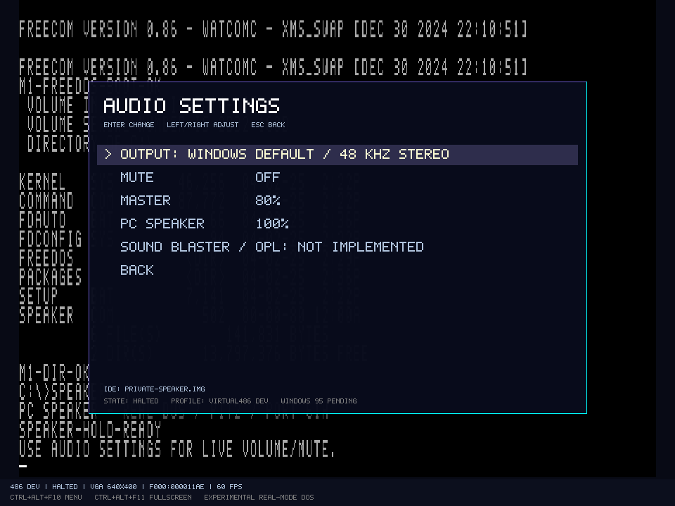

# PC Speaker und PIT-Kanal 2

Der Referenzrechner besitzt einen PC-Speaker-Pfad vom DOS-Portzugriff bis zur lokalen Windows-Ausgabe. Der optionale [SB2-DSP-/PCM-Pfad](SB2-DSP.md) und [melodische OPL2-Entwicklungspfad](OPL2.md) nutzen denselben Mixer. Die folgenden Angaben beschreiben den getesteten Speaker-Teilumfang.

## Gerät und Zeitbasis

| Verbindung | Implementierter Umfang |
| --- | --- |
| PIT-Port 42h/43h | Eigener Kanal 2 mit binären Modi 0, 2 und 3; Low-/High-/Low-High-Programmierung, Count-Latch und Status-/Count-Readback |
| Teiler | Null bedeutet 65.536; Mode-3-Ausgabe berücksichtigt gerade und ungerade Teiler sowie den um zwei fallenden Zähler |
| Laden | Auf Eingangsclockgrenzen; eine neue laufende Mode-3-Zählung wird am nächsten Halbzyklus übernommen, Mode 2 am Periodenende |
| Gate | Port 61h Bit 0; periodische Modi werden bei niedrigem Gate angehalten und auf hohen Ausgang gesetzt, Mode 0 kann pausiert/fortgesetzt werden |
| Speaker | Port 61h Bit 1 verknüpft den Ausgang mit dem Lautsprecher; Bit 5 liest den tatsächlichen berechneten OUT2-Zustand |
| Weitere Portbits | Bits 2/3 werden gespeichert; Bit 4 ist ein angenähertes virtuelles 15-µs-Refresh-Toggle. Paritäts-/I/O-Channel-Check und NMI-Fehlerpfade sind nicht implementiert |

Zeitbasis ist der gemeinsame virtuelle Scheduler mit gerundet 1.193.182 Hz Eingangsclock. OUT2 und Zählerstand hängen nicht von einer Host-Audiocallbackrate ab. Periodische Wellen werden analytisch ausgewertet; auch ein Teiler von zwei erzeugt keine Million Schedulerereignisse pro Sekunde. Nur anstehende Lade-/Umschaltzeitpunkte benötigen Ereignisse.

Bei zeitlich begrenzten GUI-Maschinenschritten laufen Geräte auch unter CLI/HLT weiter, während die CPU keine Instruktionen ausführt. Ohne Zeitvorgabe bleibt CLI/HLT im Headless-Schrittmodus eine Testprogramm-Endmarke. Menüpause hält dagegen die virtuelle Maschine einschließlich ihrer Gerätezeit an.

Kanal 0 behält seinen bisherigen IRQ0-Pfad. Dessen Mode-3-Count-Readback bleibt angenähert; Kanal 2 hat einen getrennten Zählpfad. Readback kann beide implementierten Kanäle auswählen. Kanal 1/DRAM-Refresh, BCD und die Kanal-2-Modi 1/4/5 fehlen. Nicht unterstützte Programmierung wird über `UnsupportedProgramming` und den Headless-Bericht sichtbar; sie darf IRQ0 nicht unbeabsichtigt abschalten. Gate-Flanken werden im digitalen Modell zum I/O-Zeitpunkt wirksam; analoge Setup-/Hold-Zeiten werden nicht nachgebildet.

## Rekonstruktion und Host

Der Speaker integriert den hohen Signalanteil eines Samples mit ganzzahliger Flächenrechnung. Auch direkt über Bit 1 geschaltete Impulse unterhalb einer Sampledauer behalten damit ihren Flächenanteil. Ein einfacher 20-Hz-Hochpass entfernt Gleichspannung; der Ausgang wird mit begrenztem Pegel auf beide Stereokanäle gegeben. Dies ist keine akustische Spulen-/Membran- oder vollständige elektrische PC-Speaker-Simulation.

Ausgabeformat: Float32-Stereo mit 48 kHz, zeitgestempelte Blöcke von 480 Frames und bei Abschluss ein letzter Teilblock. Bereits veröffentlichte Blöcke werden nicht überschrieben. `PcAudioMixer` integriert Speaker sowie optionale PCM-/FM-Quellen auf einer gemeinsamen Zeitachse mit getrennten Pegeln. Die Speaker-Ausgabe allein bleibt bitgleich zur ursprünglichen Abnahme.

Die GUI nutzt NAudio 2.3.0/`WaveOutEvent`, analog zur Hostanbindung des C64Emulator, mit eigener Implementierung und unveränderten C64-Dateien. Die normale Windows-Standardausgabe erhält PCM16-Stereo. Die Warteschlange ist auf 250 ms begrenzt, gewünschte Backendlatenz ist 80 ms. Überlauf verwirft alte ganze Frames, Unterlauf liefert Stille; beide werden gezählt. Menüpause und Maschinenwechsel verwerfen ausstehendes Hostaudio. Gerätezeit und Gastzustand laufen nicht im Audiothread.

Im Hauptmenü öffnet **AUDIO SETTINGS** die Regler für Mute, Master, PC Speaker und die optionale Digitalquelle. Pfeile/Enter ändern die Pegel, ohne den Gastteiler oder die virtuelle Zeit zu ändern. Quellpegel werden im Emulationsthread angewandt, Master/Mute im Windows-Ausgabepfad; Einstellungen werden gespeichert. Fehlende Ausgabehardware verhindert den Gaststart nicht und wird gemeldet. Auswahl/Wechsel des Hostgeräts, automatische Wiederverbindung nach Geräteverlust sowie Audio-Savestates sind noch offen.

## Firmware, Aufzeichnung und Abnahme

`firmware/speaker-bios.inc` implementiert INT10-Teletype-BEL mit ungefähr 40 ms Ton über echte IN/OUT-Zugriffe auf PIT2/Port 61h. Die Routine wartet auf OUT2-Flanken, erhält Cursor/Register und stellt die Port-61h-Steuerbits wieder her. Sie verändert die PIT2-Modus-/Teilerprogrammierung; diese wird wie bei einem einfachen BIOS-Bell nicht gesichert. Es gibt keinen Host-Beep-Aufruf.

Headless zeichnet mit `--audio-out <neue.wav>` die tatsächlich erzeugte Mischung als PCM16/48-kHz-Stereo auf; ohne zusätzliche Soundkarte bleibt dies der Speaker-Strom. Die GUI-Option gleichen Namens zeichnet die nach Hostpegeln an den Windows-Provider gelieferten Bytes auf. Vorhandene Aufzeichnungen werden nie überschrieben. WAVs bleiben private ignorierte Testausgaben.

`tests/guests/speaker-test.asm` wird als eigene COM-Datei auf einer neuen privaten FreeDOS-Testplatte abgelegt. FreeCOM lädt sie über FAT16/IDE. Der Gast erzeugt zwei definierte Töne, prüft Mode-2-Status/OUT2, Mode-0-Terminal Count, direkte Bit-1-Ausgabe und BIOS-BEL und kehrt über DOS zurück. `/H` hält einen Ton für die GUI-Prüfung.

`scripts/test-speaker.ps1 -SkipBuild -Gui` prüft:

- zwei unabhängige Kaltstarts mit identischen PCM-/Bildhashes und virtueller Zeit;
- PCM-Format, Stereo, Framezahl zur virtuellen Zeit, Clippinggrenze, gemessene Teilerfrequenzen und Stille nach Abschalten durch einen separaten Python-Prüfer;
- tatsächliche Windows-Providercallbacks mit Ton, über Menütasten geschaltetes Mute und reduzierte Lautstärke anhand unabhängiger Messintervalle;
- vier OpenGL-Aufnahmen der Konsole und Audiomenüs sowie unveränderte Basis-/Probeplatten.

Die Hostabnahme prüft den PCM-Strom im Ausgabepfad; sie ist keine akustische Messung oder Hardware-Loopback-Aufnahme. Allein Mute darf die Speaker-Gastprogrammierung nicht verändern. Die Geräte-/CPU-Suite prüft zusätzlich Latches, ungerade Teiler, Gate/Reload, sehr kurze Impulse, DC-Abklingen, Blockbesitz, WAV-Schutz und den tatsächlichen BIOS-Bell.

Primärgrundlagen: [Intel 8254, 231164-005, September 1993](https://www.cs.cmu.edu/~410/doc/8254.pdf) für Zählmodi/Latches/Gate und [IBM PC AT Technical Reference, März 1984](https://www.bitsavers.org/pdf/ibm/pc/at/1502494_PC_AT_Technical_Reference_Mar84.pdf) für die Plattformanbindung. Die Implementierung ist eigener Projektcode.
