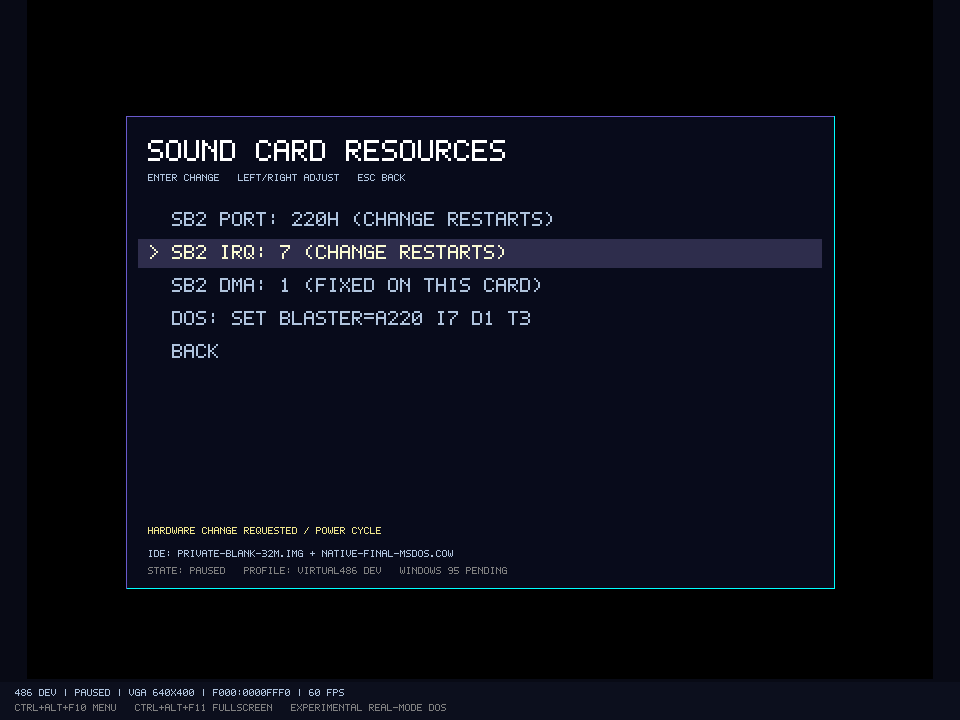

# SB2-DSP-Entwicklungspfad und gemeinsamer Audiomixer

Der Referenzrechner kann optional einen **begrenzten SB2-DSP-/PCM-/ADPCM-Pfad** installieren. Direkter DAC ist auf Geräteebene geprüft; normales und High-Speed-8-Bit-Mono-Ausgabe-DMA zusätzlich mit echten DOS-Gästen und Windows-Ausgabe. Direct-ADC und normales/High-Speed-Eingabe-DMA sind mit einem definierten virtuellen Eingang unter MS-DOS 6.22 und FreeDOS geprüft. Alle neun Creative-ADPCM-Starts sind unten abgenommen. Der ergänzte [OPL2-Entwicklungspfad](OPL2.md) kann im Kombiprofil zugeschaltet werden und besitzt jetzt Rhythmus sowie samplebasiertes CSM mit TL-Latch. Eine vollständige beliebige Sound-Blaster-Kompatibilität ist nicht abgenommen: Originalchip-Präzision, Host-Audioeingang, MIDI und Gameport bleiben offen.

## Konfiguration

`MachineProfile.SoundCard` akzeptiert `none`, `sb2-dsp-development` sowie die in der OPL2-Dokumentation beschriebenen FM-Profile. Alte Profile ohne dieses Feld behalten `none`; der PC Speaker ist unabhängig davon vorhanden. Das Profil `profiles/virtual486-sb2-dsp-dev-v1.json` wählt den bisherigen DSP-Pfad ohne FM. Im Hardwaremenü wechselt **SOUND** die Kartenoption über Prepare/Commit und Neustart. Medien und private Overlay-Leases werden wie bei anderen Profiländerungen übernommen.

Standard bleibt **220h / IRQ5 / DMA1**. Das Profil erlaubt jetzt `soundBlasterBasePort=544|576` (dezimal für 220h/240h) und `soundBlasterIrq=3|5|7|9`. `soundBlasterDmaChannel` bleibt auf dieser SB2-Referenzkarte **1**. Andere DMA-Kanäle sind keine wählbare SB2-Fähigkeit; zusätzliche Kartenprofile erhalten später eigene Verdrahtung. Alte JSON-Profile ohne neue Felder behalten ihre bisherigen Werte.

Unter **MACHINE / HARDWARE → SOUND CARD RESOURCES** werden Portbasis und IRQ über den bestehenden transaktionalen Power-Cycle gewechselt. Die aktuelle Maschine bleibt bei ungültigen oder veralteten Anfragen erhalten; gültige Wechsel leeren RAM/Geräte und behalten Batterie-CMOS sowie IDE-/FDC-Medien und private Overlay-Leases. Die neue Seite zeigt den passenden DOS-Befehl, etwa `SET BLASTER=A240 I9 D1 T3`. Diese Variable wird nicht in den Gast injiziert. Pegel bleiben unabhängig davon live einstellbar.

IRQ9 läuft auf dem AT-Slave-PIC über Vektor 71h und die Master-Kaskade IRQ2. Der Gast muss beide Controller freigeben/quittieren. IRQ2 selbst bleibt für die Kaskade reserviert. Die getestete Auswahlliste sperrt insbesondere Timer/Tastatur, FDC-IRQ6/-DMA2 und PS/2-IRQ12. Sie beschreibt die derzeitige Referenzplattform, keine beliebige konfliktfreie Kombination künftiger COM-/LPT-/Netzkarten oder sämtliche historischen Jumper-/Treiberkonventionen. Die Kennung ersetzt keine vollständige SB2-Kompatibilitätsfreigabe.



```powershell
.\scripts\run.ps1 -Profile '.\profiles\virtual486-sb2-dsp-dev-v1.json' -Disk 'C:\Pfad\private-dos.img'
.\scripts\test-sb2.ps1 -SkipBuild -Gui
.\scripts\test-sb2-highspeed.ps1 -SkipBuild -Gui
.\scripts\test-sb2-input.ps1 -SkipBuild -Disk '<private DOS-Basis.img>' -Overlay '<pristines COW.cow>'
.\scripts\test-sb2-resources.ps1 -SkipBuild -Gui -Disk '<private DOS-Basis.img>' -Overlay '<pristines COW.cow>'
```

## Getestetes Geräteprotokoll

Portnummern der Tabelle beziehen sich auf den Standard 220h. Die gewählte Basis verschiebt DSP-Ports und den SB-FM-Alias gemeinsam; bei 240h sind dies 246h/24Ah/24Ch/24Eh sowie 248h/249h. Der feste AdLib-Port 388h/389h bleibt auf demselben OPL-Chip. Alte DSP-/Aliasports sind nach einem Wechsel unbeschaltet. Die IRQ-Leitung stammt aus der aktuellen Profilverdrahtung; DMA bleibt Kanal 1.

| Schnittstelle | Implementierung |
| --- | --- |
| 226h | Reset: mindestens 3 µs hoher Pegel; nach Absenken 100 µs Initialisierung, dann AAh im Lesepuffer |
| 22Ah / 22Eh | Antwort-FIFO / Ready-Bit; Lesen von 22Eh quittiert zusätzlich die DSP-IRQ-Leitung |
| 22Ch | Command/Data und Busy; ein Eingabebyte wird nach einer modellierten Latenz von 1 µs verarbeitet; verfrühte Schreibversuche werden verworfen und gezählt |
| 10h | Direkte Ausgabe eines vorzeichenlosen 8-Bit-DAC-Werts; 128 ist die Mitte |
| 20h | Direkte ADC-Abfrage; genau ein vorzeichenloses Byte im Antwort-FIFO, ohne DMA/Abschluss-IRQ |
| 14h / 1Ch / 48h | Single-Cycle / Auto-Init / DSP-Blocklänge, jeweils unabhängig von der DMA-Pufferlänge |
| 24h / 2Ch | Normale Single-Cycle-/Auto-Init-Aufnahme über 8-Bit-Write-DMA |
| 91h / 90h | High-Speed-Ausgabe: Einzelblock / Auto-Init; beide verwenden die durch 48h gesetzte Blocklänge |
| 99h / 98h | High-Speed-Eingabe: Einzelblock / Auto-Init; Blocklänge ebenfalls aus 48h |
| 40h | Zeitkonstante; die virtuelle Sampleperiode beträgt `(256 - TC) * 1000 ns` |
| D0h / D4h | DMA-Pause / Fortsetzung; Restbytes und verbleibender Teil des nächsten Sampleintervalls bleiben erhalten |
| D1h / D3h / D8h | DAC-Ausgang ein / aus / Status; Abschalten pausiert bei diesem DSP-2-Pfad die DMA-Übertragung nicht |
| DAh | Auto-Init endet nach dem gerade laufenden DSP-Block |
| 80h | DAC für eine Anzahl Sampleperioden halten, ohne DMA-Daten zu lesen; danach IRQ |
| E1h | Versionsantwort 2.01 für diesen ausdrücklich begrenzten Entwicklungspfad |

DSP-Längen sind Little Endian und zählen die Samplezahl minus eins; FFFFh bedeutet 65.536. Ein während normalem Auto-Init programmierter Single-Cycle-Auftrag beginnt nach dem aktuellen Block. Pro abgeschlossenem DSP-Block wird die IRQ-Leitung gesetzt. Bleibt sie unquittiert hoch, entstehen keine erfundenen zusätzlichen PIC-Flanken. Der Gast benötigt DSP-Quittierung und PIC-EOI. Ein normaler Reset bricht Samples und noch ausstehende Kommandos/Antworten ab, senkt IRQ und schaltet den Ausgang ab. Der besondere High-Speed-Reset ist unten beschrieben.

Jedes PCM-Sample fordert genau ein Byte beim echten 8237-Kanal 1 an. Dessen Adress-Wrap, Count, Masken, Richtung und Auto-Init gelten unverändert. Ein maskierter Kanal oder zu kurzer DMA-Puffer hält den DSP-Transfer an; er meldet keinen erfolgreichen Blockabschluss. Ausgabe benötigt Read-DMA, Aufnahme Write-DMA. Verify-, falsche Richtung, Illegal- oder Cascade-Programmierung erzeugen weder falsche PCM-Daten noch Speicheränderungen. `LastDmaResult` macht den Zustand sichtbar.

Samplerate und Hostausgabe sind getrennt: TC 131 ergibt 8.000 Samples/s, TC 165 tatsächlich etwa 10.989 Samples/s. Der DSP übernimmt keine angeblichen 11.025 Hz, wenn die programmierte Ganzzahl-Zeitkonstante diese Rate nicht darstellen kann. Busarbitration, DRQ-/DACK-Flanken und elektrische DSP-/Analoglatenzen sind noch angenähert; die feste Kommandolatenz ist eine Modellentscheidung. Nicht alle theoretisch programmierbaren Raten sind als physikalischer SB2-Betrieb abgenommen.

## High-Speed-Ausgabe für DSP 2.01

91h überträgt einen DSP-Block, signalisiert IRQ und verlässt High-Speed auch bei Auto-Init des DMA-Controllers. 90h wiederholt DSP-Blöcke bis zum Reset. Weitere DSP-Kommandos werden währenddessen ignoriert; 22Ch meldet im Modell Busy. Dies gilt auch für D0h, D3h und DAh. Der 8237 und die IRQ-Quittierung bleiben unabhängig erreichbar. Die geprüften Zeitkonstanten 224/233 ergeben 31.250 beziehungsweise rund 43.478 Samples/s, innerhalb des von Creative dokumentierten High-Speed-Ausgabebereichs für DSP 2.01.

Ein Reset bei aktivem High-Speed beendet den Transfer und senkt IRQ, erhält jedoch Zeitkonstante, DSP-Blocklänge und Speaker-Einstellung. Im Modell bleibt auch der letzte DAC-Wert gehalten. Ein danach ausgeführter normaler Reset setzt wieder die bisherigen Standardwerte. Angefangene Blöcke erhalten beim Abbruch keinen erfundenen Abschluss-IRQ. Reset beendet nicht die externe DMA-Konfiguration; der Gast maskiert Kanal 1 selbst.

Die modellierten 3-µs-/100-µs-Resetzeiten samt AAh-Antwort werden auch beim High-Speed-Ausstieg verwendet. Diese konkreten Latenzen, die Busy-Bitfolge und das DAC-Halteverhalten sind nicht gegen Originalchipmessungen kalibriert. Es wird kein DSP-Mikrocontroller nachgebildet. Zähler `HighSpeedSamples`, `HighSpeedTransfers`, `HighSpeedResets` und `IgnoredHighSpeedWrites` machen den Ablauf im Headless-Bericht sichtbar.

## Direct-ADC und normale/High-Speed-Aufnahme

Der Boardeingang ist standardmäßig **unbeschaltet und liefert 128**. `AdcInput` kann eine maschineneigene virtuelle Quelle anhand absoluter virtueller Zeit auswerten. Headless bietet dafür ausdrücklich diagnostisch `--adc-test-signal ramp`: `(virtuelleNanosekunden / 125000) & 255`; `midpoint` liefert wie der Standard 128. Diese Optionen erzeugen analoge Eingangswerte am Gerätemodell, keine fertigen Gastpuffer. Das Gerät und der echte 8237 schreiben die Daten über DMA in den vom Gast programmierten Speicher. **Es wird kein Host-Mikrofon geöffnet; ein Audioeingabegerät oder dessen Liveauswahl sind noch nicht implementiert.**

20h nimmt bei Kommandofertigstellung einen Wert und stellt ihn in das begrenzte Antwort-FIFO. 24h nimmt eine Little-Endian-Länge minus eins; 2Ch nutzt 48h. D0h/D4h/DAh, Blockgrenzen, IRQ-Quittierung, Page-Wrap, Decrement und getrennte DSP-/DMA-Längen gelten auch bei Aufnahme. Ein vorgemerkter Single-Cycle-Auftrag erhält seine Aufnahmerichtung über die Auto-Init-Blockgrenze. Ein normaler Reset verhindert noch ausstehende RAM-Schreibvorgänge.

99h/98h entsprechen Einzel-/Auto-Init-Eingabe und verwenden dieselbe Sonderreset-/Busy-Regel wie High-Speed-Ausgabe. Der **Eingaberatenbereich von DSP 2.01 unterscheidet sich vom Ausgabebereich**. Gastabnahme: normale 8.000 Hz mit TC 131 und High-Speed **14.705,882 Hz mit TC 188**, innerhalb der von Creative dokumentierten 13..15 kHz für High-Speed-Eingabe. Andere theoretisch programmierbare Raten sind damit nicht freigegeben.

`RecordedSamples` zählt erfolgreich in RAM geschriebene Aufnahmebytes, `HighSpeedRecordedSamples` die entsprechende Teilmenge. `ConvertedSamples` zählt ADC-Auswertungen einschließlich Direct-ADC und blockierter DMA-Versuche. Bei blockiertem/falsch programmiertem DMA läuft die ADC-Uhr weiter; der DSP-Restzähler verbraucht kein Byte und meldet keinen erfundenen Block-IRQ. Das ist die definierte Verhaltenseingrenzung dieses Referenzmodells ohne vollständige DRQ/DACK-Busarbitration. Die bisherigen `TransferredSamples`/`HighSpeedSamples` bleiben reine Ausgabezähler. Aufnahme verändert weder den gehaltenen DAC-Wert noch dessen Ausgangsgate.

`--adc-trace <neue.jsonl>` liefert Zeit, ADC-Byte und tatsächliches DMA-Ergebnis; Direct-ADC besitzt kein DMA-Ergebnis. Der separate Trace erhält das bisherige Audio-I/O-Format. `--audio-irq-trace <neue.jsonl>` protokolliert wirkliche CPU-Eintritte am gewählten DSP-Vektor; Audio-I/O berücksichtigt die aktuelle Portbasis und zusätzlich tatsächliche PIC-Schreibzugriffe. Dateien werden mit CreateNew angelegt. `hostMicrophone=false` und `hostAudioInput=false` grenzen die virtuelle Gerätefähigkeit von einem noch fehlenden Hosteingang ab.

## Mischung und Windows-Ausgabe

`PcAudioMixer` besitzt einen gemeinsamen 48-kHz-Takt. Speaker und DSP liefern ganzzahlige Signalflächen mit eigener Gerätezeit; Änderungen werden erst nach Integration des alten Zustands übernommen. Dadurch bleiben sehr kurze Pulse erhalten, und die PCM-Ausgabe hängt nicht von der Größe eines Host-Zeitschritts ab. Kein Sample wird allein wegen eines Windows-Callbacks aus DMA gelesen.

Pro Quelle wird Gleichspannung mit einem einfachen 20-Hz-Hochpass entfernt. Speaker und Digitalquelle haben getrennte Pegel, danach wird die Summe auf den Float32-Bereich begrenzt und als zeitgestempeltes Stereo veröffentlicht. Dies modelliert keine vollständigen analogen SB2-Filter oder Lautsprecher. Die bisherige Speaker-Aufzeichnung bleibt bitgleich.

**AUDIO SETTINGS** bietet Mute, Master, PC Speaker, SB2 Digital und inzwischen den separaten melodischen OPL2-Pegel. Quellpegel ändern sich im Emulationsthread, Master/Mute im Windows-Ausgabepfad. Der Audiothread greift nicht auf CPU oder DMA zu. Einstellungen werden gespeichert. Der vorhandene begrenzte NAudio-Puffer und seine Unter-/Überlaufzähler bleiben erhalten. Hostgerätewechsel und Audio-Savestates fehlen. Die folgenden Bilder stammen aus der ursprünglichen DSP-Abnahme vor Ergänzung des FM-Pfads.


Headless: `--audio-out <neue.wav>` zeichnet die Mischung auf. Die GUI zeichnet unter demselben Schalter die tatsächlich an den Windows-Provider gelieferten PCM16-Bytes nach Hostpegeln auf. `--audio-io-trace <neue.jsonl>` protokolliert tatsächliche DSP-/FM-Lese- und Schreibzugriffe sowie DMA1-/Steuer-, PIT-/Speaker- und Diagnose-Schreibzugriffe mit Richtung und Abschlusszeit. Es erzeugt keine Gastdaten und verändert keine Interrupts. WAV und Trace werden mit CreateNew angelegt.

## Nachweise und Grenzen

Die 23 zusätzlichen Geräte-/Integrationstests behandeln Reset- und Busy-Zeiten, Antworten, direkten DAC, Single-/Auto-Init, getrennte DSP-/DMA-Längen, Pause, Blockwechsel, IRQ-Quittierung, Masken/Richtung/Verify, Page-Wrap, Reset-Abbruch, Längengrenze, Sampleclock, Mehrquellenmischung und Konfigurationswechsel.

18 weitere Tests behandeln High-Speed-Einzel-/Auto-Init, beide Blockzähler, Busy/ignorierte Parameter, Sonderreset und anschließenden normalen Reset, Abbruch ohne IRQ, Masken/Richtung/Terminal Count, FFFFh-Länge, 43-kHz-Geräteclock und identisches PCM bei verschiedenen Hostschrittgrößen. Acht weitere Tests prüfen die begrenzte Host-Taktung. 15 zusätzliche ADC-/Aufnahmetests prüfen tatsächliche RAM-Daten, beide Richtungen, Page-Wrap/Decrement, getrennte Zähler, blockiertes DMA, Pause, Reset, vorgemerkte Richtungswechsel und FFFFh-Länge. Aktueller gemeinsamer Stand nach ADC: **460 Regressionen**.

`tests/guests/sb2-test.asm` ist ein eigenes DOS-COM-Programm. FreeCOM lädt es über FAT16 und IDE aus einer neuen privaten Probeplatte. Es installiert seinen IRQ5-Handler über DOS, programmiert DMA1 mit einem im Gast erzeugten und physikalisch ausgerichteten Puffer und verwendet echte IN/OUT-Befehle. Der Normalpfad prüft Single-Cycle mit Pause/Fortsetzung, vier Auto-Init-Block-IRQs mit DAh aus dem Handler, eine zweite Samplerate und gleichzeitigen PIT2-Ton. Er stellt Interruptvektor, PIC-Maske und Speaker-Steuerung wieder her und kehrt zu DOS zurück. `/H` hält DMA-Ton für die GUI-Prüfung.

`tests/verify-sb2-audio.py` benötigt nur die Python-Standardbibliothek. Der Prüfer rekonstruiert die bekannten Gast-Pufferbytes anhand der tatsächlichen Port-Zeitstempel, ohne DSP-Sampletrace oder Emulatorbibliotheken. Er vergleicht sämtliche PCM-Frames vor der zusätzlichen Speaker-Ausgabe und prüft separat die Frequenzen beider Quellen in der Mischung, Stereo, Samplezahl, Datenhash und Stille nach Programmende.

Zwei unabhängige Kaltstarts liefern je 32.768 DMA-Samples, zehn Block-IRQs und identisches PCM/Bild/virtuelle Zeit. Native GUI-Läufe prüfen die DOS-Rückkehr und zehn OpenGL-Aufnahmen sowie Windows-Providercallbacks, Mute und getrennte Pegel. Digitalton bleibt bei Speaker-Pegel null hörbar; Master und Digital jeweils 50 % ergeben rund 31,25 % des Pegels bei Master 80 %/Digital 100 %. Die Aufzeichnung ist kein akustischer Hardware-Loopback. Konkrete Artefakte und der aktuelle gemeinsame Build stehen im [Implementierungsstand](../IMPLEMENTATION-STATUS.md).

Die zusätzliche eigene `SB2HST.COM` programmiert DMA1/IRQ5 und prüft 91h, drei 90h-Block-IRQs mit Reset aus dem IRQ-Handler, ignorierte Befehle, erhaltene Zeitkonstante über den 80h-Timer und erhaltene Blocklänge beim Wechsel zu normalem 1Ch. Ein zweiter High-Speed-Transfer wird unvollständig abgebrochen. Zwei Kaltstarts erreichen regulär DOS/ECHO/Prompt; je 15.663 DMA-Bytes, davon 13.615 im High-Speed-Pfad, sechs Block-IRQs und zehn absichtlich ignorierte Bytes. Der bisherige DSP-Gast behält seinen PCM-Hash.

`verify-sb2-highspeed.py` rekonstruiert sämtliche 210.210 Audioframes aus dem im Gast erzeugten Puffer und tatsächlichen DMA-/DSP-Portzeiten. Er liest keine DSP-Snapshots oder DAC-Traces. Größte PCM16-Abweichung: ein Quantisierungsschritt. Die beobachteten Töne liegen bei etwa 976,579 / 1.358,596 / 250 Hz. IRQ-Quittierungen werden anhand tatsächlicher Gastlesezugriffe überprüft; auch der kurze 32-Perioden-Timer nach Reset muss die erhaltene Zeitkonstante verwenden. Das ist eine unabhängige Prüfung des erklärten Modells, kein Originalsiliziumvergleich. Zwei weitere native Prozesse prüfen Gastende sowie Mute und Digitalpegel eines gehaltenen 43-kHz-DMA-Gasts; Messpunkte erfassen auch Pufferzähler während der laufenden Tonintervalle.

Bei dieser Prüfung wurde ein Host-Taktungsproblem sichtbar: Die GUI konnte nach Rückstand zur Wanduhr beim HLT-Warten zu viel virtuelle Audiozeit in einem Block aufholen. `RealtimePacer` begrenzt jetzt Ausführungsscheiben auf 20 ms, setzt bei mehr als 100 ms Rückstand den Hostbezug neu und verkürzt während begrenzten Aufholens die Hostwartezeit. Bei verfügbarem Audiobackend gibt es zusätzlich 40 ms festen Puffervorlauf. Geräteclocks, Sampleperioden und die virtuelle Zeit selbst bleiben davon unberührt; unter Hostlast darf der Gast langsamer laufen. Pause und Maschinenwechsel setzen nur diesen Hostbezug zurück. Das ist keine allgemeine Echtzeitgarantie unter beliebiger Last.


Die eigene `SBINPUT.COM` startet über FAT12 aus beiden echten DOS-Shells, installiert IRQ5 und programmiert DMA1 für vier Aufnahmepfade: 24h/2Ch/99h/98h. Zwei 128-Byte-Einzelaufnahmen und zwei Auto-Init-Aufnahmen mit je vier 64-Byte-DSP-Blöcken schreiben zusammen 768 Bytes; der DMA-Puffer besitzt unabhängig davon 128 Bytes. Der Gast prüft Wächterbytes, echten Terminal Count, IRQ-Zähler und Daten; beendet normales Auto-Init mit DAh und High-Speed-Auto-Init durch Reset aus dem Handler. Anschließend spielt er **dieselben tatsächlich aufgenommenen Bytes** mit Read-DMA ab, stellt PIC/Vektor wieder her und erreicht regulär VER/ECHO/Prompt.

`verify-sb2-input.py` rekonstruiert alle 769 ADC-Ereignisse je Start aus den wirklichen DSP-OUT-Zeiten, prüft fünf DMA-Programmierungen, sämtliche 512 im Gast gesicherten Datenbytes und den abschließenden RAM-Puffer samt Wächtern. Auch jedes PCM16-Frame der Aufnahme/Wiedergabe wird aus den erwarteten Eingangswerten, echten Ausgabezeiten und dem dokumentierten Mixerfilter unabhängig rekonstruiert. Acht deterministische Kaltstarts, beide DOS-Systeme × Rampe/unbeschalteter Eingang × zwei Wiederholungen: **6.152 ADC-Ereignisse und 1.357.728 Audioframes**, höchstens ein PCM16-Quantisierungsschritt Unterschied, keine ATA-/FDC-Writes. Die normale und High-Speed-Ausgaberegression besteht zusätzlich mit ihren unabhängigen Prüfern. Vollständige Artefakte stehen im Implementierungsstatus. Dies ist keine physische Mikrofon-/Analog- oder Spieleabnahme.

Für Ressourcen lässt sich derselbe eigene Gast mit `SB_BASE`/`SB_IRQ` übersetzen. Der unveränderte Default ergibt byteidentisch die ursprüngliche Probe. `SB_RESOURCE_TEST` ergänzt wirkliche FM-Timer-/Aliaszugriffe: Adresse über den verlegten SB-Port, Daten über 389h und Status aus beiden Portpaaren. Alle acht Paare aus zwei Basen und vier IRQs bestehen mit beiden DOS-Systemen und beiden Eingangsquellen, jeweils zweimal: **64 Kaltstarts**, **49.216 unabhängig geprüfte ADC-Ereignisse und 10.869.176 PCM-Frames**. `verify-sb2-resources.py` prüft separat **640 tatsächliche FM-Schreibzugriffe**, deren Yamaha-Mindestabstände, **704 echte CPU-IRQ-Eintritte** an den erwarteten Vektoren und die Wiederherstellung beider PIC-Masken. Zehn zusätzliche Geräte-/IPC-Tests prüfen alte Profile, Ressourcenfehler, Phantomports, Alias-/IRQ-Kaskade, Prepare/Commit, atomare Ablehnung und erhaltene private HDD-/FDC-Overlays. Aktueller Gesamtstand nach Ressourcen: **470 Tests**.

Zwei abschließende native Prozesse warten bis zum tatsächlichen DOS-Prompt, nehmen jeweils fünf GL-Bilder auf und ändern im normalen Ressourcenmenü **A240/I9 → A220/I9 → A220/I7**. Einstellungen, pausierter Neustartzustand und erhaltene Medien sind im Bericht geprüft; Bilder wurden visuell geprüft. Das belegt diesen Menü-/Boardpfad, keine generelle SB2-Treibererkennung oder SB16-artige Ressourcenregister. Die Karte wird weiterhin durch Profil/Power-Cycle verdrahtet.

Unbekannte bzw. noch fehlende Befehle werden über Zähler und letzte Befehlsnummer diagnostiziert; sie erhalten keine erfundenen DMA-Daten oder Abschluss-IRQs. Der Parameter des unimplementierten MIDI-Ausgabebefehls wird verbraucht, um den Parser anschließend wieder auf eine Befehlsgrenze zu bringen. Das begrenzte Antwort-FIFO ist keine vollständige DSP-Mikrocontroller-Simulation. Fähigkeiten melden zusätzlich zu PCM/ADC jetzt `sb2Adpcm=true`; die allgemeinen Bits `soundBlaster=false` und `opl=false` bleiben wegen des erklärten begrenzten Kartentyps erhalten.

OPL2-Timer, Melodie, Rhythmus und CSM-Key-/TL-Latch sind separat im erklärten Samplezeitmodell abgenommen; volle Chipgenauigkeit bleibt offen. MIDI/Gameport und Ressourcen weiterer Kartentypen bleiben außerhalb dieses M2-Referenzumfangs offen. Die allgemeine MS-DOS-Installation begründet keine vollständige Soundkarten-, Fremdprogramm-/Spiele- oder Windows-Kompatibilität.

Primärgrundlage der Schnittstelle: Creative Technology, [Sound Blaster Series Hardware Programming Guide, 1996](https://www.phatcode.net/downloads.php?action=get&file=sbhwpg.pdf&id=243), Kapitel 2/3/6 und SB2-Porttabelle. Implementierung, Probe und Audio-Prüfer sind eigener Projektcode; keine fremde Emulatorimplementierung wurde übernommen.

Für High-Speed zusätzlich gelesen: Abschnitte 3-6, 3-9, 3-17 bis 3-20 und 6-20; [Spiegelung des Creative-Herstellerleitfadens](https://www.ardent-tool.com/sound/Sound_Blaster_HW_Programming_Guide_1st.pdf). Die Referenz-PDF bleibt privat unter `artifacts/references/creative-sb-hardware-guide.pdf`.

Für Aufnahme zusätzlich gelesen: 3-4, 3-9, 3-13 bis 3-19 sowie die Kommandobeschreibungen 20h/24h/2Ch/98h/99h. Eingangswellenform, Zeitauflösung und Stauverhalten sind ausdrücklich beschriebene Referenzentscheidungen, keine Messung eines Original-DSPs.

Für die verlegten SB2-Portpaare zusätzlich Anhang A-4 des Creative-Herstellerleitfadens: zwei Basen 220h/240h, DSP-Offsets und FM-Alias. Die IRQ-Auswahlliste ist die getestete Verdrahtung unseres AT-Entwicklungsboards; sie wird nicht aus SB16-Mixerregistern abgeleitet.

## Creative ADPCM im M2-Referenzmodell

| Packung | Einzelblock ohne/mit Referenz | Auto-Init mit anfänglicher Referenz |
| --- | --- | --- |
| 4 Bit, oberes Halbbyte zuerst | 74h / 75h | 7Dh |
| 3/3/2 Bit, vom höchsten Bit aus | 76h / 77h | 7Fh |
| 2 Bit, vom höchsten Bit aus | 16h / 17h | 1Fh |

Einzelblocklängen und 48h-Auto-Init-Längen zählen **komprimierte DMA-Bytes minus eins**, einschließlich eines Referenzbytes. FFFFh bleibt 65.536 Bytes. Das Referenzbyte setzt den unsigned 8-Bit-Prädiktor und die adaptive Stufe auf null. Die maximalen Stufen sind 3/4/5 für 4/3/2 Bit. Die skalare Decoderarithmetik rekonstruiert vorzeichenbehaftete Differenzen mit Sättigung; sie verwendet weder IMA/MS-ADPCM noch FFmpegs angenäherte SBPro-Regel. Beim letzten 3/3/2-Code ist das unterste Bit des dreibittigen Codes implizit null.

Für Nicht-Referenz-Starts und Auto-Init-Folgeblöcke bleibt der Prädiktor erhalten; die Stufe startet nach den veröffentlichten DOSLIB-Hardwarebeobachtungen am jeweiligen Maximum. Der Sonderfaktor der höchsten 3-Bit-Stufe und die korrigierte höchste 2-Bit-Stufe sind enthalten. Insbesondere der 2-Bit-Nicht-Referenz-Neustart beruht in der Primärnotiz auf Hörvergleich, nicht auf einer vollständigen Bitmessung aller Creative-DSP-Revisionen. Eine solche Originalchip-Abnahme wird nicht behauptet.

Pro DAC-Deadline wird genau ein dekodierter Sample ausgegeben. Ein neues DMA-Byte wird erst benötigt, wenn sein Vorgänger vollständig ausgegeben ist. Maskierung oder Terminal Count stoppen deshalb den nächsten Fetch; bereits gepufferte Codes werden noch ausgegeben. Block-IRQ folgt hier dem **letzten dekodierten Code**, nicht bereits dem Fetch seines Bytes. Referenzbyte als erster Sample, diese IRQ-Platzierung und genaue Fetchlatenz sind der offengelegte Samplezeitvertrag unseres Boards, keine DSP-ROM-/Buszyklusmessung. D0h/D4h erhalten Teildeadline und gepackten Rest; DAh beendet den aktuellen Block; ein vorgemerkter Einzelauftrag beginnt erst nach dessen letztem Code. Reset verwirft alle gepackten Reste und ausstehenden Transfers.

`TransferredSamples` ist historisch benannt und zählt bei ADPCM DMA-Bytes; `AdpcmDmaBytes` trennt diese von PCM. `AdpcmDecodedSamples` zählt die wirklichen DAC-Ausgaben einschließlich Referenz. `RemainingSamples` zählt bei ADPCM noch nicht vollständig ausgegebene DMA-Bytes einschließlich des laufenden gepackten Bytes. Der separate Moduszähler meldet nach Stop null.

16 neue Gerätefälle prüfen unabhängige Referenzvektoren, Packungen, Sättigung, Byte-/Sample-/IRQ-Grenzen, DMA-Fehler, Pause, Reset, Auto-Init und vorgemerkte Formatwechsel. Der eigene `SBADPCM.COM` wird regulär unter beiden DOS-Systemen von einer ausschließlich eigenen FAT12-Probe geladen. Vier Kaltstarts, je **1.200 DMA-Bytes, 3.582 DAC-Samples und 24 echte IRQ5-Eintritte**. Der Python-Prüfer rekonstruiert aus eigenen Gastquelldaten und tatsächlichen OUT-Zeiten alle Audioframes; größter PCM16-Unterschied ein Quantisierungsschritt. Keine Datenträgerwrites, reguläres VER/ECHO/Prompt. Reproduktion und gemeinsame Abnahmepfade: [M2-ABNAHME.md](../M2-ABNAHME.md).

Zusätzlich zur Creative-Befehlsdokumentation gelesen: DOSLIBs [4-Bit-Referenz](https://github.com/joncampbell123/doslib/blob/master/hw/sndsb/sbadpcm4.c), [3-Bit-Referenz](https://github.com/joncampbell123/doslib/blob/master/hw/sndsb/sbadpc26.c), [korrigierte 2-Bit-Referenz](https://github.com/joncampbell123/doslib/blob/master/hw/sndsb/sbadpcm2.c), [Blockneustart-Notiz](https://github.com/joncampbell123/doslib/blob/master/hw/sndsb/sbadpcm.c) und [ursprüngliche Hardwareversuche](https://github.com/joncampbell123/doslib/blob/master/hw/sndsb/readme). Nur eigene Decoderarithmetik und eigene Tests sind Produktbestandteil; private Referenzkopien bleiben unter `artifacts/references/doslib-adpcm`.
