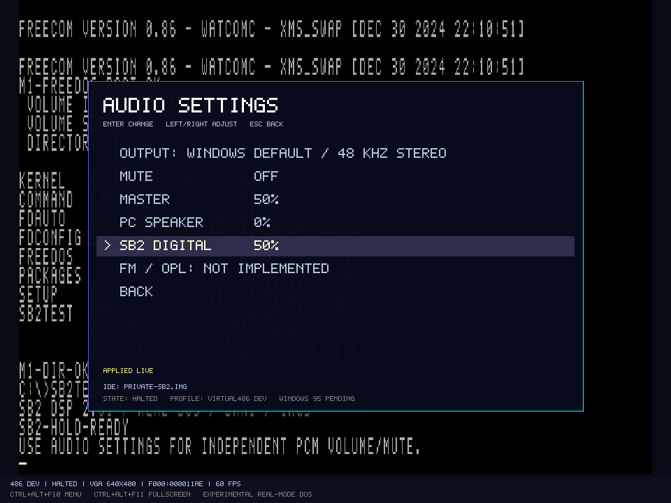
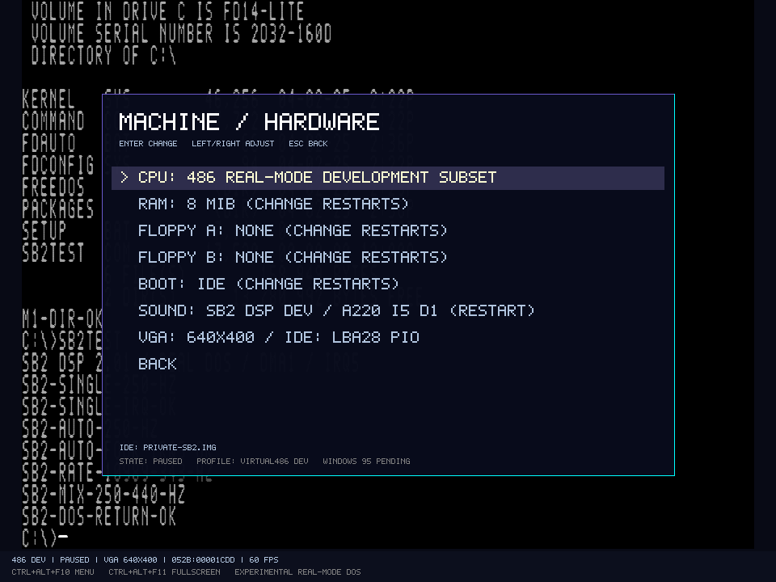
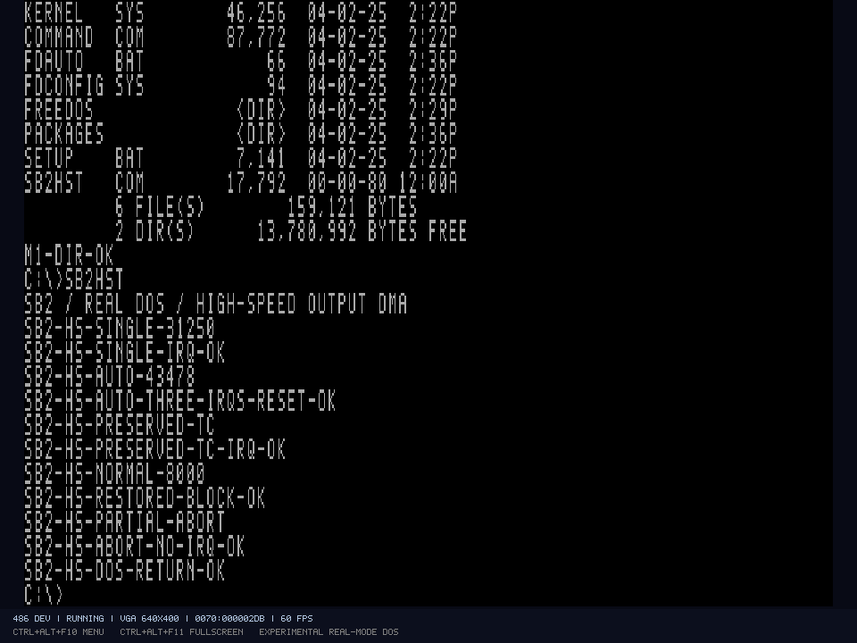

# SB2-DSP-Entwicklungspfad und gemeinsamer Audiomixer

Der Referenzrechner kann optional einen **begrenzten SB2-DSP-/PCM-Pfad** installieren. Direkter DAC ist auf Geräteebene geprüft; normales und High-Speed-8-Bit-Mono-Ausgabe-DMA zusätzlich mit echten DOS-Gästen und Windows-Ausgabe. Der ergänzte [OPL2-Entwicklungspfad](OPL2.md) kann im Kombiprofil zugeschaltet werden. Eine vollständige Sound Blaster 2.0 ist noch nicht abgenommen: vollständiges Rhythmus-/CSM-FM, ADPCM, Aufnahme einschließlich High-Speed-Eingabe, MIDI und Gameport fehlen.

## Konfiguration

`MachineProfile.SoundCard` akzeptiert `none`, `sb2-dsp-development` sowie die in der OPL2-Dokumentation beschriebenen FM-Profile. Alte Profile ohne dieses Feld behalten `none`; der PC Speaker ist unabhängig davon vorhanden. Das Profil `profiles/virtual486-sb2-dsp-dev-v1.json` wählt den bisherigen DSP-Pfad ohne FM. Im Hardwaremenü wechselt **SOUND** die Kartenoption über Prepare/Commit und Neustart. Medien und private Overlay-Leases werden wie bei anderen Profiländerungen übernommen.

Die Ressourcen sind vorerst fest: **220h / IRQ5 / DMA1**. Ein späteres Ressourcenmenü darf erst angeboten werden, wenn seine Varianten implementiert und geprüft sind. Gastprogramme können `SET BLASTER=A220 I5 D1 T3` verwenden; der Emulator injiziert diese Variable nicht in DOS. Die Kennung ersetzt keine vollständige SB2-Kompatibilitätsfreigabe.

```powershell
.\scripts\run.ps1 -Profile '.\profiles\virtual486-sb2-dsp-dev-v1.json' -Disk 'C:\Pfad\private-dos.img'
.\scripts\test-sb2.ps1 -SkipBuild -Gui
.\scripts\test-sb2-highspeed.ps1 -SkipBuild -Gui
```

## Getestetes Geräteprotokoll

| Schnittstelle | Implementierung |
| --- | --- |
| 226h | Reset: mindestens 3 µs hoher Pegel; nach Absenken 100 µs Initialisierung, dann AAh im Lesepuffer |
| 22Ah / 22Eh | Antwort-FIFO / Ready-Bit; Lesen von 22Eh quittiert zusätzlich die DSP-IRQ-Leitung |
| 22Ch | Command/Data und Busy; ein Eingabebyte wird nach einer modellierten Latenz von 1 µs verarbeitet; verfrühte Schreibversuche werden verworfen und gezählt |
| 10h | Direkte Ausgabe eines vorzeichenlosen 8-Bit-DAC-Werts; 128 ist die Mitte |
| 14h / 1Ch / 48h | Single-Cycle / Auto-Init / DSP-Blocklänge, jeweils unabhängig von der DMA-Pufferlänge |
| 91h / 90h | High-Speed-Ausgabe: Einzelblock / Auto-Init; beide verwenden die durch 48h gesetzte Blocklänge |
| 40h | Zeitkonstante; die virtuelle Sampleperiode beträgt `(256 - TC) * 1000 ns` |
| D0h / D4h | DMA-Pause / Fortsetzung; Restbytes und verbleibender Teil des nächsten Sampleintervalls bleiben erhalten |
| D1h / D3h / D8h | DAC-Ausgang ein / aus / Status; Abschalten pausiert bei diesem DSP-2-Pfad die DMA-Übertragung nicht |
| DAh | Auto-Init endet nach dem gerade laufenden DSP-Block |
| 80h | DAC für eine Anzahl Sampleperioden halten, ohne DMA-Daten zu lesen; danach IRQ |
| E1h | Versionsantwort 2.01 für diesen ausdrücklich begrenzten Entwicklungspfad |

DSP-Längen sind Little Endian und zählen die Samplezahl minus eins; FFFFh bedeutet 65.536. Ein während normalem Auto-Init programmierter Single-Cycle-Auftrag beginnt nach dem aktuellen Block. Pro abgeschlossenem DSP-Block wird die IRQ-Leitung gesetzt. Bleibt sie unquittiert hoch, entstehen keine erfundenen zusätzlichen PIC-Flanken. Der Gast benötigt DSP-Quittierung und PIC-EOI. Ein normaler Reset bricht Samples und noch ausstehende Kommandos/Antworten ab, senkt IRQ und schaltet den Ausgang ab. Der besondere High-Speed-Reset ist unten beschrieben.

Jedes Sample fordert genau ein Byte beim echten 8237-Kanal 1 an. Dessen Adress-Wrap, Count, Masken, Richtung und Auto-Init gelten unverändert. Ein maskierter Kanal oder zu kurzer DMA-Puffer hält den DSP-Transfer an; er meldet keinen erfolgreichen Blockabschluss. Verify-, Write- oder Cascade-Programmierung wird nicht als PCM interpretiert und verändert dabei keinen Speicher. `LastDmaResult` macht den Zustand sichtbar.

Samplerate und Hostausgabe sind getrennt: TC 131 ergibt 8.000 Samples/s, TC 165 tatsächlich etwa 10.989 Samples/s. Der DSP übernimmt keine angeblichen 11.025 Hz, wenn die programmierte Ganzzahl-Zeitkonstante diese Rate nicht darstellen kann. Busarbitration, DRQ-/DACK-Flanken und elektrische DSP-/Analoglatenzen sind noch angenähert; die feste Kommandolatenz ist eine Modellentscheidung. Nicht alle theoretisch programmierbaren Raten sind als physikalischer SB2-Betrieb abgenommen.

## High-Speed-Ausgabe für DSP 2.01

91h überträgt einen DSP-Block, signalisiert IRQ und verlässt High-Speed auch bei Auto-Init des DMA-Controllers. 90h wiederholt DSP-Blöcke bis zum Reset. Weitere DSP-Kommandos werden währenddessen ignoriert; 22Ch meldet im Modell Busy. Dies gilt auch für D0h, D3h und DAh. Der 8237 und die IRQ-Quittierung bleiben unabhängig erreichbar. Die geprüften Zeitkonstanten 224/233 ergeben 31.250 beziehungsweise rund 43.478 Samples/s, innerhalb des von Creative dokumentierten High-Speed-Ausgabebereichs für DSP 2.01.

Ein Reset bei aktivem High-Speed beendet den Transfer und senkt IRQ, erhält jedoch Zeitkonstante, DSP-Blocklänge und Speaker-Einstellung. Im Modell bleibt auch der letzte DAC-Wert gehalten. Ein danach ausgeführter normaler Reset setzt wieder die bisherigen Standardwerte. Angefangene Blöcke erhalten beim Abbruch keinen erfundenen Abschluss-IRQ. Reset beendet nicht die externe DMA-Konfiguration; der Gast maskiert Kanal 1 selbst.

Die modellierten 3-µs-/100-µs-Resetzeiten samt AAh-Antwort werden auch beim High-Speed-Ausstieg verwendet. Diese konkreten Latenzen, die Busy-Bitfolge und das DAC-Halteverhalten sind nicht gegen Originalchipmessungen kalibriert. Es wird kein DSP-Mikrocontroller nachgebildet. High-Speed-Eingabe 98h/99h bleibt unimplementiert; dies ist ein Ausgabe-Teilpfad. Zähler `HighSpeedSamples`, `HighSpeedTransfers`, `HighSpeedResets` und `IgnoredHighSpeedWrites` machen den Ablauf im Headless-Bericht sichtbar.

## Mischung und Windows-Ausgabe

`PcAudioMixer` besitzt einen gemeinsamen 48-kHz-Takt. Speaker und DSP liefern ganzzahlige Signalflächen mit eigener Gerätezeit; Änderungen werden erst nach Integration des alten Zustands übernommen. Dadurch bleiben sehr kurze Pulse erhalten, und die PCM-Ausgabe hängt nicht von der Größe eines Host-Zeitschritts ab. Kein Sample wird allein wegen eines Windows-Callbacks aus DMA gelesen.

Pro Quelle wird Gleichspannung mit einem einfachen 20-Hz-Hochpass entfernt. Speaker und Digitalquelle haben getrennte Pegel, danach wird die Summe auf den Float32-Bereich begrenzt und als zeitgestempeltes Stereo veröffentlicht. Dies modelliert keine vollständigen analogen SB2-Filter oder Lautsprecher. Die bisherige Speaker-Aufzeichnung bleibt bitgleich.

**AUDIO SETTINGS** bietet Mute, Master, PC Speaker, SB2 Digital und inzwischen den separaten melodischen OPL2-Pegel. Quellpegel ändern sich im Emulationsthread, Master/Mute im Windows-Ausgabepfad. Der Audiothread greift nicht auf CPU oder DMA zu. Einstellungen werden gespeichert. Der vorhandene begrenzte NAudio-Puffer und seine Unter-/Überlaufzähler bleiben erhalten. Hostgerätewechsel und Audio-Savestates fehlen. Die folgenden Bilder stammen aus der ursprünglichen DSP-Abnahme vor Ergänzung des FM-Pfads.





Headless: `--audio-out <neue.wav>` zeichnet die Mischung auf. Die GUI zeichnet unter demselben Schalter die tatsächlich an den Windows-Provider gelieferten PCM16-Bytes nach Hostpegeln auf. `--audio-io-trace <neue.jsonl>` protokolliert tatsächliche DSP-/FM-Lese- und Schreibzugriffe sowie DMA1-/Steuer-, PIT-/Speaker- und Diagnose-Schreibzugriffe mit Richtung und Abschlusszeit. Es erzeugt keine Gastdaten und verändert keine Interrupts. WAV und Trace werden mit CreateNew angelegt.

## Nachweise und Grenzen

Die 23 zusätzlichen Geräte-/Integrationstests behandeln Reset- und Busy-Zeiten, Antworten, direkten DAC, Single-/Auto-Init, getrennte DSP-/DMA-Längen, Pause, Blockwechsel, IRQ-Quittierung, Masken/Richtung/Verify, Page-Wrap, Reset-Abbruch, Längengrenze, Sampleclock, Mehrquellenmischung und Konfigurationswechsel.

18 weitere Tests behandeln High-Speed-Einzel-/Auto-Init, beide Blockzähler, Busy/ignorierte Parameter, Sonderreset und anschließenden normalen Reset, Abbruch ohne IRQ, Masken/Richtung/Terminal Count, FFFFh-Länge, 43-kHz-Geräteclock und identisches PCM bei verschiedenen Hostschrittgrößen. Acht weitere Tests prüfen die begrenzte Host-Taktung. Der Gesamtstand beträgt 262 Regressionen.

`tests/guests/sb2-test.asm` ist ein eigenes DOS-COM-Programm. FreeCOM lädt es über FAT16 und IDE aus einer neuen privaten Probeplatte. Es installiert seinen IRQ5-Handler über DOS, programmiert DMA1 mit einem im Gast erzeugten und physikalisch ausgerichteten Puffer und verwendet echte IN/OUT-Befehle. Der Normalpfad prüft Single-Cycle mit Pause/Fortsetzung, vier Auto-Init-Block-IRQs mit DAh aus dem Handler, eine zweite Samplerate und gleichzeitigen PIT2-Ton. Er stellt Interruptvektor, PIC-Maske und Speaker-Steuerung wieder her und kehrt zu DOS zurück. `/H` hält DMA-Ton für die GUI-Prüfung.

`tests/verify-sb2-audio.py` benötigt nur die Python-Standardbibliothek. Der Prüfer rekonstruiert die bekannten Gast-Pufferbytes anhand der tatsächlichen Port-Zeitstempel, ohne DSP-Sampletrace oder Emulatorbibliotheken. Er vergleicht sämtliche PCM-Frames vor der zusätzlichen Speaker-Ausgabe und prüft separat die Frequenzen beider Quellen in der Mischung, Stereo, Samplezahl, Datenhash und Stille nach Programmende.

Zwei unabhängige Kaltstarts liefern je 32.768 DMA-Samples, zehn Block-IRQs und identisches PCM/Bild/virtuelle Zeit. Native GUI-Läufe prüfen die DOS-Rückkehr und zehn OpenGL-Aufnahmen sowie Windows-Providercallbacks, Mute und getrennte Pegel. Digitalton bleibt bei Speaker-Pegel null hörbar; Master und Digital jeweils 50 % ergeben rund 31,25 % des Pegels bei Master 80 %/Digital 100 %. Die Aufzeichnung ist kein akustischer Hardware-Loopback. Konkrete Artefakte und der aktuelle gemeinsame Build stehen im [Implementierungsstand](../IMPLEMENTATION-STATUS.md).

Die zusätzliche eigene `SB2HST.COM` programmiert DMA1/IRQ5 und prüft 91h, drei 90h-Block-IRQs mit Reset aus dem IRQ-Handler, ignorierte Befehle, erhaltene Zeitkonstante über den 80h-Timer und erhaltene Blocklänge beim Wechsel zu normalem 1Ch. Ein zweiter High-Speed-Transfer wird unvollständig abgebrochen. Zwei Kaltstarts erreichen regulär DOS/ECHO/Prompt; je 15.663 DMA-Bytes, davon 13.615 im High-Speed-Pfad, sechs Block-IRQs und zehn absichtlich ignorierte Bytes. Der bisherige DSP-Gast behält seinen PCM-Hash.

`verify-sb2-highspeed.py` rekonstruiert sämtliche 210.210 Audioframes aus dem im Gast erzeugten Puffer und tatsächlichen DMA-/DSP-Portzeiten. Er liest keine DSP-Snapshots oder DAC-Traces. Größte PCM16-Abweichung: ein Quantisierungsschritt. Die beobachteten Töne liegen bei etwa 976,579 / 1.358,596 / 250 Hz. IRQ-Quittierungen werden anhand tatsächlicher Gastlesezugriffe überprüft; auch der kurze 32-Perioden-Timer nach Reset muss die erhaltene Zeitkonstante verwenden. Das ist eine unabhängige Prüfung des erklärten Modells, kein Originalsiliziumvergleich. Zwei weitere native Prozesse prüfen Gastende sowie Mute und Digitalpegel eines gehaltenen 43-kHz-DMA-Gasts; Messpunkte erfassen auch Pufferzähler während der laufenden Tonintervalle.

Bei dieser Prüfung wurde ein Host-Taktungsproblem sichtbar: Die GUI konnte nach Rückstand zur Wanduhr beim HLT-Warten zu viel virtuelle Audiozeit in einem Block aufholen. `RealtimePacer` begrenzt jetzt Ausführungsscheiben auf 20 ms, setzt bei mehr als 100 ms Rückstand den Hostbezug neu und verkürzt während begrenzten Aufholens die Hostwartezeit. Bei verfügbarem Audiobackend gibt es zusätzlich 40 ms festen Puffervorlauf. Geräteclocks, Sampleperioden und die virtuelle Zeit selbst bleiben davon unberührt; unter Hostlast darf der Gast langsamer laufen. Pause und Maschinenwechsel setzen nur diesen Hostbezug zurück. Das ist keine allgemeine Echtzeitgarantie unter beliebiger Last.



Unbekannte bzw. noch fehlende Befehle werden über Zähler und letzte Befehlsnummer diagnostiziert; sie erhalten keine erfundenen DMA-Daten oder Abschluss-IRQs. Dokumentierte Parameter einiger unimplementierter Befehle werden verbraucht, um den Parser anschließend wieder auf eine Befehlsgrenze zu bringen. Das begrenzte Antwort-FIFO ist keine vollständige DSP-Mikrocontroller-Simulation. Fähigkeiten melden `sb2Dsp=true` und `sb2HighSpeedPcm=true`, aber weiterhin `soundBlaster=false` und `opl=false`.

OPL2-Timer, melodischer FM-Grundpfad, FM-Portzeiten und begrenztes CSM-Keying sind separat abgenommen; Rhythmus und volle CSM-/Chipgenauigkeit bleiben dort offen. Weitere DSP-/SB2-Funktionen benötigen eigene Geräte- und Gastnachweise. Eine Fremdprogramm-/Spieleabnahme, vollständige MS-DOS-Installation und Windows-Kompatibilität sind damit noch nicht belegt.

Primärgrundlage der Schnittstelle: Creative Technology, [Sound Blaster Series Hardware Programming Guide, 1996](https://www.phatcode.net/downloads.php?action=get&file=sbhwpg.pdf&id=243), Kapitel 2/3/6 und SB2-Porttabelle. Implementierung, Probe und Audio-Prüfer sind eigener Projektcode; keine fremde Emulatorimplementierung wurde übernommen.

Für High-Speed zusätzlich gelesen: Abschnitte 3-6, 3-9, 3-17 bis 3-20 und 6-20; [Spiegelung des Creative-Herstellerleitfadens](https://www.ardent-tool.com/sound/Sound_Blaster_HW_Programming_Guide_1st.pdf). Die Referenz-PDF bleibt privat unter `artifacts/references/creative-sb-hardware-guide.pdf`.
